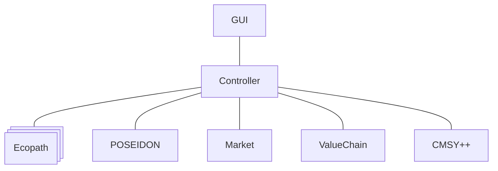

# SURIMI Context Diagram

The SURIMI System consists currently of 5 models. 
- They run on the Edito infra Datalab as Docker containers.
- Ecopath runs as a replica set of 5 containers, each running 1 simulation
 

- Communication between the containers is done with GRPC
- The Controller will run through the timesteps of each simulation
  - It will pass all data between all models
  - The way this is done is described in the [Sequence diagram](sequenceDiagram.md)
- Currently the simulation is started with a simple development GUI. This will later be replaced by the MSE GUI and others
- Input (configuration) data and output data is stored on an S3 bucket on the Edito Infra Datalab
- An observability system will be in place to log everything that happens on all docker containers
- Every user on the Edito infra Datalab can run their own version of the SURIMI system for development purposes
- There is also a SURIMI project space that can hold the 'production' SURIMI system 
