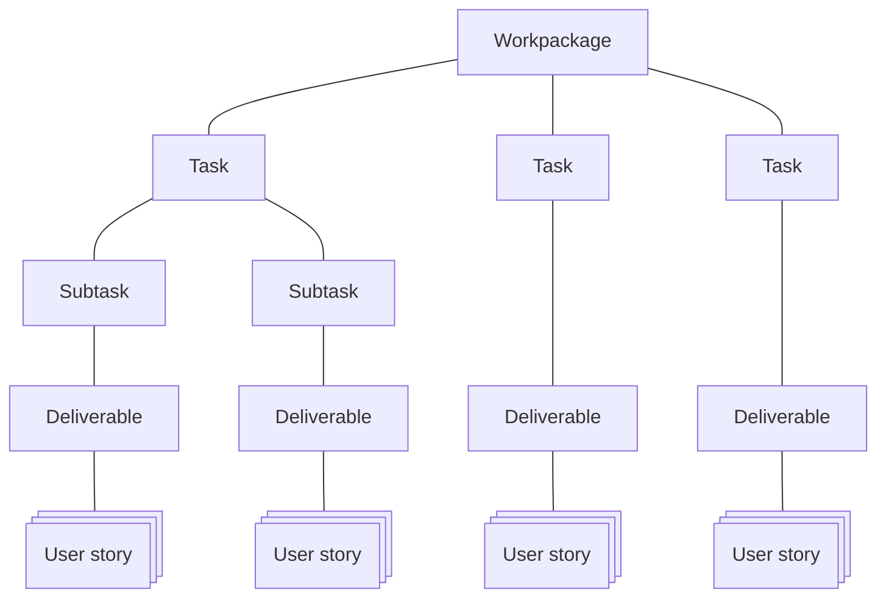

# SURIMI Issue type hierarchy

The "issue type" of a Gihub Projects "Issue" is used to create a hierarchy in the work breakdown of the SURIMI project.
Most issue types can be found in the Grant Agreement. Only the "User Story" is not. As it is specific to Scrum.

