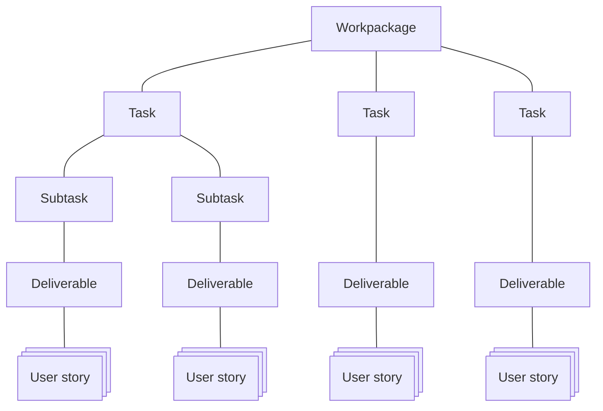

# SURIMI Issue type hierarchy

The "issue type" of a Gihub Projects "Issue" is used to create a hierarchy in the work breakdown of the SURIMI project.
Most issue types can be found in the Grant Agreement. Only the "User Story" is not. As it is specific to Scrum.

The task [T3.2 Model building](https://github.com/Official-EwE/SURIMI-project/issues/15) consists of 2 subtasks:
- [Subtask 3.2.1 Model Prototype Phase](https://github.com/Official-EwE/SURIMI-project/issues/21)
- [Subtask 3.2.2 Model Improvement Phase](https://github.com/Official-EwE/SURIMI-project/issues/22)

All deliverables from [T3.2 Model building](https://github.com/Official-EwE/SURIMI-project/issues/15) are moved to [Subtask 3.2.1 Model Prototype Phase](https://github.com/Official-EwE/SURIMI-project/issues/21)

The prototype will be demo'ed to the stakeholders. They will come with feedback and those issues will be created in the [Subtask 3.2.2 Model Improvement Phase](https://github.com/Official-EwE/SURIMI-project/issues/22)

