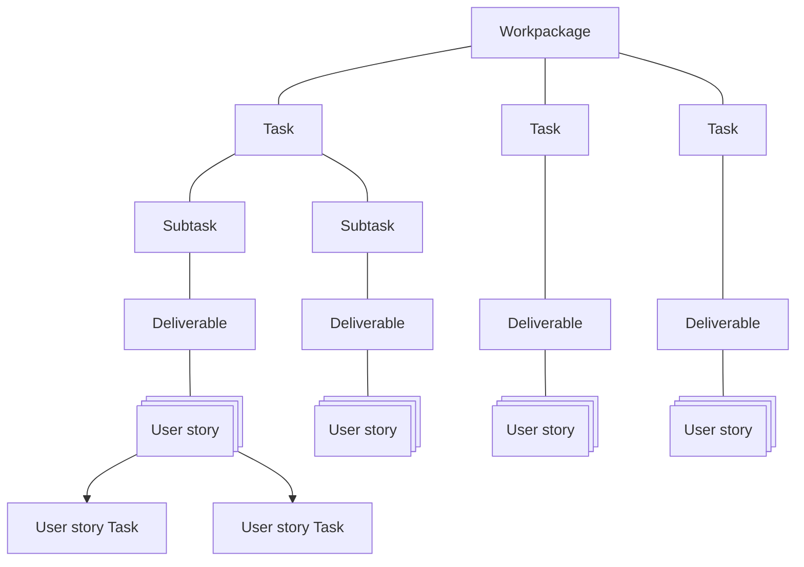

# SURIMI Issue type hierarchy

The "Issue type" of a Gihub Projects "Issue" is used to create a hierarchy in the work breakdown of the SURIMI project.
Most issue types can be found in the Grant Agreement. Only the "User Story" is not. As it is specific to Scrum.

The task [T3.2 Model building](https://github.com/Official-EwE/SURIMI-project/issues/15) consists of 2 subtasks:
- [Subtask 3.2.1 Model Prototype Phase](https://github.com/Official-EwE/SURIMI-project/issues/21)
- [Subtask 3.2.2 Model Improvement Phase](https://github.com/Official-EwE/SURIMI-project/issues/22)

All deliverables from [T3.2 Model building](https://github.com/Official-EwE/SURIMI-project/issues/15) are moved to [Subtask 3.2.1 Model Prototype Phase](https://github.com/Official-EwE/SURIMI-project/issues/21)

The prototype will be demo'ed to the stakeholders. They will come with feedback and those issues will be created in the [Subtask 3.2.2 Model Improvement Phase](https://github.com/Official-EwE/SURIMI-project/issues/22)

# Legende

## User Story
A "User Story" is a concise, informal description of a software feature from the perspective of an end user, following a common template: "As a [user type], I want to [perform an action] so that [I can achieve a goal]". It's a fundamental tool in Agile development to capture requirements, foster collaboration, and articulate the value a feature delivers. User stories are the smallest unit of work in an Agile project, are written in plain language, and serve as a prompt for conversation to clarify product requirements rather than a detailed specification. 
The User story should not be to big. Each sprint you should be able to complete a couple of user stories. If too big, slice and dice.

## User story Task
A User story can consist of a couple of tasks. Each task is a change of code and can be (doesn't need to be) evaluated as a PR (Pull request). So to implement one User story you might need a change of the Database (User Story Task 1) and a change of the front end (User Story task 2) and a change of the API (User Story Task 3).

