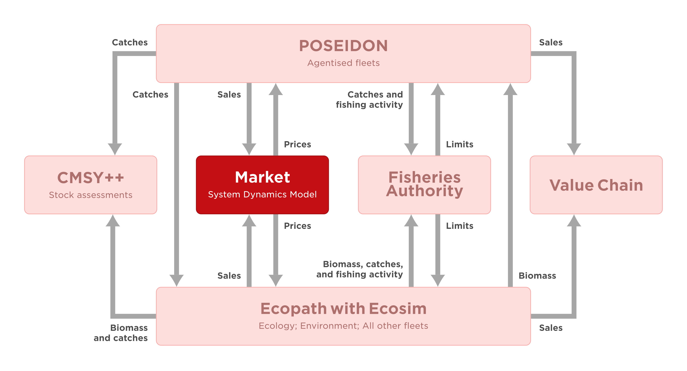
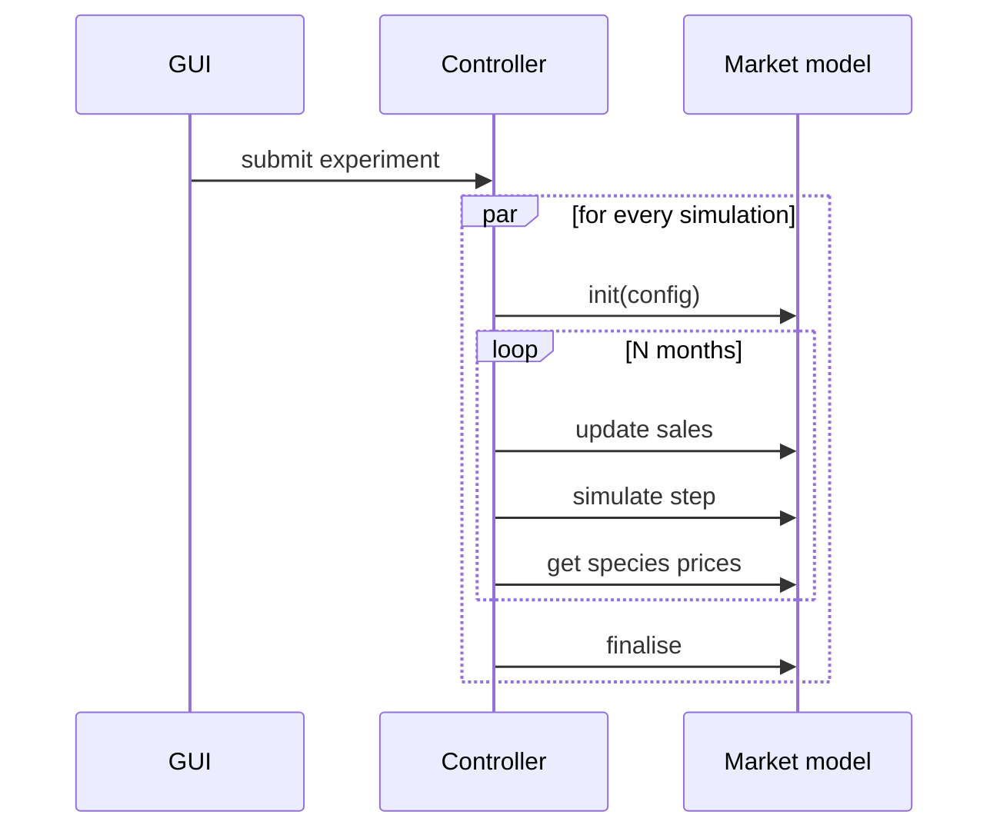
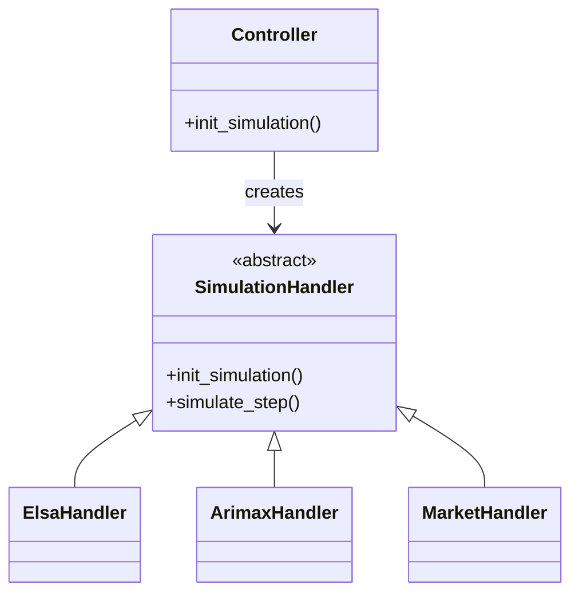

# D3.1 – System dynamics model

## DOCUMENT INFORMATION

| Grant Agreement     | 101157456 |
| ------------------- | --------- |
| Project Acronym     | SURIMI |
| Project Title       | Integration of innovative and reliable socio-ecological models and user-driven solutions into the Digital Twin Ocean, to facilitate what-if scenarios and decision support, under a co-creation approach. |
| Deliverable Number  | D3.1 |
| Work Package Number | WP3 |
| Deliverable Title   | System dynamics model |
| Lead Partner        | NORCE |
| Author(s)           | Timo Szczepanska, Khai Duong |
| Due Date            | 31 October 2026 |
| Submission Date     | |
| Dissemination Level | Public |
| Type of Deliverable | Other |

| Version   | Summary of Changes |
| --------- | ------------------ |
| Version 0 | Initial version    |

## Summary
| | |
|--|--|
| Programming language | Python 3.12 |
| No. of Kubernete pods | 1 |
| GitHub repo | https://github.com/SURIMI-Project/SURIMI-market |
| License | EUPL-1.2 |

## 1. Model purpose
The system dynamics economic model (hereafter referred to as the market model) simulates first-sale fish price dynamics in response to seasonal fluctuations and changes in landings volumes. The model is deterministic and data-driven, using relationships estimated from historical data to calculate fish prices. As identical inputs produce identical results, multiple simulations can be used to investigate how changes in landings volumes and other input conditions influence first-sale fish prices. Price formation is represented at two levels. At the local level, prices are estimated for each species and fishing port using a statistical model that accounts for seasonal patterns and the relationship between landings volumes and prices. At the national level, prices are calculated separately for each species as supply-weighted averages across active local markets, providing an aggregated representation of price dynamics.

The market model operates within a generic simulation framework that is connected to the SURIMI interoperability layer through a gRPC microservice. The microservice provides the interface through which the SURIMI workflow controller executes the market model. At each simulation step, the controller passes landings volumes received from other SURIMI models to the market model and receives the updated first-sale fish prices for each species at both the local fishing-port and aggregated national levels.

The generic simulation framework is designed to be modular and extensible, allowing different economic models to be integrated and tested within the same simulation environment. Each economic model is associated with a simulation handler that follows a predefined structure for managing model inputs, execution, and outputs. This structure can be replicated to integrate new models into the framework. Alongside the market model, the framework includes SARIMAX and CatBoost models for predicting first-sale fish prices. These additional implementations demonstrate how the same framework can accommodate different modelling approaches and provide examples for users wishing to integrate their own economic models.

The North-Western Mediterranean Sea (GSA 06 and GSA 07) serves as a case study for the market model, which is configured to represent Spanish and French markets. The implementation uses historical landings and price data for the Fresh–Whole product category, covering January 2015 to December 2024 and sourced from [EMODnet](https://emodnet.ec.europa.eu/geonetwork/srv/api/records/ff5f738f-94ee-4704-94c2-7c951c931973). The case-study input files are stored in the [SURIMI-market repository](https://github.com/SURIMI-Project/SURIMI-market/tree/main/config) and in an S3 bucket on EDITO.

TODO: Update the information about input file storage after discussing with Rik and Nic.

The source code for the economic simulation framework, including the market model, SARIMAX, CatBoost, their simulation handlers, and the gRPC microservice, is available in the [SURIMI-market repository](https://github.com/SURIMI-Project/SURIMI-market). The [`market_architecture.md`](https://github.com/SURIMI-Project/SURIMI-market/blob/main/market_architecture.md) file provides a technical description of the model, while the [`README.md`](https://github.com/SURIMI-Project/SURIMI-market/blob/main/README.md) provides instructions for configuration and execution. Documentation of the maket model plugin can fe found in the [`market_model_architecture.md`](https://github.com/SURIMI-Project/SURIMI-market/blob/main/src/models/market/ARCHITECTURE.md).

<!-- TODO: Decide on the terms used to refere to the model, there are too many in use: System dynamic economic model, market model, seasonal trend model, first-sale model. -->

## 2. Process overview and scheduling diagrams

The data flow diagram below illustrates the position of the market model within the SURIMI framework for the North-Western Mediterranean case study. The market model receives sales data from both POSEIDON and Ecopath with Ecosim (EwE), which represent different fishing fleets, and provides first-sale fish prices to both models in return. These exchanges are coordinated through the SURIMI Controller, which manages the transfer of information between the models.

 <em>Figure 1. Position of the market model within the SURIMI framework for the North-Western Mediterranean case study.</em>

<!-- TODO: Maybe add a chart for the Agean Sea as well?. -->

The sequence diagram below illustrates how the simulation GUI, SURIMI Controller, and the market model interact during an experiment. An experiment submitted through the simulation GUI can initiate multiple simulations that run concurrently, allowing each simulation to progress independently without having to wait for the others to finish. At the beginning of each simulation, the Controller initializes the market model. The model then runs in monthly steps. For each month, the Controller provides the market model with sales data, which may be updated multiple times before the Controller instructs the model to simulate the monthly step. During this step, the market model calculates new first-sale fish prices based on the sales data received. Once the calculations are complete, the Controller retrieves the updated prices for each species. Once all monthly steps are completed, the Controller finalizes the simulation.

 <em>Figure 2. The communication flow between the GUI, the controller and the Market Model.</em>

### A Multi-model framework
The market model enables experimenting with multiple models to most accurately simulate species prices. A model is implemented as a module directly in the source code, interfacing with the framework using the simulation handler, as shown by Figure 3.
<!-- TODO: Complete the description of Figure 3, explaining how the simulation framework selects and initializes the appropriate simulation handler. -->

 <em>Figure 3. On initialising a simulation, the framework instantiates one of the available handlers. The specialised handlers are often named after their algorithm or model name.</em>

<!-- A simulation handler is a function that is executed each time the Seasonal Trend initialises a new simulation. On starting up the Seasonal Trend, a model identifier is passed to its runtime, telling it which model to deploy. Each new handle is now associated with this model.
 -->
<!-- TODO mention as a demonstration, we added other models, e.g. SARIMAX, system dynamics model, which will be described later below. -->

## 3. Inputs

### 3.1 Data
<!-- For each simulation, the market model receives a number of inputs to help modeling and observing species first-sale fish prices over time. These are formed as messages, a well-defined and structured method of communicating with the market model's service. While some of the messages retrieve data from it, others mutate its internal state. They are as follows: -->
The market model relies on training data to understand how variables influence the fish prices. They are used to train the models. The application supports storing the data in the following two locations, each used with different purpose:

1. In S3 Bucket on EDITO at `/oidc-$USER/market/$SCENARIO/`
2. Locally in the project's source code at at `config/$SCENARIO`

Replace `$USER` with the username and `$SCENARIO` with a scenario name, e.g. `northwestern_med`. Option 1, i.e. storing data in EDITO, is prioritised. If this option is unavailable, then the market model defaults to local data. The data inputs are divided into the following datasets:

- `species.csv`
- `markets.csv`
- `prices.csv`

#### `species.csv`
In the species dataset, we store a list of all species that the market model supports. This list must at least adhere to the contract in §3.3.1. It includes the following variables:

| Variable name | Description |
| --- | --- |
| `species_code` | 3 letter code name for the species |
| `life_stage` | Category of life stage. Species name may depend on life stage |
| `species_name` | Species scientific name |

#### `markets.csv`
This dataset contains countries and local ports that the market model supports. It must at least adhere to the contract in §3.3.1, and it includes the following variables:

| Variable names | Description |
| --- | --- |
| `market_code` | 2 characters code name for countries, and 5 character for local ports |
| `market_name` | Official port name |
| `lon`, `lat` | Geograhic latitudal and longitudal position |

<!-- TODO we fill this data section out once Timo has completed the model implementation.

TODO data that we need
- ports
- fish species
- historic species prices (real data (EMODNET))
- data is located on the S3 server on EDITO

For species prices, must use the price from branch scripts_fisheries_data in scripts/fisheries_data/emodnet_es_raw.csv. For categories, we only use fresh-whole. Size is important.

More about the above
- ports.csv: need to include LOCODE and coords (lat, lon)
- prices.csv: LOCODE, DATE, SPECIES_CODE, CATEGORIES, etc.
- species.csv: SPECIES_CODE, SPECIES_NAME
We need to mention the format/protocol that these codes follow.

TODO no need to mention the data preparation, other than the inputs we need and refer to the script we use. TODO mention which script this is emodnet_prices_landings_raw_new.ipynb. -->

### 3.2 Configurations
As an application, the market model can be configured using environment variables. We expose the following configuration options:

| Variable name | Description |
| --- | --- |
| `MODEL_NAME` | A predefined model name. The selected model will be used to simulate species prices. Read when initialising a new simulation |

If the model name is invalid, initialising a new simulation, as explained in §3.3.1, will respond with an error.

### 3.3 Input received as SURIMI messages
The market model receives all its dynamic inputs from the SURIMI Controller over gRPC ([`MarketService`](https://buf.build/surimi/surimi-protocol/docs/main%3Asurimi.v1#surimi.v1.MarketService), proto package [`surimi.v1`](https://buf.build/surimi/surimi-protocol/docs/main:surimi.v1)). Below, we describe the gRPC messages.

#### 3.3.1 [InitialiseSimulation](https://buf.build/surimi/surimi-protocol/docs/main%3Asurimi.v1#surimi.v1.MarketService.InitialiseSimulation)
Sent once per simulation, before any other messsages ([request](https://buf.build/surimi/surimi-protocol/docs/main%3Asurimi.v1#surimi.v1.InitialiseSimulationRequest), [response](https://buf.build/surimi/surimi-protocol/docs/main%3Asurimi.v1#surimi.v1.InitialiseSimulationResponse)). When a simulation is initialised, service assigns the configured model (defined in §3.2) to the simulation. It also delivers the contract ([Simulation](https://buf.build/surimi/surimi-protocol/docs/main%3Asurimi.v1#surimi.v1.Simulation)) that the models in the ensemble to exchange information about, and the units they use. The assigned model only uses a subset of the contract as its parameter. These are as follows:

| Field | Meaning | Use in Seasonal Trend |
| --- | --- | --- |
| `simulation_id` | Identifies the simulation. Many simulations may run concurrently. | Key that references the simulation |
| `scenario_name` | Name of the scenario, e.g. "northwestern_md" | Identifier to which dataset of real landings statistics to use |
| `simulation.start_date_time` | Start time of the simulation | Determines the first month of species prices to predict. |
| `simulation.items.markets`, `.species` | Species (with life stages) and markets included in the contract | Landings and sales prices are only accounted for these |
| `simulation.items.fleet_segments` | Fleet segments, defined by gear, vessel length class, scale, country and model. Unset fields match any value | A predictor or feature in a Seasonal Trend model's sales price prediction |
| `simulation.items.price_category` | A list of preservation and presentation that a batch of landings can be delivered as | A predictor or feature in a Seasonal Trend model's sales price prediction |

The model checks its dataset that corresponds with the selected scenario to see if it supports all the markets, countries, and species from the contract. An error is sent to the controller if the dataset do not fulfill the contract. The remaining fields are unused.

#### 3.3.2 [UpdateSales](https://buf.build/surimi/surimi-protocol/docs/main%3Asurimi.v1#surimi.v1.MarketService.UpdateSales)
Market landings are appended using this message ([request](https://buf.build/surimi/surimi-protocol/docs/main%3Asurimi.v1#surimi.v1.UpdateSalesRequest), [response](https://buf.build/surimi/surimi-protocol/docs/main%3Asurimi.v1#surimi.v1.UpdateSalesResponse)). The framework is flexible, so landings can be appended to both the current and future months. Past months landings cannot be updated.

| Field | Meaning | Use in Seasonal Trend |
| --- | --- | --- |
| `start_date_time` | The date of the sales, e.g. 1st of September 2026, using `google.protobuf.Timestamp`'s format | Month of the year that the sales are associated with |
| `sales_summary.market_sales` | A list of sales for a given market. Includes a list of species sales with corresponding fleet segment, quantity, value and category code | Input data for the species sales price prediction |

#### 3.4 Control messages as SURIMI messages
Unlike messages from §3.3, control messages carry no data for the model; they drive the life cycle of a simulation.

##### 3.4.1 [SimulateStep](https://buf.build/surimi/surimi-protocol/docs/main%3Asurimi.v1#surimi.v1.MarketService.SimulateStep)
Sent once per step. The model advances once step in the simulation, predicting the first sales prices for the current month's landings. The message carries the current simulation time, which must match the model's own simulation time. This is used to verify that both the caller and the model are in sync.

##### 3.4.2 [FinaliseSimulation](https://buf.build/surimi/surimi-protocol/docs/main%3Asurimi.v1#surimi.v1.MarketService.FinaliseSimulation)
<!-- If we change the system so it no longer stores CSVs, then this must change. -->
The simulation ends. It releases the simulation from its internal register.

## 4. Outputs
### 4.1 Output provided as SURIMI messages
The model outputs provide species sales prices to other models in the ensemble. The currency is assumed to be in EUR, and weight in kg.

#### 4.2 [GetSpeciesPrices](https://buf.build/surimi/surimi-protocol/docs/main%3Asurimi.v1#surimi.v1.MarketService.GetSpeciesPrices)
Returns the current sales prices for all species across all markets. Because this message returns only the most up-to-date prices, this message should be sent after each step to accumulate the price history.

| Field | Meaning |
| --- | --- |
| `species_price_summary.species_price` | Sales grouped by species, port and category code |

### 4.2 Other potential Seasonal Trend outputs
The finalise simulation message from §3.4.2 can trigger the model to store all simulated sales prices as datasets.
