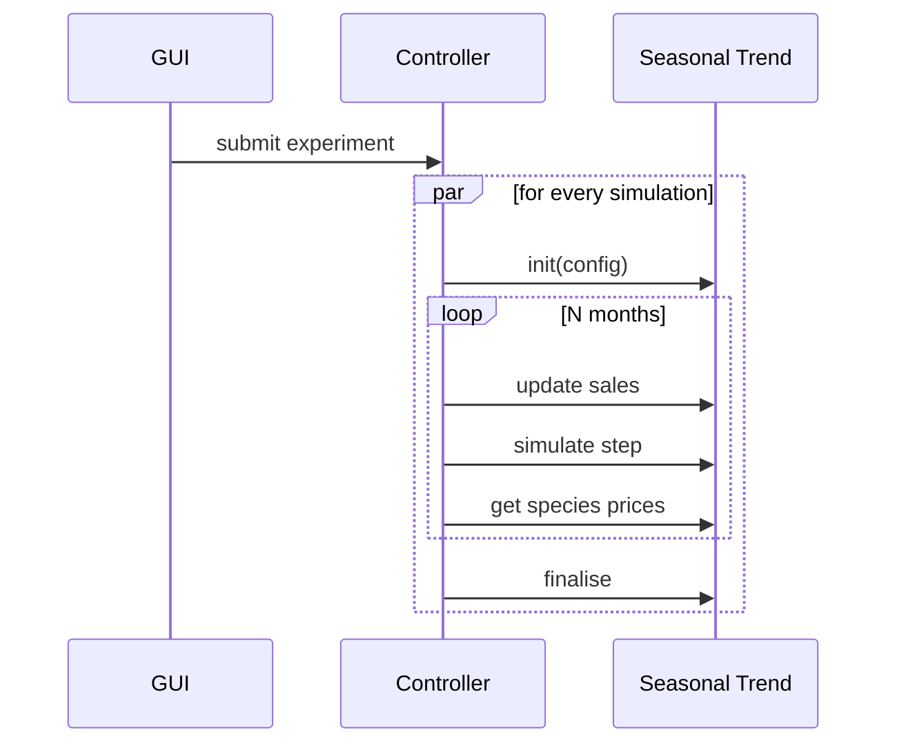
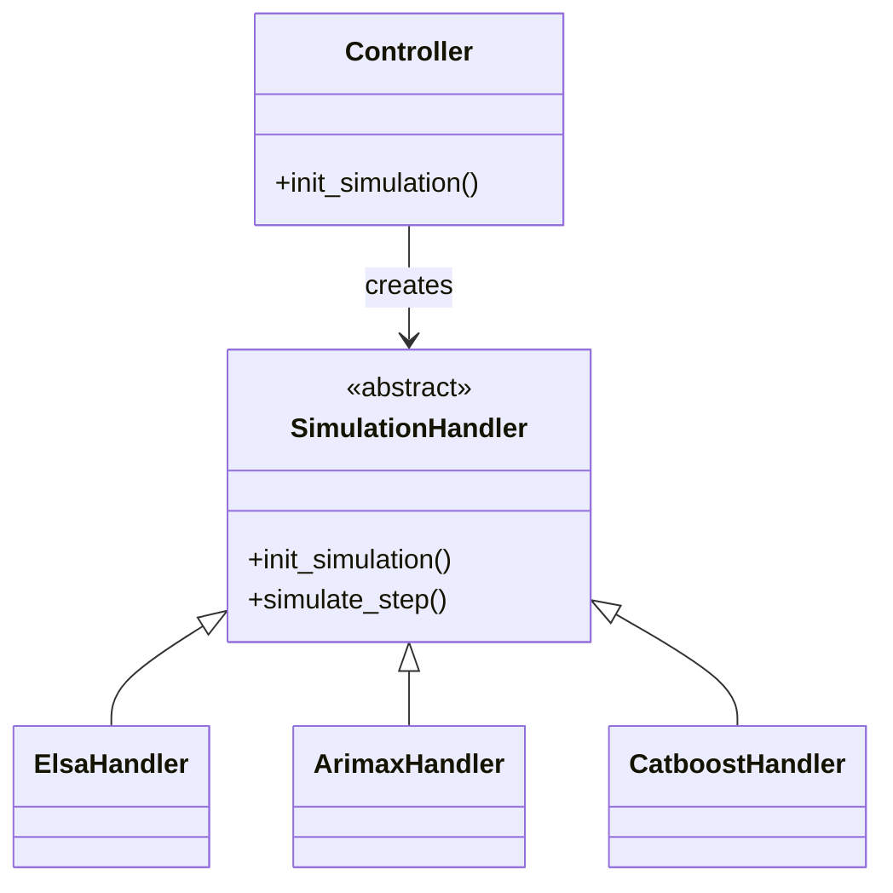

# D3.1 – System dynamics model

## DOCUMENT INFORMATION

| Grant Agreement     | 101157456 |
| ------------------- | --------- |
| Project Acronym     | SURIMI |
| Project Title       | Integration of innovative and reliable socio-ecological models and user-driven solutions into the Digital Twin Ocean, to facilitate what-if scenarios and decision support, under a co-creation approach. |
| Deliverable Number  | D3.1 |
| Work Package Number | WP3 |
| Deliverable Title   | System dynamics model |
| Lead Partner        | NORCE |
| Author(s)           | Timo Szczepanska, Khai Duong |
| Due Date            | 31 October 2026 |
| Submission Date     | |
| Dissemination Level | Public |
| Type of Deliverable | Other |

| Version   | Summary of Changes |
| --------- | ------------------ |
| Version 0 | Initial version    |

## Summary
| | |
|--|--|
| Programming language | Python 3.12 |
| No. of Kubernete pods | 1 |
| GitHub repo | https://github.com/SURIMI-Project/SURIMI-market |
| License | EUPL-1.2 |

## 1. Model purpose
The system dynamics economic model (referred to as the "market model") simulates first-sale fish price dynamics in response to seasonal fluctuations and changes in landings volumes. Price formation is represented at two levels. At the local level, prices are estimated for each species and fishing port using a statistical model that accounts for seasonal patterns and the relationship between landings volumes and prices. At the national level, prices are calculated separately for each species as supply-weighted averages across active local markets, providing an aggregated representation of price dynamics.

The market model operates within a generic simulation framework that is connected to the SURIMI interoperability layer through a gRPC microservice. The microservice provides the interface through which the SURIMI workflow controller executes the market model. At each simulation step, the controller passes landings volumes received from other SURIMI models to the market model and receives the updated first-sale fish prices for each species at both the local fishing-port and aggregated national levels.

The generic simulation framework is designed to be modular and extensible, allowing different economic models to be integrated and tested within the same simulation environment. Each economic model is associated with a simulation handler that follows a predefined structure for managing model inputs, execution, and outputs. This structure can be replicated to integrate new models into the framework. Alongside the market model, the framework includes SARIMAX and CatBoost models for predicting first-sale fish prices. These additional implementations demonstrate how the same framework can accommodate different modelling approaches and provide examples for users wishing to integrate their own economic models.

The North-Western Mediterranean Sea (GSA 06 and GSA 07) serves as a case study for the market model, which is configured to represent Spanish and French markets. The implementation uses historical landings and price data for the Fresh–Whole product category, covering January 2015 to December 2024 and sourced from [EMODnet](https://emodnet.ec.europa.eu/geonetwork/srv/api/records/ff5f738f-94ee-4704-94c2-7c951c931973). The case-study input files are stored in the [SURIMI-market repository](https://github.com/SURIMI-Project/SURIMI-market/tree/main/config) and in an S3 bucket on EDITO.

<!-- TODO: Update the information about input file storage after discussing with Rik and Nic. -->

The source code for the economic simulation framework, including the market model, SARIMAX, CatBoost, their simulation handlers, and the gRPC microservice, is available in the [SURIMI-market repository](https://github.com/SURIMI-Project/SURIMI-market). The `market_architecture.md` file provides a technical description of the model, while the `README.md` provides instructions for configuration and execution.

## 2. Process overview and scheduling diagrams

 <em>Figure 1. The SURIMI components involved in the North Western Mediterranean case study, and the position of the Seasonal Trend as the system dynamics model for species prices in the SURIMI model framework.</em>

In the diagram below, we outline the interaction between the GUI, the centralised controller and the system dynamics model named "Seasonal Trend". Each of the step between the controller and the Seasonal Trend is called with our interoperability protocol. An experiment submitted by the GUI can start multiple simulations by the controller, each running concurrently. While the Seasonal Trend is deterministic, where the same inputs lead to the same outputs, this concurrency enables simulating landings prices in different configurations among the other models. Each simulation step lasts a month and contains three steps that the controller must explicitly call. This lets the controller update sales data multiple times before a step is simulated, decide when to simulate a step and get species prices.

 <em>Figure 2. The communication flow between the GUI, the controller and the Seasonal Trend.</em>

### A Multi-Model Framework
Seasonal Trend enables experimenting with multiple models to most accurately simulate species prices. A model is implemented as a module directly in the source code, interfacing with the framework using the simulation handler, as shown by Figure 3.

 <em>Figure 3. On initialising a simulation, the framework instantiates one of the available handlers. The specialised handlers are often named after their algorithm or model name.</em>

<!-- A simulation handler is a function that is executed each time the Seasonal Trend initialises a new simulation. On starting up the Seasonal Trend, a model identifier is passed to its runtime, telling it which model to deploy. Each new handle is now associated with this model.
 -->
<!-- TODO mention as a demonstration, we added other models, e.g. SARIMAX, system dynamics model, which will be described later below. -->

## 3. Inputs
The system dynamics model 

### Data
For each simulation, the Seasonal Trend receives a number of inputs to help modeling and observing species prices over time. These are formed as messages, a well-defined and structured method of communicating with the Seasonal Trend's service. While some of the messages retrieve data from the service, others mutate its internal state. They are as follows:

TODO we fill this data section out once Timo has completed the model implementation.

TODO data that we need
- ports
- fish species
- historic species prices (real data (EMODNET))
- data is located on the S3 server on EDITO

For species prices, must use the price from branch scripts_fisheries_data in scripts/fisheries_data/emodnet_es_raw.csv. For categories, we only use fresh-whole. Size is important.

More about the above
- ports.csv: need to include LOCODE and coords (lat, lon)
- prices.csv: LOCODE, DATE, SPECIES_CODE, CATEGORIES, etc.
- species.csv: SPECIES_CODE, SPECIES_NAME
We need to mention the format/protocol that these codes follow.

TODO no need to mention the data preparation, other than the inputs we need and refer to the script we use. TODO mention which script this is emodnet_prices_landings_raw_new.ipynb.

### Interoperability Protocol
TODO Khai starts writing this now.
#### InitialiseSimulation message (init)
The configuration of the Seasonal Trend is passed that also includes the scenario contract.

#### UpdateSales message
Each monthly step starts with updating the current month's landings from EwE and POSEIDON. The message includes the following:
- The calendar date of the month, e.g. 1st of September 2026, using `google.protobuf.Timestamp`'s format.
- For each port that landings are sold to, a list of species and quantity is included, together with the preservation and presentation code as described by the European Commision's [Regulation No 1921/2006, Annex III Part A](https://eur-lex.europa.eu/legal-content/en/TXT/?uri=CELEX:32006R1921).

## 4. Outputs
### Data

The Seasonal Trend's outputs are separated in two parts:
1. Messages to retrieve data from the service
2. Final results from the simulations

### Interoperability Protocol
#### GetSpeciesPrices message
This message returns a list of prices. Each price has the following fields:
- Species identifier
- Presentation and preservation code
- Port identifier
- Price

#### Final Results
After sending the `finalise` command as described by the diagram in [2. Process overview and scheduling diagrams](#2-process-overview-and-scheduling-diagrams), datasets of the results are produced so each Seasonal Trend model's performances can be analysed. The datasets are tied to a scenario, and each simulation produces a separate dataset.
