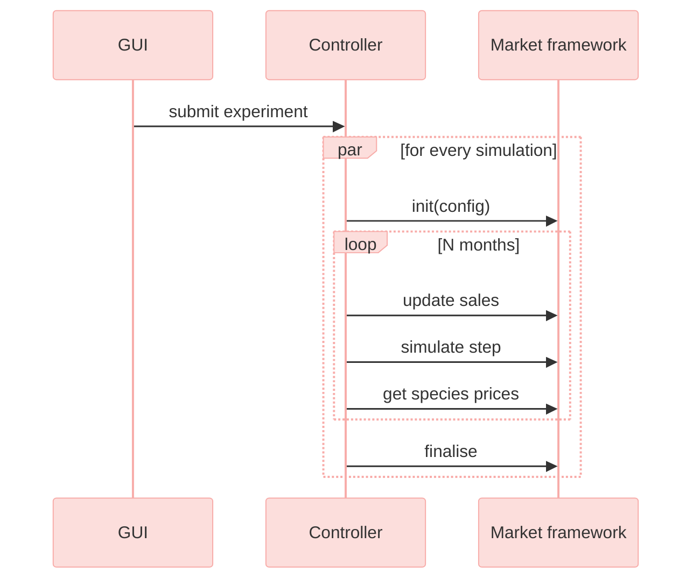
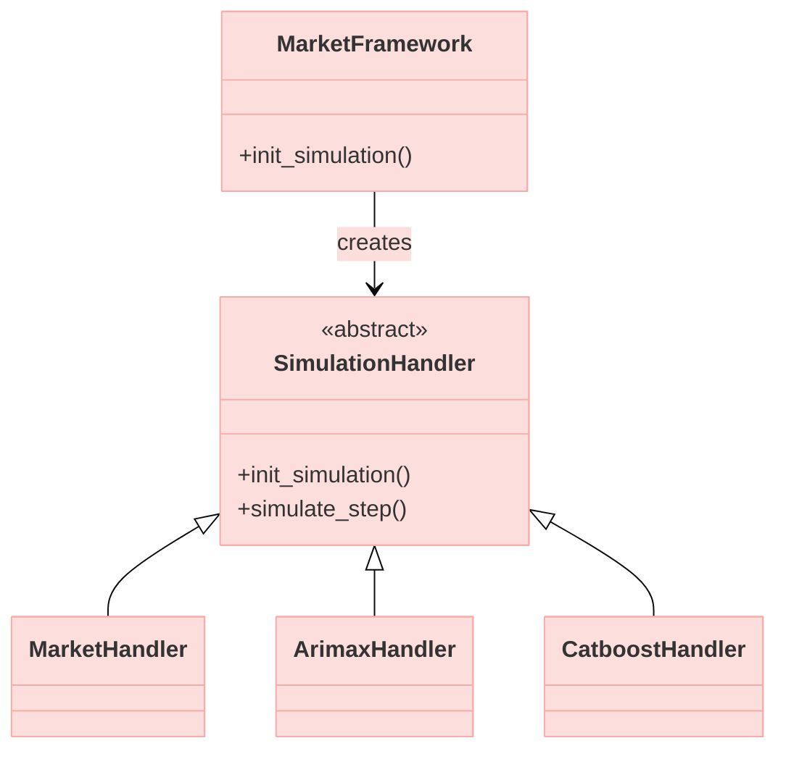
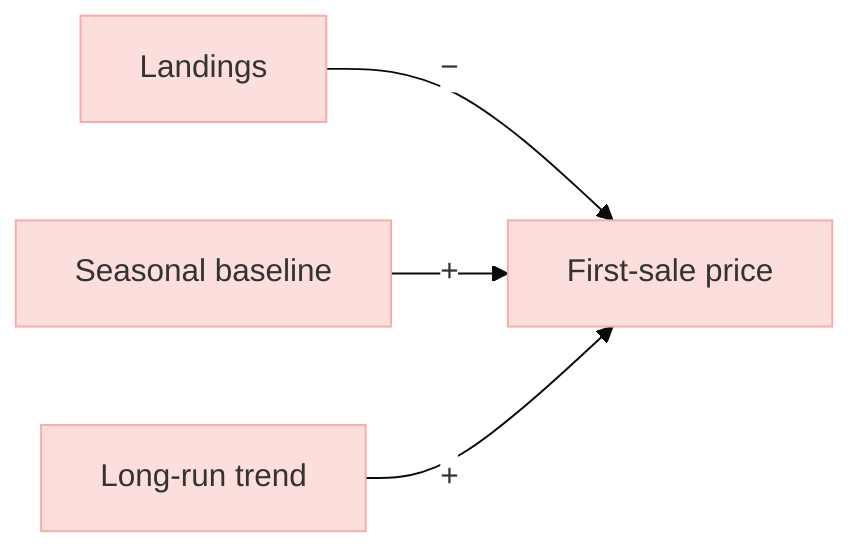

# D3.1 – System dynamics model

## DOCUMENT INFORMATION

| Grant Agreement     | 101157456 |
| ------------------- | --------- |
| Project Acronym     | SURIMI |
| Project Title       | Integration of innovative and reliable socio-ecological models and user-driven solutions into the Digital Twin Ocean, to facilitate what-if scenarios and decision support, under a co-creation approach. |
| Deliverable Number  | D3.1 |
| Work Package Number | WP3 |
| Deliverable Title   | System dynamics model |
| Lead Partner        | NORCE |
| Author(s)           | Timo Szczepanska, Khai Duong |
| Due Date            | 31 October 2026 |
| Submission Date     | |
| Dissemination Level | Public |
| Type of Deliverable | Other |

| Version   | Summary of Changes |
| --------- | ------------------ |
| Version 0 | Initial version    |
| Version 1 | Addition of figures|

## Summary
| | |
|--|--|
| Programming language | Python 3.12 |
| No. of Kubernetes pods | 1 |
| GitHub repo | https://github.com/SURIMI-Project/SURIMI-market |
| License | Apache-2.0 |

D3.1 presents the system dynamics economic model (hereafter referred to as the market model) developed for SURIMI. The deliverable includes a model for estimating first-sale fish prices and a modular simulation framework that allows different economic models to be integrated into the SURIMI simulation environment. The implementation supports the exchange of sales data and prices with other SURIMI models through the SURIMI controller.

This document describes the model's purpose (§1), its operation and integration within SURIMI (§2), and its inputs (§3) and outputs (§4). The source code and configuration files are publicly available through the SURIMI-market repository.

## 1. Model purpose
The market model simulates first-sale fish price dynamics in response to seasonal fluctuations and changes in landings volumes. The model is deterministic and data-driven, using relationships estimated from historical data to calculate fish prices. Simulations with different landings volumes can be compared to investigate their effect on first-sale fish prices.

Price formation is represented at two levels. At the local level, prices are estimated for each species and fishing port using a statistical model that accounts for seasonal patterns and the relationship between landings volumes and prices. At the national level, prices are estimated using the same kind of statistical model as at the local level, fitted on the combined landings volume summed across all active local markets, providing an aggregated representation of price dynamics.

The market model operates within a generic simulation framework (i.e., the market framework) that is connected to the SURIMI interoperability layer through a gRPC microservice. The microservice provides the interface through which the SURIMI workflow controller executes the market model. At each simulation step, the controller passes sales data received from other SURIMI models to the market model and receives the updated first-sale fish prices for each species at both the local fishing-port and aggregated national levels.

The generic simulation framework is designed to be modular and extensible, allowing different economic models to be integrated and tested within the same simulation environment. Each economic model is associated with a simulation handler that follows a predefined structure for managing model inputs, execution, and outputs. This structure can be replicated to integrate new models into the framework. Alongside the market model, the framework includes two alternative example models (Arimax and Catboost) for predicting first-sale fish prices. These examples demonstrate how the market framework can accommodate different modelling approaches and provide guidance for users wishing to integrate their own economic models.

The North-Western Mediterranean Sea (GSA 06 and GSA 07) serves as a case study for the market model, which is configured to represent Spanish and French markets. The implementation uses historical landings and price data for the "Fresh–Whole" product category, covering January 2015 to December 2024 and sourced from [EMODnet](https://emodnet.ec.europa.eu/geonetwork/srv/api/records/ff5f738f-94ee-4704-94c2-7c951c931973). The case-study input files are stored in the [SURIMI-market repository](https://github.com/SURIMI-Project/SURIMI-market/tree/main/config) and, for other scenarios, in an S3 bucket on EDITO (`minio.dive.edito.eu`).

The [SURIMI-market repository](https://github.com/SURIMI-Project/SURIMI-market) contains the source code of the market framework and the market model. Two documents provide detailed technical descriptions of the market framework ([`market_architecture.md`](https://github.com/SURIMI-Project/SURIMI-market/blob/main/market_architecture.md)) and the market model ([`market_model_architecture.md`](https://github.com/SURIMI-Project/SURIMI-market/blob/main/src/models/market/market_model_architecture.md)). Additional instructions on configuration and execution are provided in the [`README.md`](https://github.com/SURIMI-Project/SURIMI-market/blob/main/README.md).

## 2. Process overview and scheduling diagrams

The data flow diagram below illustrates the position of the market model within the SURIMI framework for the North-Western Mediterranean case study. The market model receives sales data from both POSEIDON and Ecopath with Ecosim (EwE), which represent different fishing fleets, and provides first-sale fish prices to both models in return. These exchanges are coordinated through the SURIMI controller, which manages the transfer of information between the models.

 <em>Figure 1. Position of the market model within the SURIMI framework for the North-Western Mediterranean case study.</em>

The sequence diagram below illustrates how the simulation GUI, the SURIMI controller, and the market model interact during an experiment. An experiment submitted through the simulation GUI can initiate multiple simulations that run concurrently, allowing each simulation to progress independently without having to wait for the others to finish. At the beginning of each simulation, the SURIMI controller initializes the market model. The model then runs in monthly steps. For each month, the controller provides the market model with sales data, which may be updated multiple times before the controller instructs the model to simulate the monthly step. During this step, the market model calculates new first-sale fish prices based on the sales data received. Once the calculations are complete, the controller retrieves the updated prices for each species. Once all monthly steps are completed, the controller finalizes the simulation.

 <em>Figure 2. The communication flow between the GUI, the controller and the Market framework.</em>

The controller calls the market framework, which selects and instantiates the appropriate handler, as shown in Figure 3. Each model is implemented as its own module, interfacing with the framework through a common simulation handler. The framework selects which one to use for a given run based on the MODEL_NAME environment variable, using a dictionary that maps model names to their corresponding handler classes (for more details, see [`market_architecture.md`](https://github.com/SURIMI-Project/SURIMI-market/blob/main/market_architecture.md)).

 <em>Figure 3. On initialising a simulation, the framework instantiates one of the available handlers. The specialised handlers are often named after their algorithm or model name.</em>

The market model forms prices at two levels: national, for each species across all of a country's active ports, and local, for each species at each fishing port. Both levels use the same statistical base model, but national prices are predicted independently using aggregated landings rather than calculated from local prices. If a historical price exists for the month, the model reports that price; otherwise, a price is predicted.

The baseline prediction has three steps. First, a seasonal baseline is set from the typical price for that calendar month in the historical data. Second, the baseline is adjusted for the month's landings, which lower the price when above the usual level and raise it when below. Third, the long-run price trend is carried forward, weighted by how statistically certain that trend is (Figure 4).

The two levels differ in scale and in the use of a network effect at the local level. The national model is fitted on landings summed across a country's active ports, and the local model on one port's landings and price history. The local model also carries a network effect: each port's predicted price is blended with a distance-weighted average of its nearest ports' own predicted prices, so that geographically close ports influence one another, with closer ports counting for more. A full technical description is available in [`market_model_architecture.md`](https://github.com/SURIMI-Project/SURIMI-market/blob/main/src/models/market/market_model_architecture.md).

 <em>Figure 4. Simplified causal diagram of price formation, applying at both the local and national level. + means both variables move in the same direction, − in opposite directions.</em>

## 3. Inputs

### 3.1 Data
The market model relies on training data to understand how variables influence fish prices. The application supports storing the data in two alternative locations:

1. In an S3 Bucket on EDITO at `/oidc-$USER/market/$SCENARIO/`
2. Locally in the project's source code at `config/$SCENARIO`

Replace `$USER` with the username and `$SCENARIO` with a scenario name, e.g. `northwestern_med`. If EDITO (S3) credentials are configured, the market model always downloads the data from there first, overwriting the local copy. If S3 isn't configured at all, it uses the local copy directly. If S3 *is* configured but the download fails (e.g. bad credentials), the simulation fails with an error message. The data inputs are divided into the following datasets:

- `species.csv`
- `markets.csv`
- `prices.csv`
- `size_ratios.csv` (optional)

#### `species.csv`
In the species dataset, we store a list of all species that the market model supports. This list must adhere to the contract in §3.3.1. It includes the following variables:

| Variable name | Description |
| --- | --- |
| `species_code` | Three-letter code for the species; required for the current use case |
| `life_stage` | Category of life stage; species name may depend on life stage; optional and not required for the current use case |
| `species_name` | Scientific name of the species; optional and not required for the current use case |

#### `markets.csv`
This dataset contains countries and local ports that the market model supports. It must at least adhere to the contract in §3.3.1, and it includes the following variables:

| Variable name | Description |
| --- | --- |
| `market_code` | Two-character code for countries and five-character code for local ports |
| `market_name` | Name of the port where the market is located |
| `lon`, `lat` | Geographic longitude and latitude |

#### `prices.csv`

This dataset contains the historical first-sale prices and landings used to train the market model. It includes the following variables:

| Variable name | Description |
| --- | --- |
| `date` | Month of the record |
| `market_code` | Market where the sale was recorded, using the same codes as `markets.csv` |
| `species_code` | Species sold, using the same codes as `species.csv` |
| `category_code` | Preservation and presentation category; only "Fresh–Whole" is used in the current use case |
| `landings_kg` | Landings for that month, in kilograms |
| `price` | First-sale price, in EUR per kilogram |
| `size` | Optional; not required for the current use case |

#### `size_ratios.csv`
Optional. Loaded if present, but not required for the current use case.

<!--
Optional: data that we use to create input files
- ports
- fish species
- historic species prices (real data (EMODNET))
- data is located on the S3 server on EDITO

For species prices, must use the price from branch scripts_fisheries_data in scripts/fisheries_data/emodnet_es_raw.csv. For categories, we only use fresh-whole. Size is important.

More about the above
- ports.csv: need to include LOCODE and coords (lat, lon)
- prices.csv: LOCODE, DATE, SPECIES_CODE, CATEGORIES, etc.
- species.csv: SPECIES_CODE, SPECIES_NAME
We need to mention the format/protocol that these codes follow.

 Optional: mention which script this is emodnet_prices_landings_raw_new.ipynb. -->

### 3.2 Configurations
As an application, the market model can be configured using environment variables. We expose the following configuration options:

| Variable name | Description |
| --- | --- |
| `MODEL_NAME` | A predefined model name; the selected model will be used to simulate species prices; read when initialising a new simulation |

If the model name is invalid, the initialisation request (§3.3.1) returns an error.

### 3.3 Input received as SURIMI messages
The market model receives all its dynamic inputs from the SURIMI controller over gRPC ([`MarketService`](https://buf.build/surimi/surimi-protocol/docs/main%3Asurimi.v1#surimi.v1.MarketService), proto package [`surimi.v1`](https://buf.build/surimi/surimi-protocol/docs/main:surimi.v1)). Below, we describe the gRPC messages.

#### 3.3.1 [InitialiseSimulation](https://buf.build/surimi/surimi-protocol/docs/main%3Asurimi.v1#surimi.v1.MarketService.InitialiseSimulation)
Sent once per simulation, before any other messages ([request](https://buf.build/surimi/surimi-protocol/docs/main%3Asurimi.v1#surimi.v1.InitialiseSimulationRequest), [response](https://buf.build/surimi/surimi-protocol/docs/main%3Asurimi.v1#surimi.v1.InitialiseSimulationResponse)). When a simulation is initialised, the service assigns the configured model (defined in §3.2) to the simulation. It also delivers the contract ([Simulation](https://buf.build/surimi/surimi-protocol/docs/main%3Asurimi.v1#surimi.v1.Simulation)) that the models in the ensemble use to exchange information, and the units they use. The assigned model only uses a subset of the contract as its parameters. These are as follows:

| Field | Meaning | Use in market  model |
| --- | --- | --- |
| `simulation_id` | Identifies the simulation; many simulations may run concurrently | Key that references the simulation |
| `scenario_name` | Name of the scenario, e.g. `northwestern_med` | Identifies which dataset of real landings statistics to use |
| `simulation.start_date_time` | Start time of the simulation | Determines the first month of species prices to predict |
| `simulation.time_step` | The simulation's tick length | Checked against the model's one supported step length (one month); the contract is rejected if it doesn't match |
| `simulation.items.markets`, `.species` | Species (with life stages) and markets included in the contract | Landings and sales prices are only accounted for these |
| `simulation.items.currencies` | Currencies the controller wants prices reported in | Checked against the model's one supported currency (EUR); the contract is rejected if EUR isn't among them |
| `simulation.items.price_categories` | A list of preservation and presentation categories in which a batch of landings can be delivered | A predictor or feature in a market model's sales price prediction |

The model checks the dataset corresponding to the selected scenario to see if it supports all the markets, countries, species, currencies, and time step from the contract. An error is sent to the controller if the dataset does not fulfill the contract. The remaining fields are unused.

#### 3.3.2 [UpdateSales](https://buf.build/surimi/surimi-protocol/docs/main%3Asurimi.v1#surimi.v1.MarketService.UpdateSales)
Market landings are appended using this message ([request](https://buf.build/surimi/surimi-protocol/docs/main%3Asurimi.v1#surimi.v1.UpdateSalesRequest), [response](https://buf.build/surimi/surimi-protocol/docs/main%3Asurimi.v1#surimi.v1.UpdateSalesResponse)). The framework is flexible, so landings can be appended to both the current and future months. Landings for past months cannot be updated.

| Field | Meaning | Use in market model |
| --- | --- | --- |
| `start_date_time` | The date of the sales, e.g. 1 September 2026, using the `google.protobuf.Timestamp` format | Month of the year that the sales are associated with |
| `sales_summary.market_sales` | A list of sales for a given market; includes a list of species sales with corresponding fleet segment, quantity, value and category code | Input data for the species sales price prediction |

### 3.4 Control messages as SURIMI messages
Control messages drive the life cycle of a simulation and carry no data for the model.

#### 3.4.1 [SimulateStep](https://buf.build/surimi/surimi-protocol/docs/main%3Asurimi.v1#surimi.v1.MarketService.SimulateStep)
Sent once per step. The model advances one step in the simulation, predicting the first-sale prices for the current month's landings. The message carries the current simulation time, which must match the model's own simulation time. This is used to verify that both the caller and the model are in sync.

#### 3.4.2 [FinaliseSimulation](https://buf.build/surimi/surimi-protocol/docs/main%3Asurimi.v1#surimi.v1.MarketService.FinaliseSimulation)
The simulation ends. It stores the simulated sales prices as output datasets and releases the simulation from its internal register.

#### 3.4.3 [CancelSimulation](https://buf.build/surimi/surimi-protocol/docs/main%3Asurimi.v1#surimi.v1.MarketService.CancelSimulation)
Ends a simulation without storing its results, releasing it from the model's internal register.

## 4. Outputs
### 4.1 Output provided as SURIMI messages
The model provides first-sale fish prices to other models in the ensemble. The currency is assumed to be EUR, and weight is measured in kg.

#### 4.1.1 [GetSpeciesPrices](https://buf.build/surimi/surimi-protocol/docs/main%3Asurimi.v1#surimi.v1.MarketService.GetSpeciesPrices)
Returns the current first-sale prices for all species across all markets. Because this message returns only the most up-to-date prices, it should be called after each step to accumulate the price history.

| Field | Meaning |
| --- | --- |
| `species_price_summary.species_prices` | Prices grouped by species, port and category code |

### 4.2 Output files
`FinaliseSimulation` (§3.4.2) writes two files, `combined_prices.csv` (national-level prices) and `local_prices.csv` (port-level prices), each containing one row per simulated time step, species and category.
