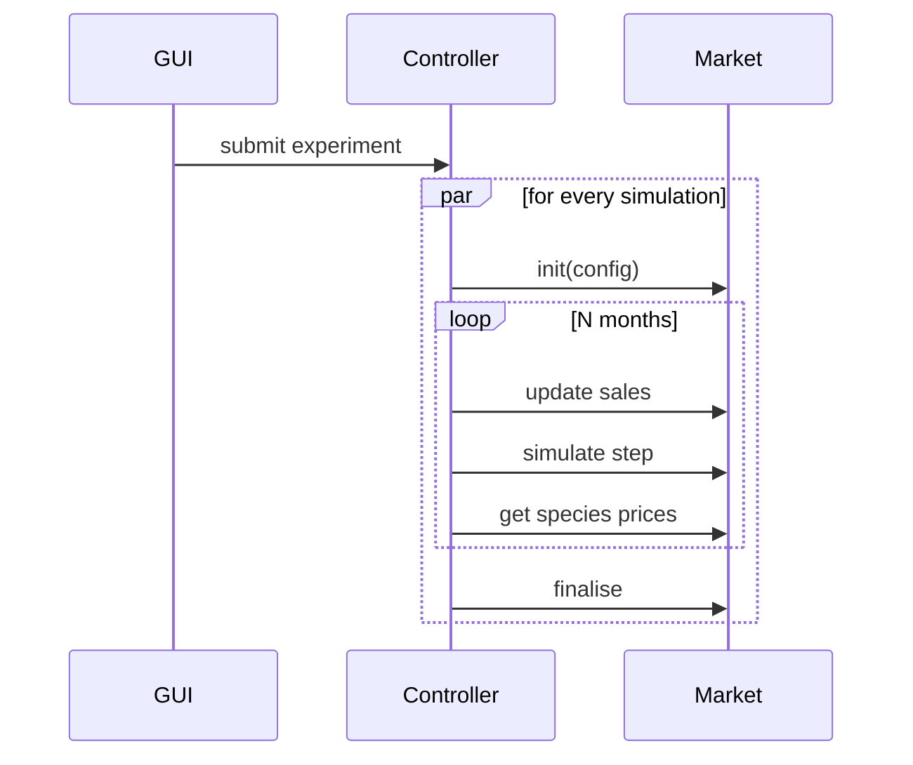

# D3.1 – System dynamics model

## DOCUMENT INFORMATION

| Grant Agreement     | 101157456 |
| ------------------- | --------- |
| Project Acronym     | SURIMI |
| Project Title       | Integration of innovative and reliable socio-ecological models and user-driven solutions into the Digital Twin Ocean, to facilitate what-if scenarios and decision support, under a co-creation approach. |
| Deliverable Number  | D3.1 |
| Work Package Number | WP3 |
| Deliverable Title   | System dynamics model |
| Lead Partner        | NORCE |
| Author(s)           |  |
| Due Date            | 31 October 2026 |
| Submission Date     | |
| Dissemination Level | Public |
| Type of Deliverable | Other |

| Version   | Summary of Changes |
| --------- | ------------------ |
| Version 0 | Initial version    |

## Summary
| | |
|--|--|
| Programming language | Python 3.12 |
| No. of Kubernete pods | 1 |
| GitHub repo | https://github.com/SURIMI-Project/SURIMI-market |
| License | Apache 2.0 |

## 1. Model purpose
The system dynamics model in itself is a modular framework that enables multiple models to be tested. Although we provide a model out-of-box, users are free to implement their own model. To support them, the framework deploys what we call simulation handlers. In the next section, we describe how they work.

## 2. Process overview and scheduling diagrams

#TODO specify that this is a general structure to predict the monthly first fish sales prices.
#TODO change the name of the "Market" so it is more descriptive, i.e. "seasonal trend".

In the diagram below, we outline the interaction between the GUI, the central controller and the system dynamics model named "Market". In short, an experiment runs many system dynamics model simulations concurrently.

A simulation handler is a function that is executed each time the Market initialises a new simulation. On starting up the Market, a model identifier is passed to its runtime, telling it which model to deploy. Each new handle is now associated with this model.

TODO mention as a demonstration, we added other models, e.g. SARIMAX, system dynamics model, which will be described later below.

## 3. Inputs
### Data
For each simulation, the Market receives a number of inputs to help modeling and observing species prices over time. These are formed as messages, a well-defined and structured method of communicating with the Market's service. While some of the messages retrieve data from the service, others mutate its internal state. They are as follows:

TODO we fill this data section out once Timo has completed the model implementation.

TODO data that we need
- ports
- fish species
- historic species prices (real data (EMODNET))
- data is located on the S3 server on EDITO

More about the above
- ports.csv: need to include LOCODE and coords (lat, lon)
- prices.csv: LOCODE, DATE, SPECIES_CODE, CATEGORIES, etc.
- species.csv: SPECIES_CODE, SPECIES_NAME
We need to mention the format/protocol that these codes follow.

### Interoperability Protocol
TODO Khai starts writing this now.
#### InitialiseSimulation message (init)
The configuration of the Market is passed that also includes the scenario contract.

#### UpdateSales message
Each monthly step starts with updating the current month's landings from EwE and POSEIDON. The message includes the following:
- The calendar date of the month, e.g. 1st of September 2026, using `google.protobuf.Timestamp`'s format.
- For each port that landings are sold to, a list of species and quantity is included, together with the preservation and presentation code as described by the European Commision's [Regulation No 1921/2006, Annex III Part A](https://eur-lex.europa.eu/legal-content/en/TXT/?uri=CELEX:32006R1921).

## 4. Outputs
### Data

The Market's outputs are separated in two parts:
1. Messages to retrieve data from the service
2. Final results from the simulations

### Interoperability Protocol
#### GetSpeciesPrices message
This message returns a list of prices. Each price has the following fields:
- Species identifier
- Presentation and preservation code
- Port identifier
- Price

#### Final Results
After sending the `finalise` command as described by the diagram in [2. Process overview and scheduling diagrams](#2-process-overview-and-scheduling-diagrams), datasets of the results are produced so each Market model's performances can be analysed. The datasets are tied to a scenario, and each simulation produces a separate dataset.