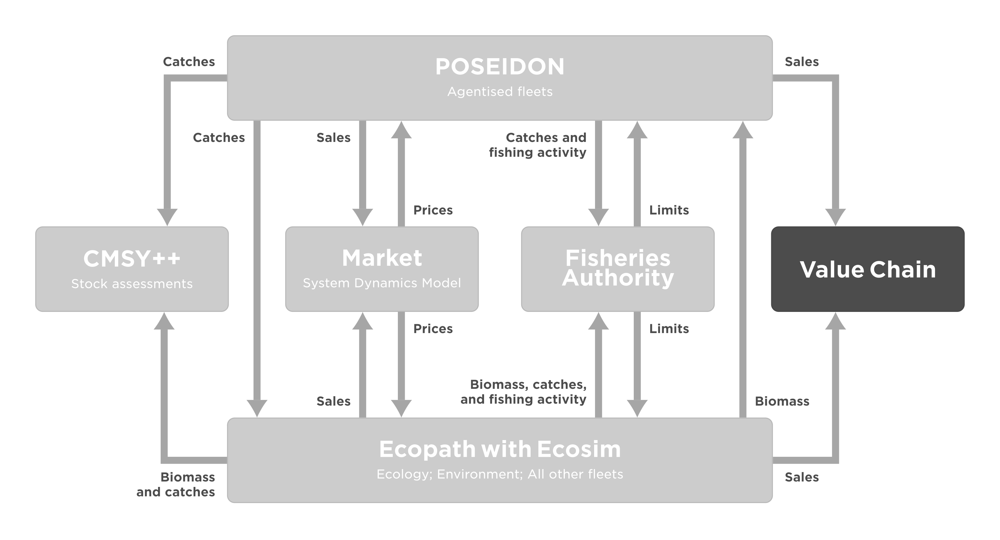
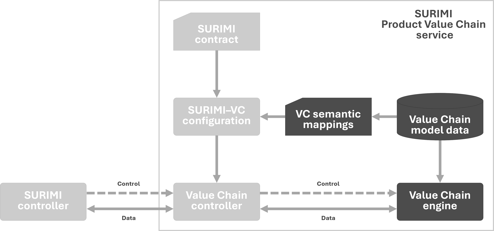

# D3.2 – Product flow value-chain model

## DOCUMENT INFORMATION

| Grant Agreement     | 101157456 |
| ------------------- | --------- |
| Project Acronym     | SURIMI |
| Project Title       | Integration of innovative and reliable socio-ecological models and user-driven solutions into the Digital Twin Ocean, to facilitate what-if scenarios and decision support, under a co-creation approach. |
| Deliverable Number  | D3.2 |
| Work Package Number | WP3 |
| Deliverable Title   | Product flow value-chain model |
| Lead Partner        | EEI |
| Author(s)           |  |
| Due Date            | 31 October 2026 |
| Submission Date     | |
| Dissemination Level | Public |
| Type of Deliverable | Other |

| Version   | Summary of Changes |
| --------- | ------------------ |
| Version 0 | Initial version    |

## Summary

## 1. Model purpose
The **Product Value Chain model** is a socioeconomic 
Economist classify fisheries as primary industries, highlighting their supporting role for numerous secondary (e.g., seafood processors) and tertiary industries (e.g., hotels and restaurants) in the economy. Extractive industries are generally limited at creating value. For example, as per 2010, the direct economic contribution of fisheries to national economies around the world ranged only between 0.5% and 2.5% of Gross Domestic Products (GDP; e.g. [Dyck & Sumaila 2010] (https://doi.org/10.1007/s10818-010-9088-3)).

However, fishing requires inputs from other industries to operate (e.g., boat building industry and fishing net manufacturers), and as fish, marine invertebrates and macroalgae move along supply chains, they are transformed into accessible seafood products tailored to meet the needs of consumers. Thus, fisheries have "upstream" (i.e., prior to fishing) and "downstream"(i.e., post-harvesting) economic effects, which are commonly characterized using input-output models to estimate multipliers (see the External bio-economic models chapter). These multipliers are factors used for approximating the extent of the contribution of an economic sector to a nation’s economy.

The Product Value Chain module, originally embedded in the Ecopath with Ecosim as a plug-in, is a powerful tool for characterizing the downstream economic effects of the fishing fleets ([Christensen et al. 2011](https://doi.org/10.1016/j.ecolmodel.2010.09.030)). The economic agents or components within the value chain are referred to as enterprises described via a set of common attributes and segregated based on their function within the value chain. The value chain model is coupled to ecosystem model through the fishing fleets. These are considered as producers, given that they are the main source of raw materials for the seafood supply chain. Non-extractive activities using marine living resources (e.g., ecotourism or non-retaining recreational fisheries) and some types of aquaculture enterprises can also be considered as producers. Enterprises that receive marine living resources from producers and transform them into seafood are classified as processors. These typically include fish cutters and filleters, canneries, seafood freezing facilities, or fishmeal processing plants.

For the SURIMI project, the Value Chain engine was separated out of the EwE software as an [independent software package](https://github.com/Official-EwE/Eii.ValueChain.git), and was added as a stand-alone computational end-point to the SURIMI model framework.

## 2. Process overview and scheduling diagrams

<em>Figure 1. The position of the Product Value Chain model in the SURIMI model ensemble.</em>

### Conceptual integration ###
The Value Chain C# code was integrated into SURIMI in its entirety and did not require any changes to its computational code or internal data model. Instead, additional software was developed to translate SURIMI inputs into the terminology and level of aggregation understood by the Value Chain (Figure 4). In turn, the Value Chain computations deliver standardized socio-economic metrics to the SURIMI model framework for further dissemination.

<em>Figure 4. Conceptual architecture of the Product Value Chain service within SURIMI. The SURIMI-specific Value Chain controller encapsulates the Value Chain computations and translates control and data exchanges using model-specific semantic mappings. These mappings are derived from the Value Chain model data, and must match the modeled entities described in the SURIMI scenario contract.</em>

## 3. Inputs

## 4. Outputs
