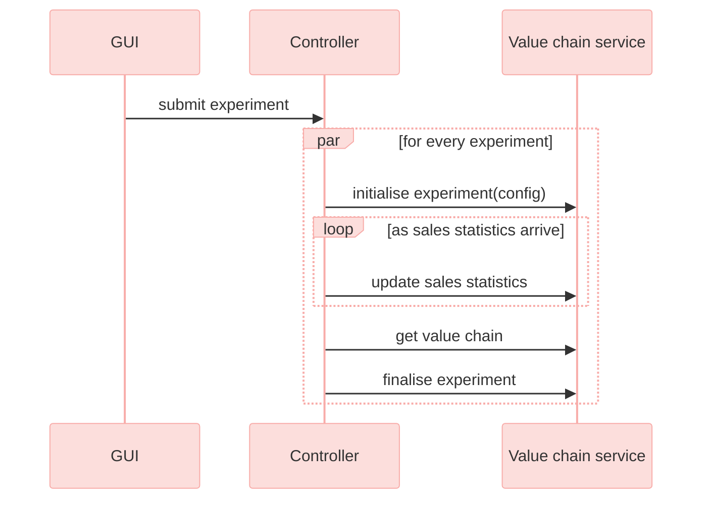
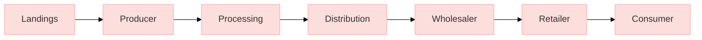

# D3.2 – Product flow value-chain model

## DOCUMENT INFORMATION

| Grant Agreement     | 101157456 |
| ------------------- | --------- |
| Project Acronym     | SURIMI |
| Project Title       | Integration of innovative and reliable socio-ecological models and user-driven solutions into the Digital Twin Ocean, to facilitate what-if scenarios and decision support, under a co-creation approach. |
| Deliverable Number  | D3.2 |
| Work Package Number | WP3 |
| Deliverable Title   | Product flow value-chain model |
| Lead Partner        | EII |
| Author(s)           | Jeroen Steenbeek |
| Due Date            | 31 October 2026 |
| Submission Date     | 31 October 2026 |
| Dissemination Level | Public |
| Type of Deliverable | Other |

| Version | Summary of Changes |
| --- | --- |
| Version 0 | Initial version |
| Version 1 | Added figures |
| Version 2 | Completed section 2, added 3 and 4 |
| Version 3 | Transferred to template |
| Final Version | Final edits |

## Summary

| | |
| --- | --- |
| Programming language | C# (.NET 10) |
| No. of Kubernetes pods | 1 |
| GitHub repo | https://github.com/SURIMI-Project/SURIMI-value-chain |
| Licence | EUPL-1.2 |

Deliverable D3.2 covers the product flow value-chain model built for SURIMI: a standalone microservice, built on gRPC (the protocol SURIMI's models use to exchange data), wrapping the value-chain engine from Ecopath with Ecosim (EwE), estimating the downstream economic and social effects of fishing activity as it moves through processing, distribution, wholesale and retail to the final consumer. It is designed to receive sales statistics from the other SURIMI models through the SURIMI controller and produce a multi-year summary of production, cost, tax and employment indicators for each stage of the chain.

The service interface and contract translation are implemented; scenario population, semantic mappings and integration with the value-chain engine remain under development.

§1 covers the model's purpose, §2 its operation and integration within SURIMI, and §3 and §4 its inputs and outputs. The service wrapper’s source code is publicly available through the SURIMI-value-chain repository; the underlying engine package is private.

## 1. Model purpose

Economists classify fisheries as a primary industry, extracting a natural resource that largely enters the economy through other sectors. The fishing sector may capture only a portion of the total economic value generated along the seafood value chain. Catching fish requires inputs from other sectors beforehand, such as boatbuilding and net manufacturing, and once landed, fish, invertebrates and macroalgae move through further processing, distribution and retail sectors before reaching a consumer. Fisheries therefore have upstream and downstream economic effects, usually estimated with input-output models that derive multipliers for how much a fishing sector's activity contributes to the wider economy.

The value-chain model represents these downstream effects directly, tracing the amount, revenue and cost of fish products from the sea to the end consumer ([Christensen et al. 2011](https://doi.org/10.1016/j.ecolmodel.2010.09.030)). Each enterprise is classified by its function in the chain: producer, processor, distributor, wholesaler, retailer or consumer — a refinement of the original method's five categories, which told wholesale and retail sellers apart only by their position in the chain. Fishing fleets are a chain's producers, since they are the source of the raw material entering it, and an enterprise's revenue, costs, taxes, subsidies and employment are recorded against its category. Enterprises link together into a flow chart that can branch and merge but not cycle, tracing how a unit of landed fish is transformed and re-sold on its way to a consumer. Each link also carries a production/input ratio, from which live-weight equivalents are derived, and a product value for that specific flow. In the method's original design, a producer's fishing effort also feeds back into the linked ecosystem model, coupling the value chain's economics to the ecosystem's own trophic dynamics. The value chain engine behind this model was originally developed as a plug-in for Ecopath with Ecosim.

For SURIMI, the value-chain engine was factored out of Ecopath with Ecosim into its own package, [`Eii.ValueChain`](https://github.com/Official-EwE/Eii.ValueChain.git) (private), and wrapped by [SURIMI-value-chain](https://github.com/SURIMI-Project/SURIMI-value-chain), a standalone gRPC microservice connected to the SURIMI controller through a shared contract (§2). The engine's own calculations did not need to change for this integration. The SURIMI-value-chain repository includes a translation layer. Its `ValueChainService.GetSurimiContract()` method maps the incoming gRPC request into `SurimiContract`, the same shared contract type used across the SURIMI ensemble.

The repository includes database files for two case studies: `northwestern_med`, aligned with SURIMI's North-Western Mediterranean case study, and `anchovy_bay`, a smaller test scenario.

## 2. Process overview and scheduling diagrams

Figure 1 places the value-chain model among the other SURIMI models: sales statistics flow into it from POSEIDON and Ecopath with Ecosim (EwE), which represent different fishing fleets, and out of it come the chain's downstream economic and social indicators. Nothing flows back from the value-chain model into the rest of the ensemble during a simulation. Its indicators are a terminal output, pulled by the controller for reporting without being fed back into the other models.

*Figure 1. Position of the value-chain model within the SURIMI model ensemble.*

Figure 2 illustrates the lifecycle of an experiment from the GUI's perspective. An experiment submitted through the GUI can contain multiple simulations. The controller initialises the value-chain service once per experiment and subsequently adds sales statistics as they become available. A summary of the value chain is intended to be available at any point after initialisation, for example, before the experiment is finalised. The exchange shown in Figure 2 does not involve fixed simulation steps. Instead, sales statistics accumulate throughout the experiment as they arrive.

*Figure 2. The communication flow between the GUI, the controller and the value-chain service.*

Figure 3 shows the internal structure of the value-chain service. A SURIMI contract, provided when an experiment is initialised, is combined with scenario-specific semantic mappings to create a SURIMI–VC configuration. These mappings are derived from the scenario's value-chain model data (§3.1) and translate SURIMI's generic codes (species, markets) into the enterprises represented in those data. The value-chain controller reads this configuration and drives the value-chain engine, exchanging control information and data with both the engine and the SURIMI controller.

*Figure 3. Conceptual architecture of the value-chain service. The semantic mappings between SURIMI's generic codes and a scenario's own enterprises are derived from that scenario's value-chain model data (§3.1).*

The value-chain service uses a single controller implementation that manages the value-chain engine's computation classes.

Within the engine, the value chain consists of enterprises ("units") classified into six categories according to their function: producer, processing, distribution, wholesaler, retailer and consumer. Producers form the entry point of the chain, receiving landings of a given species directly from fishing fleets. Each enterprise's outputs are linked to downstream enterprises, and the engine propagates production, revenue, cost and employment figures through the network to calculate the per-category indicators returned by `GetValueChain` (§4.1). The enterprises and their connections within each scenario are described in §3.1.

*Figure 4. Simplified structure of the value chain. A scenario's enterprises and links (§3.1) can branch and merge, but not cycle; this diagram shows the six functional categories in the order product typically flows between them.*

The value-chain controller is designed to load a scenario's value-chain data and semantic mappings when an experiment is initialised, accumulate incoming sales statistics, and run the engine to produce the summary returned by `GetValueChain`. So far, these functions are only defined through an interface.

## 3. Inputs

### 3.1 Data

The value-chain engine's scenario data is stored in a SQLite database (a self-contained database file), located at `Includes/$SCENARIO/$SCENARIO.vc.sqlite` in the SURIMI-value-chain repository. The database follows the engine's own schema. The base `Unit` table contains one row per enterprise, with separate subtype tables for each functional category (`ProducerUnit`, `ProcessingUnit`, `DistributionUnit`, `WholesalerUnit`, `RetailerUnit`, `ConsumerUnit`). A shared `EconomicUnit` table stores the cost, tax, subsidy and labour attributes of all enterprises, regardless of category.

The `Link` and `FlowPosition` tables describe the connections between enterprises and the visual layout of the chain. The `LinkLandings` table associates a producer-side link with the species code of the landings entering the chain at that point. Finally, the `Parameters` table stores engine settings inherited from Ecopath with Ecosim, such as the equilibrium effort range and whether the run is coupled to Ecosim.

| Table | Variable name | Description |
| --- | --- | --- |
| `Unit` | `Name`, `NameLocal` | Name of the enterprise |
| `Unit` | `Sequence` | Enterprise's position in the chain's drawing order |
| `Unit` | `Nationality` | Enterprise's country |
| `ProducerUnit` | `GearCode` | Fishing gear the producer uses |
| `ProducerUnit` | `TicketProducts`, `ObserverCost`, `ObserverRate` | Producer-specific revenue and monitoring cost |
| `ProcessingUnit` | `AgriculturalProducts`, `AgriculturalInput` | Processor-specific output and input |
| `EconomicUnit` | `EnergyCost`, `IndustrialCost`, `ServiceCost`, `CapitalInput`, `ManagementCost`, `RoyaltyCost`, `CertificationCost` | Input costs common to every enterprise |
| `EconomicUnit` | `SubsidyEnergy`, `SubsidyOther` | Subsidies received |
| `EconomicUnit` | `TaxEnvironmental`, `TaxExport`, `TaxImport`, `TaxProduction`, `TaxVAT`, `ProfitTax`, `LicenseTax` | Taxes paid |
| `EconomicUnit` | `WorkerFemale`, `WorkerMale`, `WorkerParttime`, `WorkerOther`, `OwnerFemale`, `OwnerMale` | Worker and owner counts by category |
| `EconomicUnit` | `WorkerFemalePay`, `WorkerMalePay`, `OwnerFemalePay`, `OwnerMalePay`, `WorkerOtherPay` | Pay per worker and owner category |
| `EconomicUnit` | `WorkerFemaleDependents`, `WorkerMaleDependents`, `OwnerFemaleDependents`, `OwnerMaleDependents` | Dependents supported |
| `Link` | `Source`, `Target` | The two enterprises a product flow connects |
| `LinkLandings` | `SpeciesCode` | Species landed at a producer-side link |
| `Parameters` | `RunWithEcopath`, `RunWithEcosim` | Whether the engine run couples to Ecopath/Ecosim-style effort dynamics |

As distributed, the repository's two bundled databases (`northwestern_med.vc.sqlite`, `anchovy_bay.vc.sqlite`) are empty: every one of the 13 tables has zero rows. No enterprise has yet been entered for either case study.

The semantic mappings (Figure 3) are planned to use the `SURIMI.SemanticRegistry` package but require further development.

### 3.2 Input received as SURIMI messages

All dynamic inputs to the value-chain model are received from the SURIMI controller via gRPC, using [`ValueChainService`](https://buf.build/surimi/surimi-protocol/docs/main%3Asurimi.v1#surimi.v1.ValueChainService) in the [`surimi.v1`](https://buf.build/surimi/surimi-protocol/docs/main%3Asurimi.v1) proto package. The corresponding gRPC messages are described in §3.2.1 and §3.2.2.

#### 3.2.1 [InitialiseExperiment](https://buf.build/surimi/surimi-protocol/docs/main%3Asurimi.v1#surimi.v1.ValueChainService.InitialiseExperiment)

This message sets up the value-chain model for a new experiment and is received before any other messages ([request](https://buf.build/surimi/surimi-protocol/docs/main%3Asurimi.v1#surimi.v1.InitialiseExperimentRequest), [response](https://buf.build/surimi/surimi-protocol/docs/main%3Asurimi.v1#surimi.v1.InitialiseExperimentResponse)). A single `experiment_id` can contain multiple simulations, listed under `simulation_ids`. The shared contract (`Simulation`) is included in the message, as for the other models. From this contract, the value-chain model's mapping code reads:

| Field | Meaning | Use in value-chain model |
| --- | --- | --- |
| `experiment_id` | Identifies the experiment; may group several simulations | Key that references the experiment |
| `scenario_name` | Name of the scenario, e.g. `northwestern_med` | Identifies which scenario database (§3.1) to use |
| `climate_scenario` | The climate scenario the experiment runs under | Read but not yet checked against the scenario database |
| `simulation.items.species` | Species, with life stages, included in the contract | Intended to be matched against `LinkLandings.SpeciesCode` once a scenario's data is populated |
| `simulation.items.markets` | Markets included in the contract | Intended to be matched against the scenario's enterprises |
| `simulation.items.fleet_segments` | Gear, vessel size, scale and country per fleet segment | Intended to be matched against `ProducerUnit.GearCode` and a producer's nationality |
| `simulation.items.currencies`, `.price_categories` | Currencies and preservation/presentation categories the controller uses | Mapped to the shared contract but not yet checked against the scenario database |

The request is used to create a `SurimiContract`, while the contract's integration with the scenario database and value-chain engine requires further refinement (§2).

#### 3.2.2 [UpdateSalesStatistics](https://buf.build/surimi/surimi-protocol/docs/main%3Asurimi.v1#surimi.v1.ValueChainService.UpdateSalesStatistics)

This message adds sales statistics for a specified date range ([request](https://buf.build/surimi/surimi-protocol/docs/main%3Asurimi.v1#surimi.v1.UpdateSalesStatisticsRequest), [response](https://buf.build/surimi/surimi-protocol/docs/main%3Asurimi.v1#surimi.v1.UpdateSalesStatisticsResponse)). Each record contains the mean, 5th and 95th percentiles of quantity and value for a given species, fleet segment and market.

| Field | Meaning | Use in value-chain model |
| --- | --- | --- |
| `start_date_time`, `end_date_time` | The period the statistics cover | Period the sales statistics are associated with |
| `sales_statistics_summary.market_sales_statistics` | Sales statistics for a given market; includes a list of species sales with their fleet segment, and quantity and value as a mean, 5th and 95th percentile | Intended input to the engine's production and revenue figures |

The value-chain model is designed to accumulate the incoming sales statistics throughout the experiment for subsequent processing by the value-chain engine (§2).

### 3.3 Control messages as SURIMI messages

The messages described in §3.3.1–§3.3.3 handle experiment termination and protocol version queries and do not provide input data to the value-chain model.

#### 3.3.1 [FinaliseExperiment](https://buf.build/surimi/surimi-protocol/docs/main%3Asurimi.v1#surimi.v1.ValueChainService.FinaliseExperiment)

Sent once at the end of an experiment. The value-chain service finalises the experiment.

#### 3.3.2 [CancelExperiment](https://buf.build/surimi/surimi-protocol/docs/main%3Asurimi.v1#surimi.v1.ValueChainService.CancelExperiment)

Shuts an experiment down without computing or storing any results.

#### 3.3.3 [GetProtocolVersion](https://buf.build/surimi/surimi-protocol/docs/main%3Asurimi.v1#surimi.v1.ValueChainService.GetProtocolVersion)

Returns the protocol version implemented by the value-chain service, allowing the SURIMI controller to check compatibility.

## 4. Outputs

The specified output format provides for results to be returned through the `GetValueChain` gRPC message, without producing separate output files.

### 4.1 [GetValueChain](https://buf.build/surimi/surimi-protocol/docs/main%3Asurimi.v1#surimi.v1.ValueChainService.GetValueChain)

The specified response represents the computed value chain for an experiment as a yearly summary for each of the six enterprise categories (§2).

| Field | Meaning |
| --- | --- |
| `value_chain_summary.value_chain_years` | One entry per simulated year |
| `values[].type` | Enterprise category: producer, processing, distribution, wholesaler, retailer or consumer |
| `values[].production`, `.production_live_weight`, `.production_value`, `.other_production_value` | Production volume, live-weight equivalent and value for the category |
| `values[].ticket_revenue`, `.subsidies`, `.saleries_shares` | Revenue, subsidies and profit shares paid out (`saleries_shares` is the field's name in the current contract) |
| `values[].input_fish`, `.input_other`, `.taxes`, `.overhead` | Inputs purchased, taxes paid and overhead costs |
| `values[].jobs_female`, `.jobs_male`, `.worker_dependents`, `.owner_dependents` | Employment and dependents supported, by gender |

The response is designed to contain the value-chain engine's output, organised by simulated year and enterprise category.
