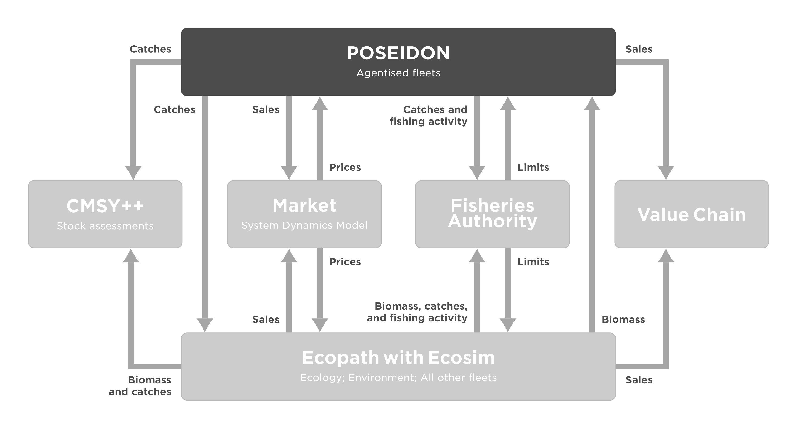
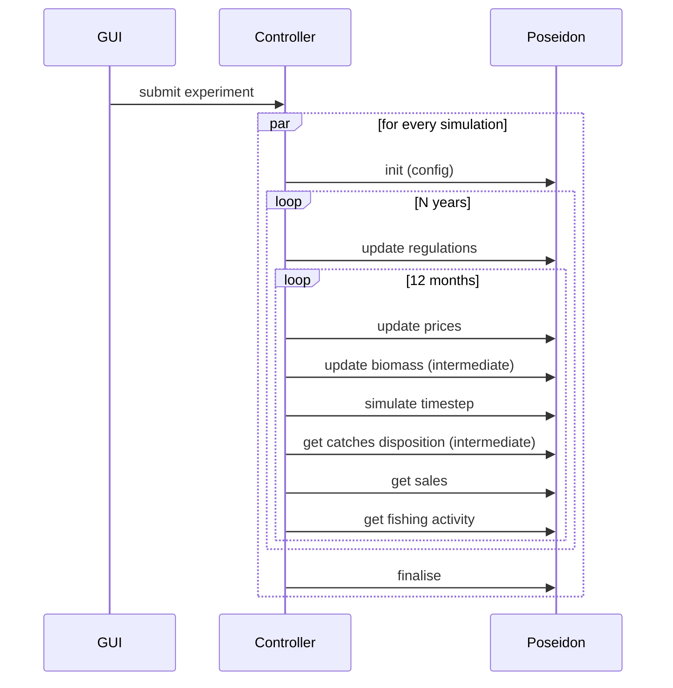

# D3.3 – Agent-based model

## DOCUMENT INFORMATION

| Grant Agreement     | 101157456 |
| ------------------- | --------- |
| Project Acronym     | SURIMI |
| Project Title       | Integration of innovative and reliable socio-ecological models and user-driven solutions into the Digital Twin Ocean, to facilitate what-if scenarios and decision support, under a co-creation approach. |
| Deliverable Number  | D3.3 |
| Work Package Number | WP3 |
| Deliverable Title   | Agent-based model |
| Lead Partner        | UOXF |
| Author(s)           | Nicolas Payette |
| Due Date            | 31 October 2026 |
| Submission Date     | |
| Dissemination Level | Public |
| Type of Deliverable | Other |

| Version   | Summary of Changes |
| --------- | ------------------ |
| Version 0 | Initial version    |

## Summary

## 1. Model purpose

POSEIDON is the agent-based model (ABM) component of the SURIMI toolbox. Its purpose is to represent some of the fishing fleets in a particular case study as individual vessels exhibiting adaptive behaviour.

Modelling fleets as individual vessels lets the model represent how fishers respond to their circumstances, instead of assuming a fixed distribution of fishing effort. Vessels differ in their characteristics, such as size, gear and home port, are subject to the regulations that apply to them, and decide individually where to fish. In the Northwestern Mediterranean scenario, a vessel setting out on a trip either explores a fishing ground near its current one or, more often, goes to the best ground known to itself or to a few other vessels from the same port. At the end of each trip, it records how much it caught per hour of fishing at that ground. Fishing effort therefore moves as biomass, closures and regulations change, which is the kind of response that management strategy evaluation needs to capture.

POSEIDON was developed at the University of Oxford as a general platform for exploring how fishers adapt to their environment and to management. Its vessels follow simple adaptive decision rules rather than perfectly rational optimisation ([Bailey et al., 2019](https://doi.org/10.1007/s11625-018-0579-9); [Carrella et al., 2019](https://doi.org/10.1016/j.envsoft.2018.08.023)). It has since been applied to several fisheries. For the US West Coast groundfish fishery, simple adaptive rules were shown to describe fishing behaviour better than perfect rationality ([Carrella et al., 2020](https://doi.org/10.1016/j.ecolecon.2019.106449)). It was also applied to the deep-water snapper fishery of Indonesia, supported by a survey of fishers' decision-making ([Madsen et al., 2023](https://doi.org/10.1086/722725)). For the hairtail troll fishery of the Bungo Channel in Japan, it was combined with rejection sampling to deal with limited data ([Carrella et al., 2024](https://doi.org/10.3389/fmars.2024.1243954)). For the tropical tuna purse-seine fishery of the Eastern Pacific Ocean, it was used with the Inter-American Tropical Tuna Commission (IATTC) to evaluate limits on the number of fish aggregating devices (FADs) ([Payette et al., 2023](https://doi.org/10.1007/978-3-031-34920-1_8); [Vert-Pre et al., 2024](https://www.iattc.org/getattachment/34dc00b7-981d-4ada-844a-20f1a248b522/FAD-08-INF-A_POSEIDON-FAD-limit-scenario.pdf)). That model has since been adapted to the Atlantic tropical tuna fishery for the International Commission for the Conservation of Atlantic Tunas (ICCAT) ([Vert-Pre et al., 2025](https://www.iccat.int/Documents/CVSP/CV082_2025/n_5/CV082050185.pdf)).

POSEIDON grew through a series of applied projects, each with its own deadlines and requirements, and each adding the components and scenarios it needed. It was designed as a self-contained program that simulated the whole fishery, biology included. SURIMI required POSEIDON to also work as one component among several: driven step by step by the SURIMI Controller, receiving biomass from an ecosystem model and prices from a market model instead of computing them, and reporting its results in the terms and units agreed by all models. Because these requirements touched every part of the model, POSEIDON is being rebuilt from the ground up, carrying over its concepts and the lessons of its past applications. This work started in late 2024 and has continued throughout SURIMI. The new POSEIDON is a library of small, interchangeable building blocks, such as vessels, gears, behaviours, regulations, biology and markets, from which scenarios are assembled and stored as readable configuration files. A new case study therefore needs configuration and data rather than new code. POSEIDON can still run on its own, with its own biology and markets, as in the [example scenario](https://github.com/poseidon-fisheries/POSEIDON/tree/main/examples/src/main/java/uk/ac/ox/poseidon/examples/petersnapper) of a single-species snapper fishery included in the repository. The previous code remains available in the [`legacy`](https://github.com/poseidon-fisheries/POSEIDON/tree/legacy) branch of the POSEIDON repository.

In practice, the "Agent-based model" that constitutes this deliverable is composed of three distinct but highly coupled entities:

- The core POSEIDON software as a modular platform for building agent-based models of fisheries. The code for POSEIDON is hosted in the https://github.com/poseidon-fisheries/POSEIDON repository. POSEIDON is written in the Java programming language and builds upon the MASON agent-based simulation library (https://people.cs.gmu.edu/~eclab/projects/mason/).

- POSEIDON as the ABM component of SURIMI. The code for it is hosted in the https://github.com/SURIMI-Project/SURIMI-POSEIDON repository. This component handles the interoperability between the core POSEIDON and the general SURIMI framework. The bulk of it is about implementing the SURIMI protocol, but it also contains SURIMI-specific model components like total allowable catch (TAC) regulations for implementing management strategy evaluation (MSE).

- The Northwestern Mediterranean POSEIDON scenario, which is the ABM part of the case study that was built to demonstrate the capabilities of the SURIMI framework. The scenario definition and its accompanying data files are hosted in the https://github.com/SURIMI-Project/SURIMI-POSEIDON_inputs repository. POSEIDON scenario definitions are typically generated from Java code (https://github.com/SURIMI-Project/SURIMI-POSEIDON/blob/main/src/main/java/eu/project/surimi/poseidon/scenarios/northwesternmed/NorthwesternMedScenario.java) and stored as human-readable YAML configuration files (https://github.com/SURIMI-Project/SURIMI-POSEIDON_inputs/blob/master/northwestern_med.yaml).

Given the modular nature of POSEIDON, it is not possible to describe a fixed set of inputs and outputs for it: these depend entirely on which particular components are used in a specific scenario. For the purpose of this document, we will rely on the POSEIDON scenario developed for the Northwestern Mediterranean case study, which we will take as being representative of what a SURIMI-enabled POSEIDON scenario involves.

For the technical documentation of the core POSEIDON platform, we refer the reader to its JavaDoc (https://poseidon-fisheries.github.io/POSEIDON/), which details all the software components that can possibly enter into a POSEIDON scenario. The SURIMI-POSEIDON server components also have their own JavaDoc (https://surimi-project.github.io/SURIMI-POSEIDON/).

## 2. Process overview and scheduling diagrams

The data flow diagram below shows where POSEIDON sits among the SURIMI models and what information it exchanges with them. POSEIDON represents some of the case study's fleets as individual vessels. Ecopath with Ecosim (EwE) represents the ecosystem, the environment and all the other fleets. The diagram is a simplification: the models never communicate directly. Every exchange goes through the SURIMI Controller, which requests outputs from one model and passes them on as inputs to the others.

The sequence diagram below shows the order of the exchanges between the Controller and POSEIDON. An experiment submitted through the GUI can run many simulations in parallel, typically to compare management strategies in an MSE. Because POSEIDON is stochastic, repeated runs of the same scenario also quantify the uncertainty in its results. In each simulation, POSEIDON receives new regulations at the start of every year. Every month, it then receives updated prices and biomass, simulates the month, and reports its catches, sales and fishing activity. Sections 3 and 4 describe each message.

## 3. Inputs

### 3.1 POSEIDON configuration inputs

Everything that defines a POSEIDON scenario, apart from the dynamic inputs of §3.2, is read from the scenario's YAML file when [`InitialiseSimulation`](https://buf.build/surimi/surimi-protocol/docs/main:surimi.v1#surimi.v1.FisheryService.InitialiseSimulation) creates the simulation. In the Northwestern Mediterranean scenario, the YAML sets the behavioural and regulatory parameters, such as vessel speeds, departure days and times, maximum trip durations and the depths at which each gear may fish. It also points to the data files listed below, in the [`northwestern_med`](https://github.com/SURIMI-Project/SURIMI-POSEIDON_inputs/tree/master/northwestern_med) folder. A data preprocessing pipeline, written in R, produces these files from the sources listed.

The scenario represents the Spanish bottom trawlers (OTB) and purse seiners (PS) of the Northwestern Mediterranean, with every vessel in these fleets modelled individually.

| Input | Content | Source |
| --- | --- | --- |
| **Geography** | | |
| `bathymetry_grid.asc` | Depth of each cell of the model grid (1/12° resolution). | GEBCO |
| `exclusion_grid.asc` | Cells outside the modelled area. | EwE model |
| `ports.csv` | Ports where the modelled vessels are based, land and sell. | EMODnet first sales |
| **Fleets** | | |
| `fleet_register.csv` | Each vessel's characteristics (length, gear, home port, etc.) and the history of its registration, which determines when it is active. | EU Fleet Register |
| `operating_costs.csv` | Hourly and daily operating costs by country, year, vessel length class and gear. | STECF Annual Economic Report |
| **Species** | | |
| `species.csv` | Species and life stages modelled. | FAO ASFIS, EwE model |
| `discard_ratios.csv` | Fraction of the catch discarded, by species, life stage and gear. | EwE model |
| **Regulations** | | |
| `mpa_grids.nc`, `mpa_months.csv`, `mpa_fleet_restrictions.csv` | Marine protected areas, the months in which they are closed and the fleets they apply to. | EwE model |
| `port_closures.csv` | Temporary cessations of activity, by port and gear. | Compiled by ICM-CSIC from Spanish and Catalan regulations |
| `habitat_grids.nc` | Rock, *Posidonia oceanica* and *Cymodocea* habitats, where fishing is forbidden. | EwE model |
| `french_eez.asc` | French exclusive economic zone, where the Spanish fleets cannot fish. | Marine Regions World EEZ |
| **Calibration** (standalone runs only) | | |
| `biomass_grids.nc` | Yearly spatial distribution of each species' biomass, 2013–2024, standing in for the biomass otherwise provided by EwE. | EwE model outputs |
| `prices.csv` | Monthly first-sale prices by port, species and category, 2015–2024, standing in for the prices otherwise provided by the market model. | EMODnet first sales |
| `target_landings.csv` | Yearly landings by gear, species and life stage, to which the simulated landings are fitted. | STECF FDI, split by life stage using the EwE model |

The last three inputs serve to calibrate the model's parameters, such as the catchability of each gear for each species and the parameters governing how vessels choose where to fish. Calibration runs POSEIDON on its own, disconnected from the other SURIMI models, so these files replace the biomass and prices it would otherwise receive through [`UpdateBiomass`](https://buf.build/surimi/surimi-protocol/docs/main:surimi.v1#surimi.v1.FisheryService.UpdateBiomass) and [`UpdateSpeciesPrices`](https://buf.build/surimi/surimi-protocol/docs/main:surimi.v1#surimi.v1.FisheryService.UpdateSpeciesPrices). The calibration of the Northwestern Mediterranean scenario is still in progress.

### 3.2 Inputs received as SURIMI messages

POSEIDON receives all its dynamic inputs from the SURIMI Controller over gRPC ([`FisheryService`](https://buf.build/surimi/surimi-protocol/docs/main:surimi.v1#surimi.v1.FisheryService), proto package [`surimi.v1`](https://buf.build/surimi/surimi-protocol/docs/main:surimi.v1)). The messages below are in the order in which they occur during an experiment.

#### 3.2.1 [`InitialiseSimulation`](https://buf.build/surimi/surimi-protocol/docs/main:surimi.v1#surimi.v1.FisheryService.InitialiseSimulation)

Sent once per simulation, before anything else ([request](https://buf.build/surimi/surimi-protocol/docs/main:surimi.v1#surimi.v1.InitialiseSimulationRequest), [response](https://buf.build/surimi/surimi-protocol/docs/main:surimi.v1#surimi.v1.InitialiseSimulationResponse)). It creates a POSEIDON simulation instance from one of the scenarios bundled with the service (see §3.1). It also delivers the simulation contract ([`Simulation`](https://buf.build/surimi/surimi-protocol/docs/main:surimi.v1#surimi.v1.Simulation)), which lists the items (species, markets, fleet segments, etc.) that the models in the ensemble agree to exchange information about, and the units they use. POSEIDON may model more than the contract lists, for example extra species or fleets, but it only reports on items in the contract.

| Field | Meaning | Use in POSEIDON |
| --- | --- | --- |
| `simulation_id` | Identifies this simulation. Many simulations run in parallel in one experiment. | Key under which the simulation instance is stored. |
| `scenario_name` | Name of the scenario, e.g. `northwestern_med`. | Selects the bundled scenario to run. |
| `simulation.start_date_time` | Start of the simulation. | Overrides the scenario's start date. |
| `simulation.time_step` | Length of one step, e.g. one month (`P1M`). | Every [`SimulateStep`](https://buf.build/surimi/surimi-protocol/docs/main:surimi.v1#surimi.v1.FisheryService.SimulateStep) advances the simulation by this period. |
| `simulation.standards.measurements` | Units used in subsequent messages. | A mass unit is required. All biomass, catch, sales and quota quantities, as well as prices (per unit of mass), are exchanged in that unit. |
| `simulation.items.species`, `.markets`, `.price_categories` | Species (with life stage), markets and price categories in the contract. | Catches and sales are only reported for these. |
| `simulation.items.fleet_segments` | Fleet segments, defined by gear, vessel length class, scale, country and model. Unset fields match any value. | POSEIDON only considers the segments assigned to it, which must not overlap. Each vessel's catches and sales are reported under the segment that covers it. Vessels outside all segments are not reported. |
| `simulation.geography` | Region, resolution and raster conventions. | POSEIDON only checks that raster cells are referenced by their centroid. |
| `climate_scenario` | Climate scenario identifier, e.g. `RCP_4.5`. | Not used directly: POSEIDON does not model climate itself, and climate effects reach it through the biomass updates ([`UpdateBiomass`](https://buf.build/surimi/surimi-protocol/docs/main:surimi.v1#surimi.v1.FisheryService.UpdateBiomass)). |

The remaining fields (case study name, end dates, currencies and the list of climate scenarios) are not used by POSEIDON. The response only echoes the simulation ID. Requests that violate the constraints above are rejected with an error.

#### 3.2.2 [`UpdateRegulations`](https://buf.build/surimi/surimi-protocol/docs/main:surimi.v1#surimi.v1.FisheryService.UpdateRegulations)

Sent at the start of each management period, typically each year, with the total allowable catches (TACs) decided by the Fisheries Authority for that period ([request](https://buf.build/surimi/surimi-protocol/docs/main:surimi.v1#surimi.v1.UpdateRegulationsRequest), [response](https://buf.build/surimi/surimi-protocol/docs/main:surimi.v1#surimi.v1.UpdateRegulationsResponse)). TACs are currently the only kind of regulation exchanged in SURIMI.

| Field | Meaning | Use in POSEIDON |
| --- | --- | --- |
| `start_date_time`, `end_date_time` | Period the regulations apply to. | Each TAC applies to catches made during this period. |
| `regulations_summary.total_allowable_catches` | List of TACs, each for one species and one fleet segment, in the contract's mass unit. | Each TAC becomes a quota on the vessels covered by the fleet segment. TACs for fleets simulated by other models are ignored. A TAC for a species without a life stage covers all its life stages. |

POSEIDON tallies each fleet segment's catches against its quotas as the simulation runs (daily, in the Northwestern Mediterranean scenario). Everything caught counts, discards included. As soon as any one of a segment's quotas is exhausted, fishing closes for the whole segment until the end of the period, even if its other quotas are not used up. The quotas do not distinguish between areas or stocks. The resulting closures are reported back through [`GetFishingActivity`](https://buf.build/surimi/surimi-protocol/docs/main:surimi.v1#surimi.v1.FisheryService.GetFishingActivity) (§4.1.3).

#### 3.2.3 [`UpdateSpeciesPrices`](https://buf.build/surimi/surimi-protocol/docs/main:surimi.v1#surimi.v1.FisheryService.UpdateSpeciesPrices)

Sent every step, before the step is simulated, with prices computed by the market model ([request](https://buf.build/surimi/surimi-protocol/docs/main:surimi.v1#surimi.v1.UpdateSpeciesPricesRequest), [response](https://buf.build/surimi/surimi-protocol/docs/main:surimi.v1#surimi.v1.UpdateSpeciesPricesResponse)).

| Field | Meaning | Use in POSEIDON |
| --- | --- | --- |
| `species_price_summary.species_prices` | List of prices, each for one species, price category (e.g. "Fresh - Whole") and market (a port), in a given currency per unit of the contract's mass unit. | Sets the price at which vessels sell that species and category when landing in that port. Prices for markets that are not in the scenario are ignored. A price for a species without a life stage applies to all its life stages. |

Prices stay in effect until replaced by a later update. They determine the revenue vessels get from their landings, and therefore what they report through [`GetSales`](https://buf.build/surimi/surimi-protocol/docs/main:surimi.v1#surimi.v1.FisheryService.GetSales) (§4.1.2).

#### 3.2.4 [`UpdateBiomass`](https://buf.build/surimi/surimi-protocol/docs/main:surimi.v1#surimi.v1.FisheryService.UpdateBiomass)

Sent every step, before the step is simulated, with the spatial distribution of biomass computed by Ecopath with Ecosim (EwE) ([request](https://buf.build/surimi/surimi-protocol/docs/main:surimi.v1#surimi.v1.UpdateBiomassRequest), [response](https://buf.build/surimi/surimi-protocol/docs/main:surimi.v1#surimi.v1.UpdateBiomassResponse)). This is how POSEIDON's fleets interact with the ecosystem: EwE models the ecology and the environment, including the effects of climate and of all fleets' catches, and POSEIDON's vessels fish from the biomass it provides.

| Field | Meaning | Use in POSEIDON |
| --- | --- | --- |
| `date_time` | Moment the biomass is computed for. | Must match the current simulation time. |
| `biomass_summary.biomass_grids` | One grid per species, giving the biomass in each cell (identified by the coordinates of its centre), in the contract's mass unit. | Replaces the biomass of that species in the corresponding cells of POSEIDON's grid. Species that POSEIDON does not model are ignored. |

During the step, vessels' catches deplete the biomass where they fish. The next update replaces it with EwE's new values, which take into account the catches POSEIDON reported through [`GetCatchDisposition`](https://buf.build/surimi/surimi-protocol/docs/main:surimi.v1#surimi.v1.FisheryService.GetCatchDisposition) (§4.1.1).

#### 3.2.5 Control messages

These messages carry no data for the model; they drive the life cycle of a simulation.
##### 3.2.5.1 [`SimulateStep`](https://buf.build/surimi/surimi-protocol/docs/main:surimi.v1#surimi.v1.FisheryService.SimulateStep)

Sent once per step, after the inputs for that step have been received. POSEIDON advances the simulation by one time step (as set in `InitialiseSimulation`), during which vessels take their decisions, travel, fish, land and sell their catches. The request carries the current simulation time, which must match POSEIDON's own.

##### 3.2.5.2 [`FinaliseSimulation`](https://buf.build/surimi/surimi-protocol/docs/main:surimi.v1#surimi.v1.FisheryService.FinaliseSimulation)

Sent once at the end of a simulation. POSEIDON ends the simulation and releases it.

##### 3.2.5.3 [`CancelSimulation`](https://buf.build/surimi/surimi-protocol/docs/main:surimi.v1#surimi.v1.FisheryService.CancelSimulation)

Sent if a simulation is cancelled before its end, e.g. when the user aborts the experiment. POSEIDON discards the simulation without finalising it.

##### 3.2.5.4 [`GetProtocolVersion`](https://buf.build/surimi/surimi-protocol/docs/main:surimi.v1#surimi.v1.FisheryService.GetProtocolVersion)

Can be sent at any time, independently of any simulation. POSEIDON returns the version of the SURIMI protocol it implements, so the Controller can check that the two are compatible.

## 4. Outputs

### 4.1 Outputs provided as SURIMI messages

POSEIDON's outputs are requested by the Controller after each step and forwarded to the other models. Each request specifies a time period, normally the step just simulated, and POSEIDON reports on what happened during that period. All quantities are in the contract's mass unit, and, as explained in §3.2.1, only items in the contract are reported.

#### 4.1.1 [`GetCatchDisposition`](https://buf.build/surimi/surimi-protocol/docs/main:surimi.v1#surimi.v1.FisheryService.GetCatchDisposition)

Reports the catches of POSEIDON's fleets ([request](https://buf.build/surimi/surimi-protocol/docs/main:surimi.v1#surimi.v1.GetCatchDispositionRequest), [response](https://buf.build/surimi/surimi-protocol/docs/main:surimi.v1#surimi.v1.GetCatchDispositionResponse)). The catches are used by EwE to update the biomass. CMSY++ and the Fisheries Authority receive them as part of EwE's total catches, which cover all fleets.

| Field | Meaning |
| --- | --- |
| `catch_disposition_summary.disposition_grids` | One grid per fleet segment and species, giving, for each location where fish were caught, the gross catch (everything caught) and how much of it was discarded alive and dead. Landings are the gross catch minus the discards. |

#### 4.1.2 [`GetSales`](https://buf.build/surimi/surimi-protocol/docs/main:surimi.v1#surimi.v1.FisheryService.GetSales)

Reports the sales of POSEIDON's fleets ([request](https://buf.build/surimi/surimi-protocol/docs/main:surimi.v1#surimi.v1.GetSalesRequest), [response](https://buf.build/surimi/surimi-protocol/docs/main:surimi.v1#surimi.v1.GetSalesResponse)). The sales are used by the market model to compute prices (§3.2.3) and by the value chain model.

| Field | Meaning |
| --- | --- |
| `sales_summary.market_sales` | Sales grouped by market (port) and currency. Each sale gives, for one fleet segment, species and price category, the quantity sold and its value. |

#### 4.1.3 [`GetFishingActivity`](https://buf.build/surimi/surimi-protocol/docs/main:surimi.v1#surimi.v1.FisheryService.GetFishingActivity)

Reports how much fishing the regulations allowed ([request](https://buf.build/surimi/surimi-protocol/docs/main:surimi.v1#surimi.v1.GetFishingActivityRequest), [response](https://buf.build/surimi/surimi-protocol/docs/main:surimi.v1#surimi.v1.GetFishingActivityResponse)). It is not passed on to other models: the Controller aggregates it across the simulations of an experiment and includes it in the experiment's outputs.

| Field | Meaning |
| --- | --- |
| `fishing_activity_summary.fishing_activities` | For each fleet segment with TACs that apply to POSEIDON's fleets during the period (§3.2.2), the fraction of the period during which it was allowed to fish: 1 if its fishery stayed open throughout, 0 if it was closed throughout. |

This is the fraction of time fishing was permitted, not a measure of the fishing effort actually exerted.

### 4.2 Other potential POSEIDON outputs

The outputs of §4.1 are a deliberately narrow subset of what POSEIDON simulates: they are what the other SURIMI models need. Because every vessel is modelled individually, POSEIDON also keeps track of each vessel's trips, where and for how long it fished, what it caught, landed and sold, and what its trips cost. From these, many more outputs could be derived, for example:

- maps of fishing effort, by fleet segment or by vessel;
- revenues, costs and profits, by vessel, port or fleet segment;
- the number of active vessels and trips over time;
- how vessels redistribute their effort in response to closures and quotas.

When the model runs on its own, POSEIDON's visual interface already shows vessels moving across the map, together with the biomass and the areas closed by regulations. The other outputs listed above would still need to be added, either as files written during standalone runs or as new messages in the SURIMI protocol.
