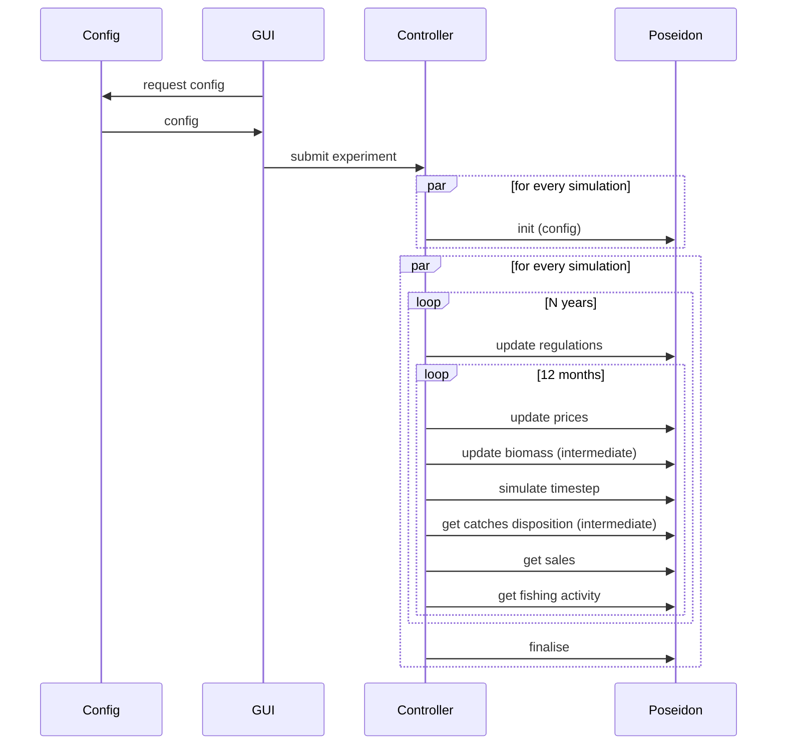

# D3.3 – Agent-based model

## DOCUMENT INFORMATION

| Grant Agreement     | 101157456 |
| ------------------- | --------- |
| Project Acronym     | SURIMI |
| Project Title       | Integration of innovative and reliable socio-ecological models and user-driven solutions into the Digital Twin Ocean, to facilitate what-if scenarios and decision support, under a co-creation approach. |
| Deliverable Number  | D3.3 |
| Work Package Number | WP3 |
| Deliverable Title   | Agent-based model |
| Lead Partner        | UOXF |
| Author(s)           | Nicolas Payette |
| Due Date            | 31 October 2026 |
| Submission Date     | |
| Dissemination Level | Public |
| Type of Deliverable | Other |

| Version   | Summary of Changes |
| --------- | ------------------ |
| Version 0 | Initial version    |

## Summary

## 1. Model purpose

## 2. Process overview and scheduling diagrams

## 3. Inputs

## 4. Outputs
