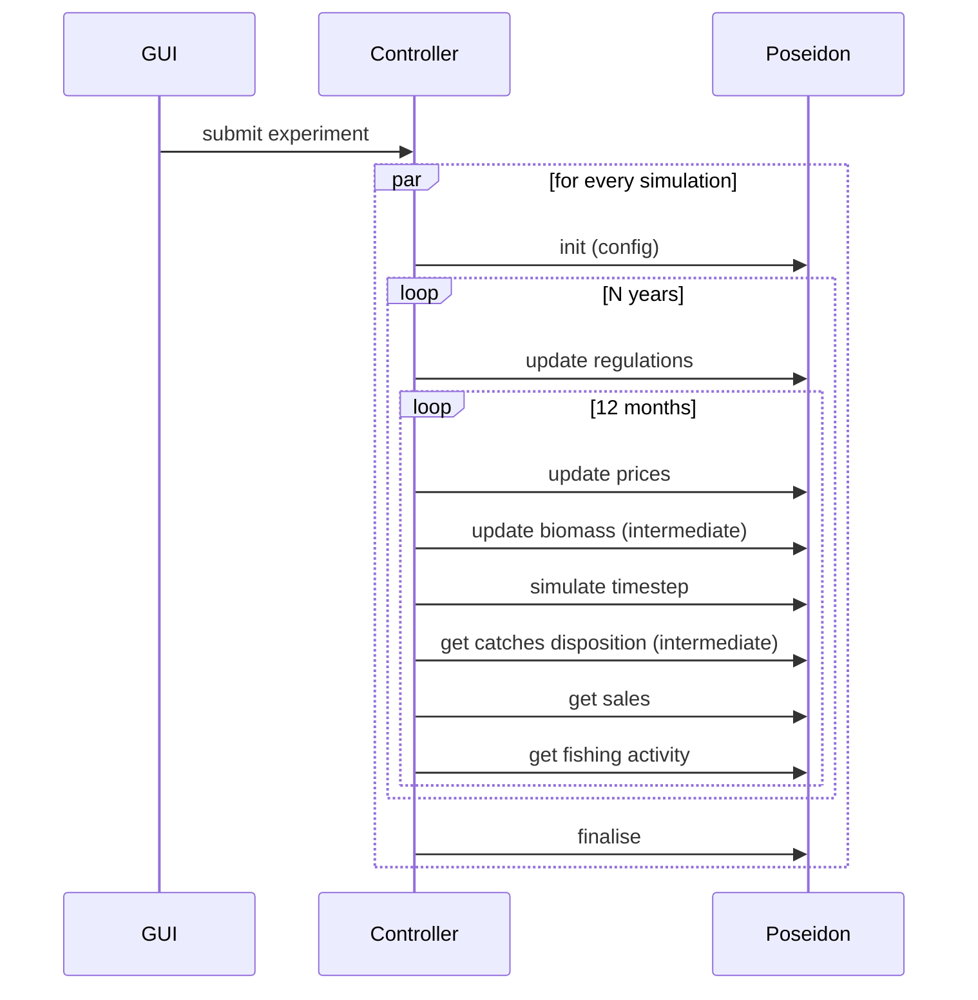

# D3.3 – Agent-based model

## DOCUMENT INFORMATION

| Grant Agreement     | 101157456 |
| ------------------- | --------- |
| Project Acronym     | SURIMI |
| Project Title       | Integration of innovative and reliable socio-ecological models and user-driven solutions into the Digital Twin Ocean, to facilitate what-if scenarios and decision support, under a co-creation approach. |
| Deliverable Number  | D3.3 |
| Work Package Number | WP3 |
| Deliverable Title   | Agent-based model |
| Lead Partner        | UOXF |
| Author(s)           | Nicolas Payette |
| Due Date            | 31 October 2026 |
| Submission Date     | |
| Dissemination Level | Public |
| Type of Deliverable | Other |

| Version   | Summary of Changes |
| --------- | ------------------ |
| Version 0 | Initial version    |

## Summary

## 1. Model purpose

POSEIDON is the agent-based component of the SURIMI toolbox. Its purpose is to represent some of the fishing fleets in particular case study as individual vessels exhibiting adaptive behaviour.

historical note

POSEIDON as a platform vs. case study/scenario distinction

Distinction between POSEIDON as a SURIMI component (the SURIMI-POSEIDON repo) and POSEIDON itself.

The Northwestern Mediteranean case study as an example

JavaDoc:

https://surimi-project.github.io/SURIMI-POSEIDON/
https://poseidon-fisheries.github.io/POSEIDON/

## 2. Process overview and scheduling diagrams

## 3. Inputs

### 3.1 POSEIDON configuration inputs

### 3.2 Inputs received as SURIMI messages

POSEIDON receives all its dynamic inputs from the SURIMI Controller over gRPC ([`FisheryService`](https://buf.build/surimi/surimi-protocol/docs/main:surimi.v1#surimi.v1.FisheryService), proto package [`surimi.v1`](https://buf.build/surimi/surimi-protocol/docs/main:surimi.v1)). The messages below are in the order in which they occur during an experiment.

#### 3.2.1 [`InitialiseSimulation`](https://buf.build/surimi/surimi-protocol/docs/main:surimi.v1#surimi.v1.FisheryService.InitialiseSimulation)

Sent once per simulation, before anything else ([request](https://buf.build/surimi/surimi-protocol/docs/main:surimi.v1#surimi.v1.InitialiseSimulationRequest), [response](https://buf.build/surimi/surimi-protocol/docs/main:surimi.v1#surimi.v1.InitialiseSimulationResponse)). It creates a POSEIDON simulation instance from one of the scenarios bundled with the service (see §3.1). It also delivers the simulation contract ([`Simulation`](https://buf.build/surimi/surimi-protocol/docs/main:surimi.v1#surimi.v1.Simulation)), which lists the items (species, markets, fleet segments, etc.) that the models in the ensemble agree to exchange information about, and the units they use. POSEIDON may model more than the contract lists, for example extra species or fleets, but it only reports on items in the contract.

| Field | Meaning | Use in POSEIDON |
| --- | --- | --- |
| `simulation_id` | Identifies this simulation. Many simulations run in parallel in one experiment. | Key under which the simulation instance is stored. |
| `scenario_name` | Name of the scenario, e.g. `northwestern_med`. | Selects the bundled scenario to run. |
| `simulation.start_date_time` | Start of the simulation. | Overrides the scenario's start date. |
| `simulation.time_step` | Length of one step, e.g. one month (`P1M`). | Every [`SimulateStep`](https://buf.build/surimi/surimi-protocol/docs/main:surimi.v1#surimi.v1.FisheryService.SimulateStep) advances the simulation by this period. |
| `simulation.standards.measurements` | Units used in subsequent messages. | A mass unit is required. All biomass, catch, sales and quota quantities, as well as prices (per unit of mass), are exchanged in that unit. |
| `simulation.items.species`, `.markets`, `.price_categories` | Species (with life stage), markets and price categories in the contract. | Catches and sales are only reported for these. |
| `simulation.items.fleet_segments` | Fleet segments, defined by gear, vessel length class, scale, country and model. Unset fields match any value. | POSEIDON only considers the segments assigned to it, which must not overlap. Each vessel's catches and sales are reported under the segment that covers it. Vessels outside all segments are not reported. |
| `simulation.geography` | Region, resolution and raster conventions. | POSEIDON only checks that raster cells are referenced by their centroid. |
| `climate_scenario` | Climate scenario identifier, e.g. `RCP_4.5`. | Not used directly: POSEIDON does not model climate itself, and climate effects reach it through the biomass updates ([`UpdateBiomass`](https://buf.build/surimi/surimi-protocol/docs/main:surimi.v1#surimi.v1.FisheryService.UpdateBiomass)). |

The remaining fields (case study name, end dates, currencies and the list of climate scenarios) are not used by POSEIDON. The response only echoes the simulation ID. Requests that violate the constraints above are rejected with an error.

#### 3.2.2 [`UpdateRegulations`](https://buf.build/surimi/surimi-protocol/docs/main:surimi.v1#surimi.v1.FisheryService.UpdateRegulations)

#### 3.2.3 [`UpdateSpeciesPrices`](https://buf.build/surimi/surimi-protocol/docs/main:surimi.v1#surimi.v1.FisheryService.UpdateSpeciesPrices)

#### 3.2.4 [`UpdateBiomass`](https://buf.build/surimi/surimi-protocol/docs/main:surimi.v1#surimi.v1.FisheryService.UpdateBiomass)

#### 3.2.5 Control messages

##### 3.2.5.1 [`SimulateStep`](https://buf.build/surimi/surimi-protocol/docs/main:surimi.v1#surimi.v1.FisheryService.SimulateStep)

##### 3.2.5.2 [`FinaliseSimulation`](https://buf.build/surimi/surimi-protocol/docs/main:surimi.v1#surimi.v1.FisheryService.FinaliseSimulation)

##### 3.2.5.3 [`CancelSimulation`](https://buf.build/surimi/surimi-protocol/docs/main:surimi.v1#surimi.v1.FisheryService.CancelSimulation)

##### 3.2.5.4 [`GetProtocolVersion`](https://buf.build/surimi/surimi-protocol/docs/main:surimi.v1#surimi.v1.FisheryService.GetProtocolVersion)

## 4. Outputs

### 4.1 Outputs provided as SURIMI messages

#### 4.1.1 [`GetCatchDisposition`](https://buf.build/surimi/surimi-protocol/docs/main:surimi.v1#surimi.v1.FisheryService.GetCatchDisposition)

#### 4.1.2 [`GetSales`](https://buf.build/surimi/surimi-protocol/docs/main:surimi.v1#surimi.v1.FisheryService.GetSales)

#### 4.1.3 [`GetFishingActivity`](https://buf.build/surimi/surimi-protocol/docs/main:surimi.v1#surimi.v1.FisheryService.GetFishingActivity)

### 4.2 Other potential POSEIDON outputs
