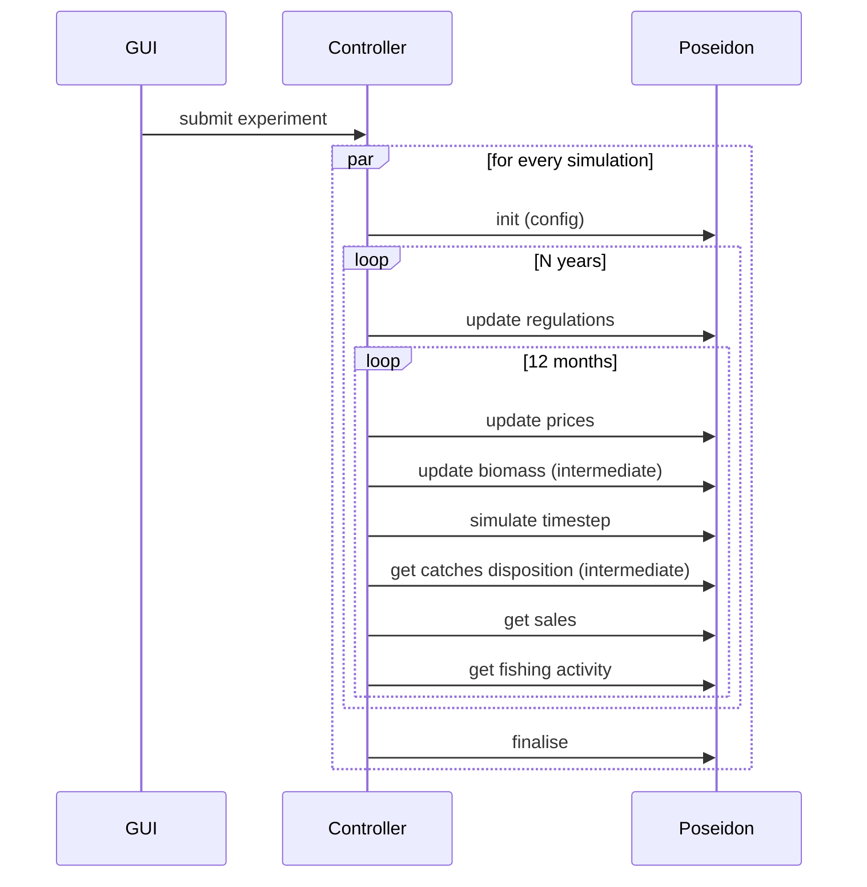

# D3.3 – Agent-based model

## DOCUMENT INFORMATION

| Grant Agreement     | 101157456 |
| ------------------- | --------- |
| Project Acronym     | SURIMI |
| Project Title       | Integration of innovative and reliable socio-ecological models and user-driven solutions into the Digital Twin Ocean, to facilitate what-if scenarios and decision support, under a co-creation approach. |
| Deliverable Number  | D3.3 |
| Work Package Number | WP3 |
| Deliverable Title   | Agent-based model |
| Lead Partner        | UOXF |
| Author(s)           | Nicolas Payette |
| Due Date            | 31 October 2026 |
| Submission Date     | |
| Dissemination Level | Public |
| Type of Deliverable | Other |

| Version   | Summary of Changes |
| --------- | ------------------ |
| Version 0 | Initial version    |

## Summary

## 1. Model purpose

POSEIDON is the agent-based component of the SURIMI toolbox. Its purpose is to represent some of the fishing fleets in particular case study as individual vessels exhibiting adaptive behaviour.

historical note

POSEIDON as a platform vs. case study/scenario distinction

Distinction between POSEIDON as a SURIMI component (the SURIMI-POSEIDON repo) and POSEIDON itself.

The Northwestern Mediteranean case study as an example

JavaDoc:

https://surimi-project.github.io/SURIMI-POSEIDON/
https://poseidon-fisheries.github.io/POSEIDON/

## 2. Process overview and scheduling diagrams

## 3. Inputs

### 3.1 POSEIDON configuration inputs

### 3.2 Inputs received as SURIMI messages

POSEIDON receives all its dynamic inputs from the SURIMI Controller over gRPC ([`FisheryService`](https://buf.build/surimi/surimi-protocol/docs/main:surimi.v1#surimi.v1.FisheryService), proto package [`surimi.v1`](https://buf.build/surimi/surimi-protocol/docs/main:surimi.v1)). The messages below are in the order in which they occur during an experiment.

#### 3.2.1 [`InitialiseSimulation`](https://buf.build/surimi/surimi-protocol/docs/main:surimi.v1#surimi.v1.FisheryService.InitialiseSimulation)

Sent once per simulation, before anything else ([request](https://buf.build/surimi/surimi-protocol/docs/main:surimi.v1#surimi.v1.InitialiseSimulationRequest), [response](https://buf.build/surimi/surimi-protocol/docs/main:surimi.v1#surimi.v1.InitialiseSimulationResponse)). It creates a POSEIDON simulation instance from one of the scenarios bundled with the service (see §3.1). It also delivers the simulation contract ([`Simulation`](https://buf.build/surimi/surimi-protocol/docs/main:surimi.v1#surimi.v1.Simulation)), which lists the items (species, markets, fleet segments, etc.) that the models in the ensemble agree to exchange information about, and the units they use. POSEIDON may model more than the contract lists, for example extra species or fleets, but it only reports on items in the contract.

| Field | Meaning | Use in POSEIDON |
| --- | --- | --- |
| `simulation_id` | Identifies this simulation. Many simulations run in parallel in one experiment. | Key under which the simulation instance is stored. |
| `scenario_name` | Name of the scenario, e.g. `northwestern_med`. | Selects the bundled scenario to run. |
| `simulation.start_date_time` | Start of the simulation. | Overrides the scenario's start date. |
| `simulation.time_step` | Length of one step, e.g. one month (`P1M`). | Every [`SimulateStep`](https://buf.build/surimi/surimi-protocol/docs/main:surimi.v1#surimi.v1.FisheryService.SimulateStep) advances the simulation by this period. |
| `simulation.standards.measurements` | Units used in subsequent messages. | A mass unit is required. All biomass, catch, sales and quota quantities, as well as prices (per unit of mass), are exchanged in that unit. |
| `simulation.items.species`, `.markets`, `.price_categories` | Species (with life stage), markets and price categories in the contract. | Catches and sales are only reported for these. |
| `simulation.items.fleet_segments` | Fleet segments, defined by gear, vessel length class, scale, country and model. Unset fields match any value. | POSEIDON only considers the segments assigned to it, which must not overlap. Each vessel's catches and sales are reported under the segment that covers it. Vessels outside all segments are not reported. |
| `simulation.geography` | Region, resolution and raster conventions. | POSEIDON only checks that raster cells are referenced by their centroid. |
| `climate_scenario` | Climate scenario identifier, e.g. `RCP_4.5`. | Not used directly: POSEIDON does not model climate itself, and climate effects reach it through the biomass updates ([`UpdateBiomass`](https://buf.build/surimi/surimi-protocol/docs/main:surimi.v1#surimi.v1.FisheryService.UpdateBiomass)). |

The remaining fields (case study name, end dates, currencies and the list of climate scenarios) are not used by POSEIDON. The response only echoes the simulation ID. Requests that violate the constraints above are rejected with an error.

#### 3.2.2 [`UpdateRegulations`](https://buf.build/surimi/surimi-protocol/docs/main:surimi.v1#surimi.v1.FisheryService.UpdateRegulations)

Sent at the start of each management period, typically each year, with the total allowable catches (TACs) decided by the Fisheries Authority for that period ([request](https://buf.build/surimi/surimi-protocol/docs/main:surimi.v1#surimi.v1.UpdateRegulationsRequest), [response](https://buf.build/surimi/surimi-protocol/docs/main:surimi.v1#surimi.v1.UpdateRegulationsResponse)). TACs are currently the only kind of regulation exchanged in SURIMI.

| Field | Meaning | Use in POSEIDON |
| --- | --- | --- |
| `start_date_time`, `end_date_time` | Period the regulations apply to. | Each TAC applies to catches made during this period. |
| `regulations_summary.total_allowable_catches` | List of TACs, each for one species and one fleet segment, in the contract's mass unit. | Each TAC becomes a quota on the vessels covered by the fleet segment. A TAC for a species without a life stage covers all its life stages. |

POSEIDON tallies each fleet segment's catches against its quotas as the simulation runs (daily, in the Northwestern Mediterranean scenario). Everything caught counts, discards included. As soon as any one of a segment's quotas is exhausted, fishing closes for the whole segment until the end of the period, even if its other quotas are not used up. The quotas do not distinguish between areas or stocks. The resulting closures are reported back through [`GetFishingActivity`](https://buf.build/surimi/surimi-protocol/docs/main:surimi.v1#surimi.v1.FisheryService.GetFishingActivity) (§4.1.3).

#### 3.2.3 [`UpdateSpeciesPrices`](https://buf.build/surimi/surimi-protocol/docs/main:surimi.v1#surimi.v1.FisheryService.UpdateSpeciesPrices)

Sent every step, before the step is simulated, with prices computed by the market model ([request](https://buf.build/surimi/surimi-protocol/docs/main:surimi.v1#surimi.v1.UpdateSpeciesPricesRequest), [response](https://buf.build/surimi/surimi-protocol/docs/main:surimi.v1#surimi.v1.UpdateSpeciesPricesResponse)).

| Field | Meaning | Use in POSEIDON |
| --- | --- | --- |
| `species_price_summary.species_prices` | List of prices, each for one species, price category (e.g. "Fresh - Whole") and market (a port), in a given currency per unit of the contract's mass unit. | Sets the price at which vessels sell that species and category when landing in that port. Prices for markets that are not in the scenario are ignored. A price for a species without a life stage applies to all its life stages. |

Prices stay in effect until replaced by a later update. They determine the revenue vessels get from their landings, and therefore what they report through [`GetSales`](https://buf.build/surimi/surimi-protocol/docs/main:surimi.v1#surimi.v1.FisheryService.GetSales) (§4.1.2).

#### 3.2.4 [`UpdateBiomass`](https://buf.build/surimi/surimi-protocol/docs/main:surimi.v1#surimi.v1.FisheryService.UpdateBiomass)

Sent every step, before the step is simulated, with the spatial distribution of biomass computed by Ecopath with Ecosim (EwE) ([request](https://buf.build/surimi/surimi-protocol/docs/main:surimi.v1#surimi.v1.UpdateBiomassRequest), [response](https://buf.build/surimi/surimi-protocol/docs/main:surimi.v1#surimi.v1.UpdateBiomassResponse)). This is how POSEIDON's fleets interact with the ecosystem: EwE models the ecology and the environment, including the effects of climate and of all fleets' catches, and POSEIDON's vessels fish from the biomass it provides.

| Field | Meaning | Use in POSEIDON |
| --- | --- | --- |
| `date_time` | Moment the biomass is computed for. | Must match the current simulation time. |
| `biomass_summary.biomass_grids` | One grid per species, giving the biomass in each cell (identified by the coordinates of its centre), in the contract's mass unit. | Replaces the biomass of that species in the corresponding cells of POSEIDON's grid. Species that POSEIDON does not model are ignored. |

During the step, vessels' catches deplete the biomass where they fish. The next update replaces it with EwE's new values, which take into account the catches POSEIDON reported through [`GetCatchDisposition`](https://buf.build/surimi/surimi-protocol/docs/main:surimi.v1#surimi.v1.FisheryService.GetCatchDisposition) (§4.1.1).

#### 3.2.5 Control messages

These messages carry no data for the model; they drive the life cycle of a simulation.
##### 3.2.5.1 [`SimulateStep`](https://buf.build/surimi/surimi-protocol/docs/main:surimi.v1#surimi.v1.FisheryService.SimulateStep)

Sent once per step, after the inputs for that step have been received. POSEIDON advances the simulation by one time step (as set in `InitialiseSimulation`), during which vessels take their decisions, travel, fish, land and sell their catches. The request carries the current simulation time, which must match POSEIDON's own.

##### 3.2.5.2 [`FinaliseSimulation`](https://buf.build/surimi/surimi-protocol/docs/main:surimi.v1#surimi.v1.FisheryService.FinaliseSimulation)

Sent once at the end of a simulation. POSEIDON ends the simulation and releases it.

##### 3.2.5.3 [`CancelSimulation`](https://buf.build/surimi/surimi-protocol/docs/main:surimi.v1#surimi.v1.FisheryService.CancelSimulation)

Sent if a simulation is cancelled before its end, e.g. when the user aborts the experiment. POSEIDON discards the simulation without finalising it.

##### 3.2.5.4 [`GetProtocolVersion`](https://buf.build/surimi/surimi-protocol/docs/main:surimi.v1#surimi.v1.FisheryService.GetProtocolVersion)

Can be sent at any time, independently of any simulation. POSEIDON returns the version of the SURIMI protocol it implements, so the Controller can check that the two are compatible.

## 4. Outputs

### 4.1 Outputs provided as SURIMI messages

#### 4.1.1 [`GetCatchDisposition`](https://buf.build/surimi/surimi-protocol/docs/main:surimi.v1#surimi.v1.FisheryService.GetCatchDisposition)

#### 4.1.2 [`GetSales`](https://buf.build/surimi/surimi-protocol/docs/main:surimi.v1#surimi.v1.FisheryService.GetSales)

#### 4.1.3 [`GetFishingActivity`](https://buf.build/surimi/surimi-protocol/docs/main:surimi.v1#surimi.v1.FisheryService.GetFishingActivity)

### 4.2 Other potential POSEIDON outputs
