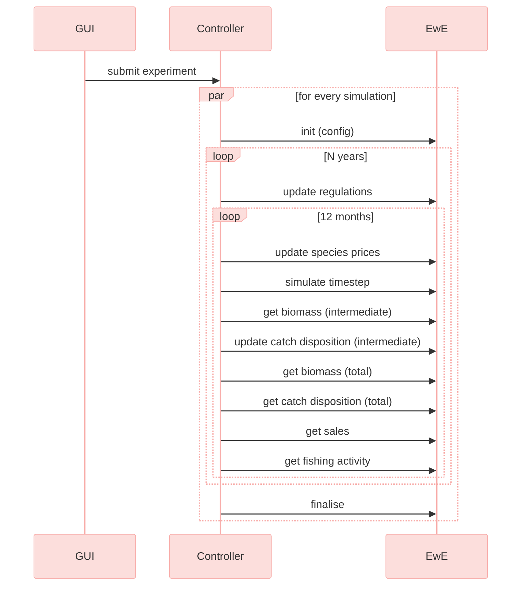

# D3.5 – EwE model

## DOCUMENT INFORMATION

| Grant Agreement     | 101157456 |
| ------------------- | --------- |
| Project Acronym     | SURIMI |
| Project Title       | Integration of innovative and reliable socio-ecological models and user-driven solutions into the Digital Twin Ocean, to facilitate what-if scenarios and decision support, under a co-creation approach. |
| Deliverable Number  | D3.5 |
| Work Package Number | WP3 |
| Deliverable Title   | EwE model |
| Lead Partner        | EII |
| Author(s)           | Jeroen Steenbeek, Rik Kreeftenberg, Villy Christensen (EII) |
| Due Date            | 31 October 2026 |
| Submission Date     | |
| Dissemination Level | Public |
| Type of Deliverable | Other |


| Version   | Summary of Changes |
| --------- | ------------------ |
| Version 0 | Initial version    |
| Version 1 | Addition of figures|

## Summary

| Entry | Detail |
| --- | --- |
| Programming language | C# .NET 10 (SURIMI service); Visual Basic .NET (EwE computational core) |
| GitHub repos | https://github.com/SURIMI-Project/SURIMI-Ecopath (SURIMI service), https://github.com/Official-EwE/Eii.Ecopath (EwE computational core) |
| Licence | EUPL-1.2 |

Ecopath with Ecosim (EwE) implements the **Ecology service** of the SURIMI model ensemble. It simulates spatial-temporal food-web dynamics under the influence of fishing, fisheries management measures and climate change. An EwE controller encapsulates the EwE computational core and uses model-specific semantic mappings to translate between the species, fishing segments and markets used by SURIMI and the functional groups and fleets used by EwE. This document describes the purpose of the model (§1); its place in the SURIMI framework, its integration with the other models and the North-Western Mediterranean ecosystem model (§2); the messages through which it receives its configuration, regulations, prices and external catches (§3); and the biomass, catch, sales and fishing-activity outputs it returns (§4).

## 1. Model purpose
Marine ecosystem models help improve our understanding of the impacts of human activities, natural phenomena, and climate change on marine food webs ([Heymans et al., 2020](https://doi.org/10.3389/fmars.2020.554573); [Stow et al., 2009](https://doi.org/10.1016/j.jmarsys.2008.03.011)). Offering the most comprehensive platforms to unify ecological processes with statistical insights and data-driven approaches ([Ellis et al., 2020](https://doi.org/10.1017/S1751731120000312)), complex, mechanistic ecosystem models are increasingly applied in ecological research, management advice, policy exploration, and environmental impact analysis under climate change scenarios ([Borja et al., 2020](https://doi.org/10.3389/fmars.2020.00362); [Fulton et al., 2015](https://doi.org/10.1016/j.envsci.2014.12.006); [Kytinou et al., 2020](https://doi.org/10.3389/fmars.2020.00636); [Link et al., 2011](https://doi.org/10.1111/j.1467-2979.2011.00411.x); [Peck et al., 2018](https://doi.org/10.1016/j.ecss.2016.05.019); [Serpetti et al., 2017](https://doi.org/10.1038/s41598-017-13220-7)). Ecosystem modelling integrates a wide range of disciplines ([Fulton, 2010](https://doi.org/10.1016/j.jmarsys.2009.12.012)), including physical oceanography, biochemistry, food-web dynamics, risk analysis, decision making, economics and the social sciences (Figure 1).

<p>
 
 
 <em>Figure 1. The range of interconnected pressures, processes and ecosystem services that complex spatial-temporal marine ecosystem models may consider. Figure credit: [Steenbeek et al. (2021)](https://www.sciencedirect.com/science/article/pii/S1364815221002516).</em>
</p>

Here, we describe how the computational core of the Ecopath with Ecosim (EwE) food-web modelling approach ([Christensen and Walters, 2004](https://doi.org/10.1016/j.ecolmodel.2003.09.003); [Heymans et al., 2016](https://doi.org/10.1016/j.ecolmodel.2015.12.007)) was integrated into the SURIMI modelling framework.

EwE is a free ecological modelling software suite built around three main components:
- Ecopath – a static, mass-balanced representation of an ecosystem;
- Ecosim – a time-dynamic simulation module; and
- Ecospace – a spatial-temporal simulation module.

Together, these components can be used to address ecological questions, evaluate ecosystem effects of fishing, explore management options, analyse the effects of environmental change, examine spatial management measures, simulate contaminants and tracers through the Ecotracer module, and support end-to-end ecosystem model development.

Within SURIMI, the integrated EwE computational core represents ecological dynamics under the influence of fishing, fisheries management measures, and climate change.

Different ecosystems can be represented by loading different EwE models and parameter sets into the computational core. Within SURIMI, these capabilities are used to represent the North-Western Mediterranean ecosystem described in this deliverable, as well as a simpler EwE model of the Aegean Sea described in Deliverable D3.4 (MICE ecosystem model).

## 2. Process overview and scheduling diagrams

The **Ecology service** in the SURIMI model ensemble is shown in the context diagram (Figure 2), including the data flows within the system and the place of the EwE model among the other models.


 <em>Figure 2. The SURIMI components involved in the North-Western Mediterranean case study, and the position of the EwE model as the implementation of the ecology service, in the SURIMI model framework.</em>

The sequence diagram (Figure 3) focusses on the communication with the SURIMI model ensemble controller and the **Ecology service**.


 <em>Figure 3. The communication flow between the SURIMI controller and the ecology service.</em>

### 2.1 Conceptual integration
The original EwE computational core was integrated into SURIMI in its entirety and did not require any changes to its computational code or internal data model. Instead, additional software was developed to translate SURIMI inputs into the terminology and level of aggregation understood by EwE, and to translate EwE model outputs back into the terminology and granularity required by SURIMI (Figure 4).


<em>Figure 4. Conceptual architecture of the EwE Ecology service within SURIMI. The SURIMI-specific EwE controller encapsulates the unchanged EwE computational core and translates control and data exchanges using model-specific semantic mappings. These mappings are derived from the EwE model and must match the modelled entities described in the SURIMI scenario contract.</em>

The main conceptual differences that needed to be reconciled were:

- **Biological entities:** SURIMI operates at the species level, whereas EwE operates on functional groups. An EwE functional group may represent an aggregation of multiple species, a single species, or a particular life stage of a species.
- **Fishing activity:** SURIMI represents fisheries through fishing-gear segments, whereas EwE provides considerably more flexibility in how fleets and fishing effort can be represented.
- **Temporal resolution:** Both SURIMI and EwE operate on monthly time steps, so no temporal aggregation or disaggregation is required.

To automate the exchange of information between SURIMI and EwE, the EwE modeller provides a semantic mapping between the entities defined in the SURIMI scenario contract and the corresponding entities within the EwE model. This mapping is model-specific and defines, for example, how SURIMI species and fishing segments relate to EwE functional groups and fleets.

Using this mapping, the **EwE controller**—the software component that encapsulates EwE within the SURIMI workflow—performs the required translations at runtime. Its responsibilities include:

- incorporating the fisheries dynamics simulated by POSEIDON (the agent-based model, Deliverable D3.3) into the EwE fleets that POSEIDON controls (or, hypothetically, any other dedicated fisheries model);
- maintaining an internal estimate of species composition within each EwE functional group and spatial cell;
- translating species-level catches generated by POSEIDON into removals from the corresponding EwE functional-group biomass;
- translating catches calculated by EwE at the functional-group level back into species-level catches, discards, and yields for reporting to the SURIMI framework; and
- translating fish prices, given per species and market, into off-vessel prices per functional group and fleet.

Because EwE does not explicitly represent individual species within an aggregated functional group, the controller maintains an approximate species composition for each spatial cell. This composition is initially based on the taxonomic proportions assigned to the corresponding EwE functional group.

When POSEIDON removes a particular species from a cell, the catch is deducted from the biomass of the corresponding EwE functional group and the local species composition is adjusted accordingly. Over subsequent monthly time steps, the composition recovers towards its baseline proportions at a rate derived from the production rate ($`P/B`$) of the functional group (Section 3.4).

This provides SURIMI with an approximate representation of species-level change while leaving the underlying EwE functional-group dynamics unchanged.

### 2.2 Ecosystem model
The Ecopath with Ecosim model used for the North-Western Mediterranean was obtained directly from the EU project FutureMARES ([Coll et al., 2024](https://digital.csic.es/handle/10261/412296)), with environmental data statistically downscaled under the same project ([Kristiansen et al., 2024](https://doi.org/10.1038/s41598-024-51160-1)).

## 3. Inputs

### 3.1 [`InitialiseSimulation`](https://buf.build/surimi/surimi-protocol/docs/main:surimi.v1#surimi.v1.EcologyService.InitialiseSimulation)

The configuration of an EwE simulation is provided through the `InitialiseSimulation` message, which also contains the SURIMI scenario contract.

When this message is received, the EwE controller:
- initialises the EwE modelling engine;
- loads the requested EwE model, including its Ecopath, Ecosim, and Ecospace components as specified by the contract;
- validates the semantic mappings supplied with the EwE model against the SURIMI contract for the loaded scenario, and configures the EwE model for semantic information exchange with the SURIMI model ensemble;
- configures Ecospace with external environmental time series requested in the contract;
- runs Ecospace for the spin-up period prescribed in the contract; and
- continues the simulation until the first SURIMI simulation year is reached, after which the EwE controller pauses and waits for further instructions.

### 3.2 [`UpdateRegulations`](https://buf.build/surimi/surimi-protocol/docs/main:surimi.v1#surimi.v1.EcologyService.UpdateRegulations)

The `UpdateRegulations` message supplies the harvest-control rules that apply during the simulation. The EwE controller interprets these rules and monitors whether Ecospace fishing fleets exceed their quota. If so, the fleet is closed for fishing by setting the Ecospace effort multiplier parameter to 0 until the start of the next year. The number of months that a fleet is closed for fishing is recorded and reported through the `GetFishingActivity` message (Section 4.5).

### 3.3 [`UpdateSpeciesPrices`](https://buf.build/surimi/surimi-protocol/docs/main:surimi.v1#surimi.v1.EcologyService.UpdateSpeciesPrices)

The `UpdateSpeciesPrices` message supplies species- and market-specific first-sale fish prices, calculated by the SURIMI market model (System dynamics model, Deliverable D3.1). The EwE controller converts these prices into Ecopath off-vessel prices per fleet and functional group, and overwrites the corresponding off-vessel prices in the EwE model.

SURIMI represents fish prices by market and species, whereas EwE represents off-vessel prices by functional group and fishing fleet. The price bridge in the EwE controller therefore translates the evolving SURIMI prices into the EwE group–fleet structure while preserving the relative differences in prices between EwE fleets.

During initialisation, each EwE fleet is first associated with a SURIMI market. For every EwE functional group landed by that fleet, the original EwE off-vessel price is registered together with the corresponding baseline landings. These baseline values are used to calculate a fleet-specific price scalar for each functional group.

For a functional group $`g`$ and fleet $`f`$, the baseline contribution is calculated as:

```math
B_{g,f} = P^{0}_{g,f} \, L^{0}_{g,f},
```

where $`P^{0}_{g,f}`$ is the original EwE off-vessel price and $`L^{0}_{g,f}`$ is the registered baseline landings value. The mean baseline contribution across the fleets associated with the group is then

```math
\bar{B}_g = \frac{\sum_f B_{g,f}}{N_g},
```

where $`N_g`$ is the number of fleets in the same SURIMI market with an off-vessel price for group $`g`$. Each fleet receives a scalar

```math
S_{g,f} = \frac{B_{g,f}}{\bar{B}_g}.
```

These scalars preserve the relative price structure of the original EwE model when externally supplied prices subsequently change.

At runtime, SURIMI prices are supplied for each market and species, and are mapped onto the corresponding EwE functional groups. Where several species, price observations, or other contributions map onto the same EwE group, they can be supplied with a proportional weight. The resulting evolving price for group $`g`$ in market $`m`$ at time step $`t`$ is calculated as the weighted mean

```math
P^{\mathrm{SURIMI}}_{g,m,t} = \frac{\sum_i P_i w_i}{\sum_i w_i},
```

where $`P_i`$ is an incoming SURIMI price and $`w_i`$ is its associated weight.

SURIMI prices may either be supplied for an entire market or separately for individual fleets. If the prices are market-wide, the same evolving market price is used as the starting point for all EwE fleets associated with that market. If fleet-specific prices are supplied, each fleet instead uses its own evolving price.

The final EwE off-vessel price for group $`g`$ and fleet $`f`$ is obtained by multiplying the evolving SURIMI price for the market $`m`$ associated with that fleet by the fleet-specific baseline scalar:

```math
P^{\mathrm{EwE}}_{g,f,t} = P^{\mathrm{SURIMI}}_{g,m,t} \, S_{g,f}.
```

The resulting value is written into the EwE off-vessel price matrix for the corresponding fleet and functional group. Thus, SURIMI determines the temporal evolution of market prices, while the original EwE model determines how those prices are distributed among fleets. After the prices have been transferred to EwE, the accumulated evolving-price values are cleared so that the next SURIMI time step is calculated independently.

### 3.4 [`UpdateCatchDisposition`](https://buf.build/surimi/surimi-protocol/docs/main:surimi.v1#surimi.v1.EcologyService.UpdateCatchDisposition)

The `UpdateCatchDisposition` message supplies species-level catches calculated by an external model in the SURIMI framework (POSEIDON, in the North-Western Mediterranean case study). These catches need to be accounted for in the fishable biomass pools over time and space.

Ecospace represents biomass at functional-group level, while the SURIMI model framework requires species-level accounting. Rather than introducing species-level population dynamics into EwE, the EwE controller maintains a cell-specific species composition for each mapped functional group. Species biomass is estimated as the Ecospace functional-group biomass multiplied by the locally maintained species proportion.

External species-specific fishing removals alter these proportions locally, after which the affected composition is normalised. Species proportions subsequently relax towards their baseline values at a rate derived from the functional group's production term (the $`P/B`$ ratio in EwE). The resulting species biomasses are therefore lightweight spatial proxies that follow the biomass dynamics calculated by EwE while retaining the species-level response required by coupled models.

The proxy mechanism is intentionally lightweight. It is intended to preserve species-level information required for model coupling, not to reproduce full species-level population dynamics. Additional processes such as species-specific growth or movement could be incorporated, but where such detail becomes important it is preferable to represent the species explicitly within the EwE functional-group structure.

## 4. Outputs

### 4.1 [`GetBiomass`](https://buf.build/surimi/surimi-protocol/docs/main:surimi.v1#surimi.v1.EcologyService.GetBiomass) (intermediate)
The `GetBiomass` message requests the spatial distribution of species biomass in the previous month.

### 4.2 [`GetBiomass`](https://buf.build/surimi/surimi-protocol/docs/main:surimi.v1#surimi.v1.EcologyService.GetBiomass) (total)
The `GetBiomass` message requests the total species biomasses, aggregated over space and over the previous year.

### 4.3 [`GetCatchDisposition`](https://buf.build/surimi/surimi-protocol/docs/main:surimi.v1#surimi.v1.EcologyService.GetCatchDisposition)
The `GetCatchDisposition` message requests the total volume of species-level catches, and dead and live discards, across space, in the previous month.

### 4.4 [`GetSales`](https://buf.build/surimi/surimi-protocol/docs/main:surimi.v1#surimi.v1.EcologyService.GetSales)
The `GetSales` message requests the total economic value of species catches for the previous month.

### 4.5 [`GetFishingActivity`](https://buf.build/surimi/surimi-protocol/docs/main:surimi.v1#surimi.v1.EcologyService.GetFishingActivity)
The `GetFishingActivity` message requests the proportion of the reporting period during which each fishing fleet was active in response to the applicable harvest-control rules.
