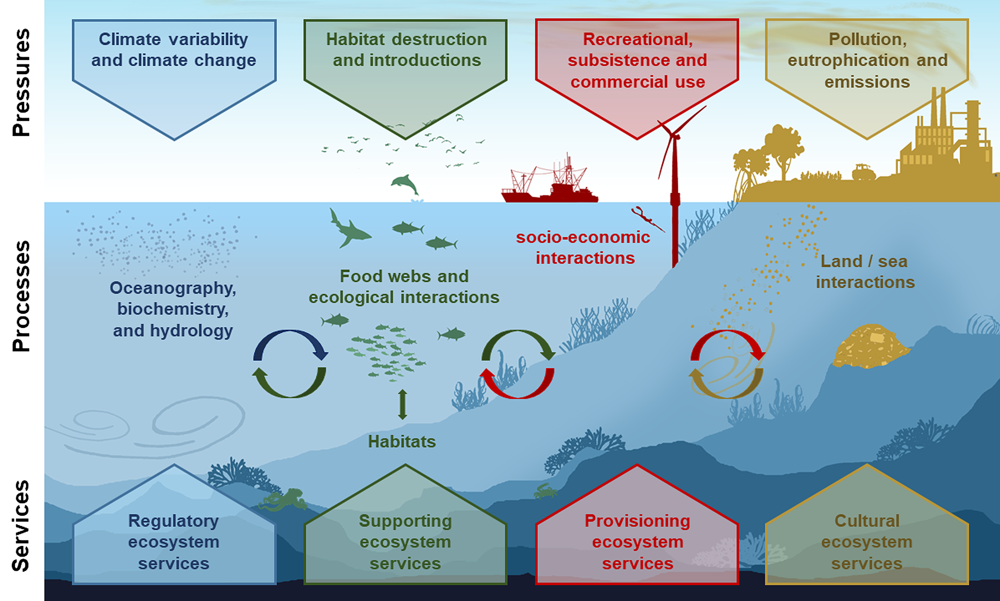
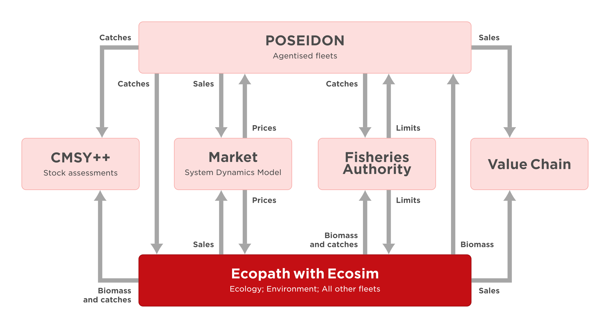
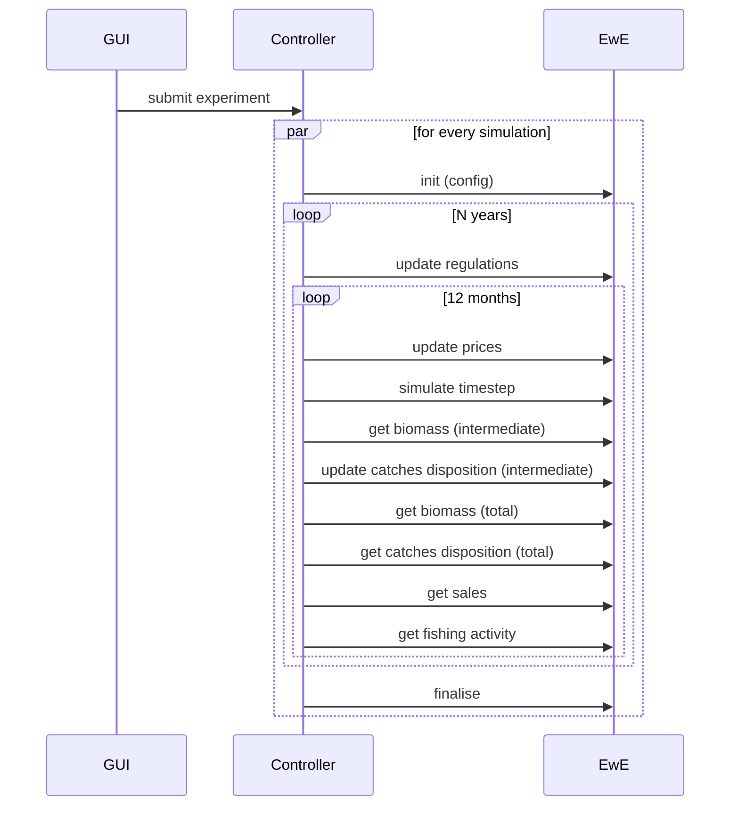
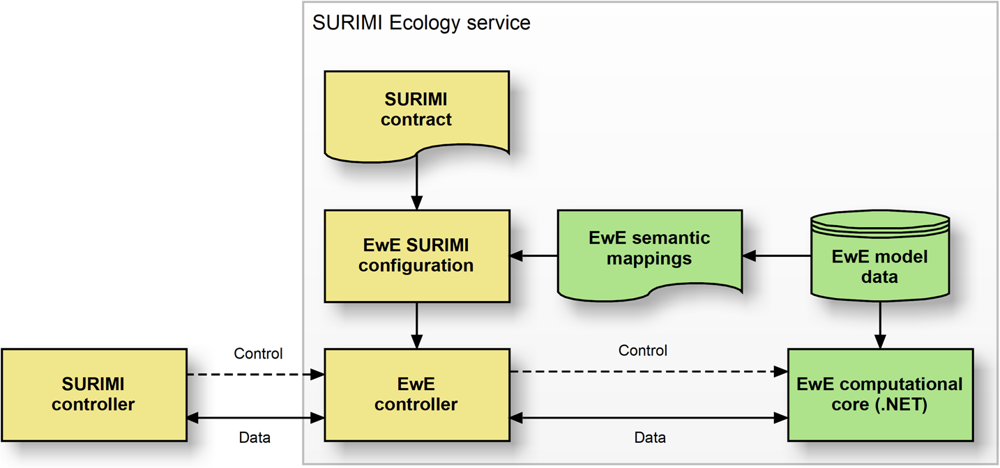

# D3.5 – EwE model

## DOCUMENT INFORMATION

| Grant Agreement     | 101157456 |
| ------------------- | --------- |
| Project Acronym     | SURIMI |
| Project Title       | Integration of innovative and reliable socio-ecological models and user-driven solutions into the Digital Twin Ocean, to facilitate what-if scenarios and decision support, under a co-creation approach. |
| Deliverable Number  | D3.5 |
| Work Package Number | WP3 |
| Deliverable Title   | EwE model |
| Lead Partner        | EII |
| Author(s)           | Jeroen Steenbeek, Rik Kreeftenberg, Villy Christensen (EII) |
| Due Date            | 31 October 2026 |
| Submission Date     | |
| Dissemination Level | Public |
| Type of Deliverable | Other |

| Version   | Summary of Changes |
| --------- | ------------------ |
| Version 0 | Initial version    |

## Summary

## 1. Model purpose
Marine ecosystem models help improve our understanding of the impacts of human activities, natural phenomena, and climate change on marine food webs ([Heymans et al., 2020](https://doi.org/10.3389/fmars.2020.554573); [Stow et al., 2009](https://doi.org/10.1016/j.jmarsys.2008.03.011)). Offering the most comprehensive platforms to unify ecological processes with statistical insights and data-driven approaches ([Ellis et al., 2020](https://dio.org/10.1017/S1751731120000312)), complex, mechanistic ecosystem models are increasingly applied in ecological research, management advice, policy exploration, and environmental impact analysis under climate change scenarios ([Borja et al., 2020](https://doi.org/10.3389/fmars.2020.00362); [Fulton et al., 2015](https://doi.org/10.1016/j.envsci.2014.12.006); [Kytinou et al., 2020](https://doi.org/10.3389/fmars.2020.00636); [Link et al., 2011](https://doi.org/10.1111/j.1467-2979.2011.00411.x); [Peck et al., 2018](https://doi.org/10.1016/j.ecss.2016.05.019); [Serpetti et al., 2017](https://doi.org/10.1038/s41598-017-13220-7)). Ecosystem modelling integrates a wide range of disciplines ([Fulton, 2010](https://doi.org/10.1016/j.jmarsys.2009.12.012)), including physical oceanography, biochemistry, food-web dynamics, risk analysis, decision making, economics and the social sciences (Figure 1).

 
 
 <em>Figure 1. The range of interconnected pressures, processes and ecosystem services that complex spatial-temporal marine ecosystem models may consider. Figure credits [Steenbeek et al. (2021)](https://www.sciencedirect.com/science/article/pii/S1364815221002516) </em>

Here, we describe how the computational core of the Ecopath with Ecosim (EwE) food web modelling approach ([Christensen and Walters 2024](https://doi.org/10.1016/j.ecolmodel.2003.09.003); [Heymans et al. 2016](https://doi.org/10.1016/j.ecolmodel.2015.12.007)) was integrated into the SURIMI modeling framework. 

EwE is a free ecological modelling software suite built around three main components:
- Ecopath – a static, mass-balanced representation of an ecosystem;
- Ecosim – a time-dynamic simulation module; and
- Ecospace – a spatial-temporal simulation module.

Together, these components can be used to address ecological questions, evaluate ecosystem effects of fishing, explore management options, analyse the effects of environmental change, examine spatial management measures, simulate contaminants and tracers through Ecotracer, and support end-to-end ecosystem model development.

Within SURIMI, the integrated EwE computational core represents ecological dynamics under the influence of fishing, fisheries management measures, and climate change.

Different ecosystems can be represented by loading different EwE models and parameter sets into the computational core. Within SURIMI, these capabilities are used to represent the north-western Mediterranean ecosystem described in this deliverable, as well as a simpler EwE model of the Aegean Sea described in SURIMI Deliverable 3.4.

## 2. Process overview and scheduling diagrams

The **Ecology service** in the SURIMI model ensemble is shown in the context diagram (Figure 2), including the data flows within the system and the place of the EwE model among the other models.

 <em>Figure 2. The SURIMI components involved in the North Western Mediterranean case study, and the position of the EwE model as the implementation of the ecology service, in SURIMI model ensemble.</em>

The sequence diagram (Figure 3) focusses on the communication with the SURIMI model ensemble controller and the **Ecology service**.

 <em>Figure 3. The communication flow between the SURIMI controller and the ecology service.</em>

### Conceptual integration ###
The original EwE computational core was integrated into SURIMI in its entirety and did not require any changes to its computational code or internal data model. Instead, additional software was developed to translate SURIMI inputs into the terminology and level of aggregation understood by EwE, and to translate EwE model outputs back into the terminology and granularity required by SURIMI (Figure 4).

<em>Figure 4. Conceptual architecture of the EwE Ecology service within SURIMI. The SURIMI-specific EwE controller encapsulates the unchanged EwE computational core and translates control and data exchanges using model-specific semantic mappings derived from the EwE model and the SURIMI scenario contract.</em>

The main conceptual differences that needed to be reconciled were:

- **Biological entities:** SURIMI operates at the species level, whereas EwE operates on functional groups. An EwE functional group may represent an aggregation of multiple species, a single species, or a particular life stage of a species.
- **Fishing activity:** SURIMI represents fisheries through fishing-gear segments, whereas EwE provides considerably more flexibility in how fleets and fishing effort can be represented.
- **Temporal resolution:** Both SURIMI and EwE operate on monthly time steps, so no temporal aggregation or disaggregation is required.

To automate the exchange of information between SURIMI and EwE, the EwE modeller provides a semantic mapping between the entities defined in the SURIMI scenario contract and the corresponding entities within the EwE model. This mapping is model-specific and defines, for example, how SURIMI species and fishing segments relate to EwE functional groups and fleets.

Using this mapping, the **EwE controller**—the software component that encapsulates EwE within the SURIMI workflow—performs the required translations at runtime. Its responsibilities include:

- incorporating POSEIDON fisheries dynamics into those EwE fleets that are controlled by POSEIDON (or hypthetically any other dedicated fisheries model);
- maintaining an internal estimate of species composition within each EwE functional group and spatial cell;
- translating species-level catches generated by POSEIDON into removals from the corresponding EwE functional-group biomass;
- translating catches calculated by EwE at the functional-group level back into species-level catches, discards, and yields for reporting to the SURIMI framework; and
- translating fish prices, given per species and per market segment, to the prices per functional group.

Because EwE does not explicitly represent individual species within an aggregated functional group, the controller maintains an approximate species composition for each spatial cell. This composition is initially based on the taxonomic proportions assigned to the corresponding EwE functional group.

When POSEIDON removes a particular species from a cell, the catch is deducted from the biomass of the corresponding EwE functional group and the local species composition is adjusted accordingly. Over subsequent monthly time steps, the composition is allowed to recover towards its default Ecopath proportions according to the growth rates assigned to the individual species.

This provides SURIMI with an approximate representation of species-level change while leaving the underlying EwE functional-group dynamics unchanged.

### Ecosystem model ###
The Ecopath with Ecosim model used for the North Western Mediterranean was directly obtained from EU project FutureMares [(Coll et al. 2024)](https://digital.csic.es/handle/10261/412296) with environmental data statistically downscaled under that same project [(Kirstiansen et al. 2024)](https://www.nature.com/articles/s41598-024-51160-1).

## 3. Inputs ##

### InitialiseSimulation message

The configuration of an EwE simulation is provided through the InitialiseSimulation message, which also contains the SURIMI scenario contract.

When this message is received, the EwE controller:
- initialises the EwE modelling engine;
- loads the requested EwE model, including its Ecopath, Ecosim, and Ecospace components as specified by the contract;
- configures Ecospace with external environmental time series requested in the contract;
- validates the semantic mappings supplied with the EwE model against the scenario contract and configures the model for SURIMI information exchange;
- runs the required Ecospace spin-up period; and
- continues the simulation until the first SURIMI simulation year is reached, after which the EwE controller pauses and waits for further instructions.

### UpdateRegulations message

The UpdateRegulations message supplies the harvest-control rules that apply during the simulation. The EwE controller interprets these rules and applies them to the relevant EwE fleets and fisheries processes.

### UpdatePrices message

The UpdatePrices message supplies species- and market-specific fish prices. The EwE controller translates these prices to the corresponding EwE functional groups and applies them relative to the Ecopath base prices.

### UpdateCatchDisposition message

The UpdateCatchDisposition message supplies species-level catches calculated by POSEIDON. These catches are translated through the semantic mapping and deducted from the biomass of the corresponding EwE functional groups in the affected spatial cells. The local species composition maintained by the EwE controller is then updated accordingly.

## 4. Outputs ##

### GetCatchDisposition message
The GetCatchDisposition message requests the total volume of species-level catches, and dead and live discards, across space, in the previous month.

### GetBiomass message (intermediate)
The GetBiomass message requests the spatial distribution of species biomass in the previous month.

### GetBiomass message (total)
The GetBiomass message requests the total species biomasses, aggregated over space and over the previous year.

### GetSales message
The GetSales message requests the total economic value of species catches for the previous month.

### GetFishingActivity message
The GetFishingActivity message requests the proportion of the reporting period during which each fishing fleet was active in response to the applicable harvest-control rules.
