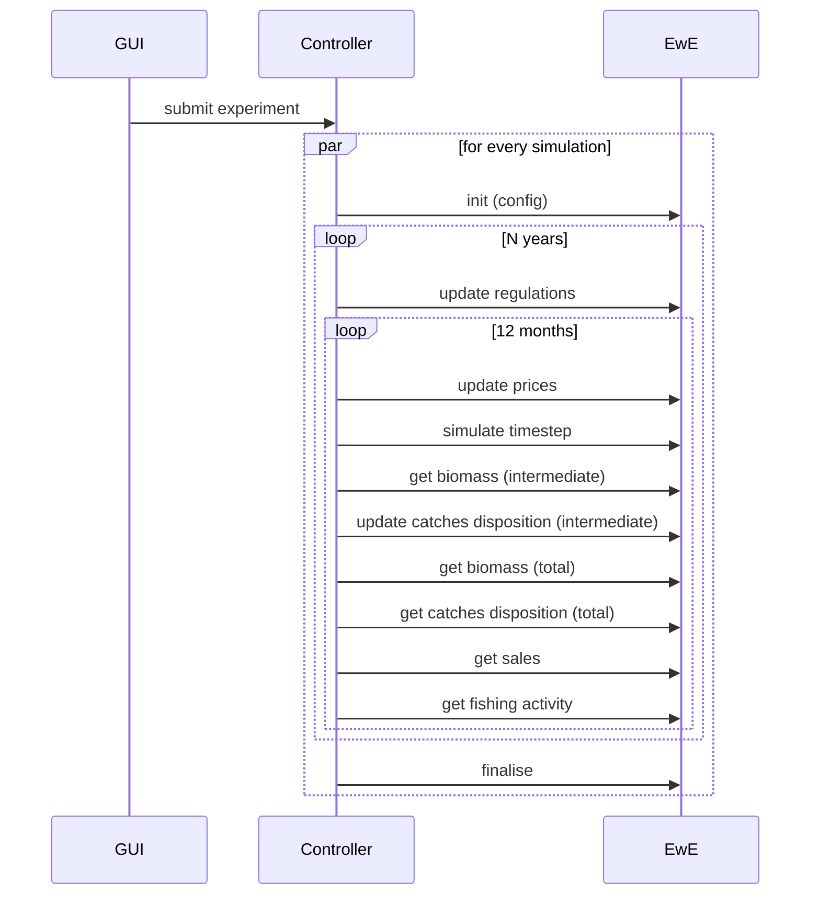

# D3.5 – EwE model

## DOCUMENT INFORMATION

| Grant Agreement     | 101157456 |
| ------------------- | --------- |
| Project Acronym     | SURIMI |
| Project Title       | Integration of innovative and reliable socio-ecological models and user-driven solutions into the Digital Twin Ocean, to facilitate what-if scenarios and decision support, under a co-creation approach. |
| Deliverable Number  | D3.5 |
| Work Package Number | WP3 |
| Deliverable Title   | EwE model |
| Lead Partner        | EII |
| Author(s)           | Jeroen Steenbeek, Rik Kreeftenberg, Villy Christensen (EII) |
| Due Date            | 31 October 2026 |
| Submission Date     | |
| Dissemination Level | Public |
| Type of Deliverable | Other |

| Version   | Summary of Changes |
| --------- | ------------------ |
| Version 0 | Initial version    |

## Summary

## 1. Model purpose
Marine ecosystem models help improve our understanding of the impacts of human activities, natural phenomena, and climate change on marine food webs (Heymans et al., 2020; Stow et al., 2009). Offering the most comprehensive platforms to unify ecological processes with statistical insights and data-driven approaches (Ellis et al., 2020), complex, mechanistic ecosystem models are increasingly applied in ecological research, management advice, policy exploration, and environmental impact analysis under climate change scenarios (Borja et al., 2020; Fulton et al., 2015; Kytinou et al., 2020; Link et al., 2011; Peck et al., 2018; Serpetti et al., 2017). Ecosystem modelling integrates a wide range of disciplines (Fulton, 2010), including physical oceanography, biochemistry, food-web dynamics, risk analysis, decision making, economics and the social sciences (Figure 1).

 
 <em>Figure 1. The range of interconnected pressures, processes and ecosystem services that complex spatial-temporal marine ecosystem models may consider</em>

Here, we describe how the computational core of the Ecopath with Ecosim (EwE) food web modelling approach was integrated into the SURIMI modeling framework. Ecopath with Ecosim (EwE) is a free ecological/ecosystem modeling software suite. EwE has three main components: Ecopath – a static, mass-balanced snapshot of the system; Ecosim – a time dynamic simulation module for policy exploration; and Ecospace – a spatial and temporal dynamic module primarily designed for exploring impact and placement of protected areas. The Ecopath software package can be used to address ecological questions, evaluate ecosystem effects of fishing, explore management policy options, analyze the impact and placement of marine protected areas, predict movement and accumulation of contaminants and tracers (Ecotracer), model effect of environmental changes, and facilitate end-to-end model construction.

In SURIMI, the integerated EwE computational core represents ecological dynamics under influence of fishing, fisheries measures, and climate change. 

By loading different EwE parameter sets into the computational core, the EwE model can represent different ecosystems. In SURIMI, these capabilities will be used to represent the North-western Mediterranean ecosystem (as described in this deliverable) and a simpler EwE model - the MICE model of the Aegean Sea (as described in SURIMI deliverable 3.4)

## 2. Process overview and scheduling diagrams

## 3. Inputs

### InitialiseSimulation message (init)
The configuration of the EwE run is passed in the InitialiseSimulation message. It also includes the scenario contract.

### UpdateRegulations message
The harvest control rules are sent to EwE

### UpdatePrices message

### UpdateCatchDisposition message
The catches of POSEIDON are 

## 4. Outputs

### GetBiomass message (intermediate)

### GetBiomass message (total)

### GetSales message

### GetFishingActivity message
