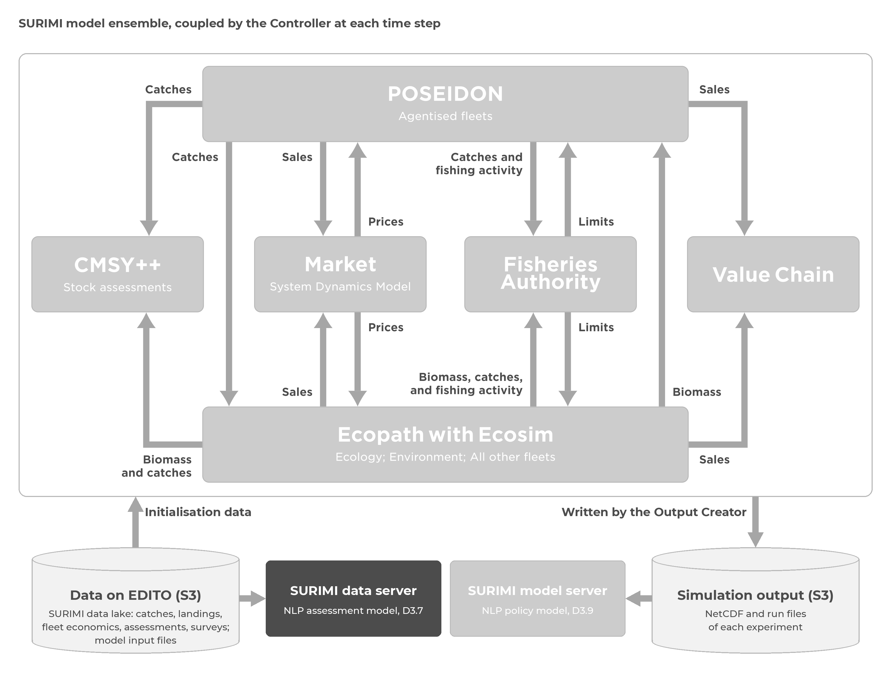
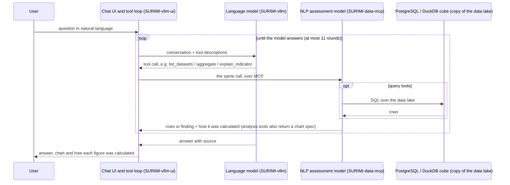
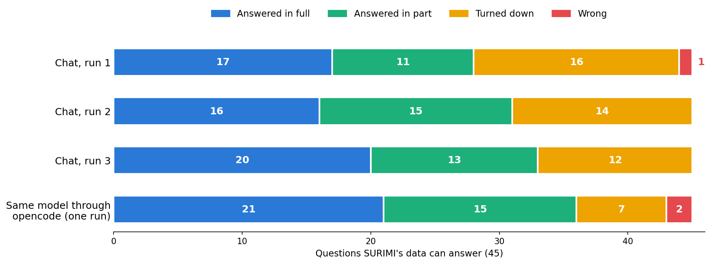

# D3.7 – NLP assessment model

## DOCUMENT INFORMATION

| Grant Agreement     | 101157456 |
| ------------------- | --------- |
| Project Acronym     | SURIMI |
| Project Title       | Integration of innovative and reliable socio-ecological models and user-driven solutions into the Digital Twin Ocean, to facilitate what-if scenarios and decision support, under a co-creation approach. |
| Deliverable Number  | D3.7 |
| Work Package Number | WP3 |
| Deliverable Title   | NLP assessment model |
| Lead Partner        | NORCE |
| Author(s) | Hasan Asyari Arief, Önder Gürcan |
| Due Date            | 31 October 2026 |
| Submission Date     | |
| Dissemination Level | Public |
| Type of Deliverable | Other |

| Version   | Summary of Changes |
| --------- | ------------------ |
| Version 0 | Initial version. |

## Summary

|      |  |
| ------------------- | --------- |
| Programming language     | Python |
| Nr of Kubernetes pods       | 2 (the server and its PostgreSQL database) |
| GitHub repo       | https://github.com/SURIMI-Project/SURIMI-data-mcp |
| Architecture       | [data_mcp_architecture.md](https://github.com/SURIMI-Project/SURIMI-data-mcp/blob/master/data_mcp_architecture.md) |
| Tools, in plain words       | [docs/tools.md](https://github.com/SURIMI-Project/SURIMI-data-mcp/blob/master/docs/tools.md) |
| Chat and language model       | [SURIMI-vllm-ui](https://github.com/SURIMI-Project/SURIMI-vllm-ui) (chat), [SURIMI-vllm](https://github.com/SURIMI-Project/SURIMI-vllm) (language model serving) |
| Licence       | EUPL-1.2 |

SURIMI-data-mcp is the natural language processing (NLP) assessment model of the SURIMI toolbox. It lets users ask questions about the SURIMI data lake in their own words, for example which data exists, what a table or an indicator means, how complete the data is, where specific data can be found and what it shows. It can also produce plots from the data.

A large language model (LLM) reads the user's question and chooses the server's tools, the chat runs them, and the tools query the data to produce the answer. The server runs on the Kubernetes platform of the European Digital Twin of the Ocean (EDITO) and is used with Muse-Glimmer-30B, an open-weight language model from Red Hat.

A second NLP model, SURIMI-model-mcp (D3.9), complements it by answering questions about the SURIMI simulation runs and about gridded ocean and climate data (Figure 1).

 <em>Figure 1. Position of the NLP assessment model (dark) within the SURIMI framework. It reads the raw data and metadata on EDITO data storage (S3) that the SURIMI models use, while the NLP policy model (D3.9) reads the NetCDF output that the SURIMI models produce.</em>

## 1. Model purpose

SURIMI-data-mcp is the NLP assessment model of SURIMI. Its purpose is to make the data behind the SURIMI models usable by people who do not work with it every day, such as fisheries managers or policy officers. It is a server that holds the data catalogue and the tools to look up, compute and explain the data, and it is the main deliverable of D3.7. Users do not talk to the server directly. They type their question in the chat (SURIMI-vllm-ui), and an LLM served by SURIMI-vllm reads the question and chooses the server's tools. The chat runs the tools and passes the results back, and the LLM writes the answer. SURIMI-data-mcp works outside the simulation loop and takes no part in a SURIMI experiment.

In the chat, users can ask which data exists on a topic and which dataset fits their needs. With the server's tools, the LLM explains what a table, indicator, code, unit or confidence interval means, where the data came from and how complete it is. The numbers themselves, whether shown as a single value, a table or a chart, are calculated by the server and not by the LLM. The `describe_data_capabilities` tool lets the LLM tell a new user what the system can and cannot answer, and the chat draws charts from the data the server returns. Neither of the two NLP models runs simulations or reads the user's own data or screen.

For example, when asked how much Spain landed in 2022, the language model first looks up which dataset holds landings data. It then calls the server's `aggregate` tool, which sums Spain's 2022 landings in the EU catch table (by country, quarter, gear and species), and replies that the total is at least 749,178 tonnes. Below the answer, the chat shows how the number was calculated: "Sum of `total_live_weight_landed` in ‘EU DCF FDI Catches by Country, Quarter, Gear and Species’, where `country` is `'Spain'` and `year` is 2022. This is a lower bound: 59956 matching rows reported no value and are left out."

A language model that answers from memory alone can give numbers that no data supports ([Ji et al., 2023](https://doi.org/10.1145/3571730)). SURIMI-data-mcp limits this because it is a server rather than a trained model, and every number the server returns is looked up in the data by one of its tools. The language model does not hold the data. The model can still misstate or invent a figure, which happened in at most one wrong and one fabricated answer per chat run (§5.3). This design builds on earlier work on tool-using language models, such as [Yao et al. (2022)](https://doi.org/10.48550/arXiv.2210.03629) and [Schick et al. (2023)](https://doi.org/10.48550/arXiv.2302.04761). Definitions are taken from the public SURIMI documentation. Because the data and the rules are kept in the server, the language model can be replaced. During development we tested the server with Muse-Glimmer-30B, Qwen3-Coder-30B and Claude Sonnet.

As explained above, the NLP assessment model is used through three closely linked parts, and only SURIMI-data-mcp is the deliverable:

- **SURIMI-data-mcp** ([SURIMI-Project/SURIMI-data-mcp](https://github.com/SURIMI-Project/SURIMI-data-mcp)), the data server and the deliverable of D3.7. It holds the catalogue of 28 datasets and offers 20 tools over the Model Context Protocol (MCP; [Anthropic, 2025](https://modelcontextprotocol.io/specification/2025-06-18)), an open standard that lets a language model call external tools.

- **SURIMI-vllm-ui** ([SURIMI-Project/SURIMI-vllm-ui](https://github.com/SURIMI-Project/SURIMI-vllm-ui)), the chat on EDITO (supporting part). It is a standard Open WebUI deployment with a SURIMI assistant ([`surimi_pipe.py`](https://github.com/SURIMI-Project/SURIMI-vllm-ui/blob/master/openwebui_functions/surimi_pipe.py)) that sends the question to the language model, runs the tools the model requests on both SURIMI servers, and shows under each answer how the numbers were calculated.

- **SURIMI-vllm** ([SURIMI-Project/SURIMI-vllm](https://github.com/SURIMI-Project/SURIMI-vllm)), the language model service (supporting part). It runs the model on the EDITO graphics processing unit (GPU) node with vLLM ([Kwon et al., 2023](https://doi.org/10.1145/3600006.3613165)).

## 2. Process overview and scheduling diagrams

The sequence diagram below shows how a question is answered. The chat sends the question to the language model along with descriptions of the server's tools. The model then either answers directly or asks for a tool call, which the chat runs on the server before passing the result back to the model. This loop continues until the model has its answer, for at most 11 rounds of tool calls by default.

### 2.1 The tools

SURIMI-data-mcp consists of 20 tools, grouped into five modules (Table 1).

*Table 1. The 20 tools of SURIMI-data-mcp, grouped by module.*

| Group | Tools | What they answer |
| --- | --- | --- |
| Discovery | `list_datasets`, `describe_table`, `list_columns`, `list_metrics`, `describe_data_capabilities`, `describe_quality` | Which datasets are available, their columns, units and quality, and which questions the server cannot answer. |
| Calculations | `aggregate`, `query_metric`, `query_data` | Totals, averages and counts, filtered and grouped as requested. |
| Analyses | `analyze_trend`, `compare_countries`, `breakdown`, `generate_report` | Trends over time, comparisons between countries, breakdowns by category, and reports. |
| Explanation | `explain_indicator`, `explain_species_code`, `explain_provenance`, `search_documents`, `describe_models`, `data_list_functional_groups` | The meaning of codes and indicators, the origin of each table, and definitions from the public SURIMI documentation. |
| Verification | `verify` | Checks that a record has not been altered and, with recompute on, re-runs `aggregate` and `query_data` figures on the current data. |

### 2.2 Ready to use on EDITO

The two SURIMI servers, the chat and the language model run as services of the SURIMI project on the [EDITO Datalab](https://dive.edito.eu/), and are launched from the EDITO service catalogue. Since SURIMI-data-mcp uses MCP, it can also be used outside the EDITO chat. Any MCP client, such as Claude.ai or ChatGPT, can connect to its `/mcp` address and use the same tools.

*Table 2. Configuration. The full list of settings is in the architecture documents of the [data server](https://github.com/SURIMI-Project/SURIMI-data-mcp/blob/master/data_mcp_architecture.md#environment-variables), the [chat](https://github.com/SURIMI-Project/SURIMI-vllm-ui/blob/master/vllm_ui_architecture.md#environment-variables) and the [language model](https://github.com/SURIMI-Project/SURIMI-vllm/blob/master/vllm_architecture.md#server-arguments).*

| Setting | Value |
| --- | --- |
| Entry point | The `surimi_data_mcp` package, started with `python -m surimi_data_mcp` ([`server.py`](https://github.com/SURIMI-Project/SURIMI-data-mcp/blob/master/surimi_data_mcp/server.py)); Streamable HTTP at `/mcp` and SSE at `/sse`. |
| Dataset registry | [`datasets/datasets.yaml`](https://github.com/SURIMI-Project/SURIMI-data-mcp/blob/master/surimi_data_mcp/datasets/datasets.yaml), 28 registered datasets. |
| Backend | PostgreSQL on EDITO, or Trino for a partner database ([`engine/databases.py`](https://github.com/SURIMI-Project/SURIMI-data-mcp/blob/master/surimi_data_mcp/engine/databases.py)); a DuckDB cube serves aggregates ([`engine/cube.py`](https://github.com/SURIMI-Project/SURIMI-data-mcp/blob/master/surimi_data_mcp/engine/cube.py)); SQL written by the language model can only read data. |
| Column names | Column headers are cleaned by `_sanitize_headers` ([`loader/load_csv.py`](https://github.com/SURIMI-Project/SURIMI-data-mcp/blob/master/surimi_data_mcp/loader/load_csv.py)), so all column names are in `lower_snake_case`. |
| Signing key | `SURIMI_RECEIPT_SECRET`, the key used to sign calculation records, shared with SURIMI-model-mcp (D3.9) and the chat. |
| Document corpus | The public SURIMI documentation, indexed with BM25 ([Robertson and Zaragoza, 2009](https://doi.org/10.1561/1500000019); [`knowledge/docsearch.py`](https://github.com/SURIMI-Project/SURIMI-data-mcp/blob/master/surimi_data_mcp/knowledge/docsearch.py)). |
| Chat assistant | The SURIMI assistant ([`surimi_pipe.py`](https://github.com/SURIMI-Project/SURIMI-vllm-ui/blob/master/openwebui_functions/surimi_pipe.py)), connected to both servers over MCP as listed under `mcpServers` in [`chart/values.yaml`](https://github.com/SURIMI-Project/SURIMI-vllm-ui/blob/master/chart/values.yaml); [`seed_openwebui.py`](https://github.com/SURIMI-Project/SURIMI-vllm-ui/blob/master/scripts/seed_openwebui.py) reinstalls it after each redeployment. |
| System prompt | `SYSTEM_PROMPT` in `surimi_pipe.py`, 29,367 characters including the data catalogue block (§5.1); temperature 0. |
| Language models | [Muse-Glimmer-30B (W4A16)](https://huggingface.co/RedHatAI/Muse-Glimmer-30B-W4A16), open weights, served by vLLM on the EDITO GPU node; users can also select Muse-Glimmer-30B or Qwen3.8-27B hosted at NORCE, and a status dot shows whether each one is available. |
| Deployed version | Image `ghcr.io/surimi-project/surimidatamcp:1.2.53`, with the chat on chart 0.2.94. The evaluation in §5 used data-mcp 1.2.37 and 1.2.38, model-mcp 1.2.11 and chat 0.2.79. Later versions updated the audit page, added a read-only copy of the data lake behind sign-in, documented that SURIMI records the use of only the CMSY++ input files and of no other dataset, made SQL queries read-only, restructured the code as one package, corrected the tool and dataset descriptions, and added a plain-language note under each number on what was calculated and from which table. |

## 3. Inputs

Apart from the user's question, the data server reads only what it holds: the 28 datasets in its catalogue and the public SURIMI documentation. Many datasets come with a README stored next to them in the data lake, which gives its source, time and spatial coverage, variables, processing steps and preferred citation. Table 3 groups the datasets by family and names the source of each family.

*Table 3. The 28 registered datasets by family.*

| Family | Datasets | Examples | Source |
| --- | ---: | --- | --- |
| EU Data Collection Framework, economic and fleet | 9 | economic performance (Aegean Sea, national, 2013-2023), fleet capacity, fuel costs, revenue and gross profit, FDI (Fisheries Dependent Information) catches and effort by country, quarter, gear and species | STECF; [STECF, 2025](https://data.europa.eu/doi/10.2760/3446647) for the FDI tables |
| EU Data Collection Framework, social and employment | 6 | employment by gender, by nationality, full-time equivalents | STECF |
| OECD fisheries support estimates | 3 | support by country and year, breakdown by fisheries support estimate (FSE) category, subsidies in million euro | OECD |
| ICES stock database | 2 | latest assessment per stock, every assessment year per stock | ICES |
| Fisheries landings | 2 | tonnes live weight by FAO area 37 and ICES division | FAO; [ICES, 2024](https://www.ices.dk/data/dataset-collections/Pages/Fish-catch-and-stock-assessment.aspx) |
| SURIMI's own and simulated tables | 4 | empirical biomass surveys (Western Mediterranean), MEDITS bottom-trawl catch per unit of effort (CPUE), simulated sales output | SURIMI project; MEDITS |
| Energy | 1 | energy cost, consumption and landings income by country | STECF |
| Species traits | 1 | FishBase and SeaLifeBase thermal range and trophic level | [Froese and Pauly, 2025](https://www.fishbase.org); SeaLifeBase |

## 4. Outputs

### 4.1 Analyses run on the server

Five of the tools run a complete analysis on the server ([`engine/skills.py`](https://github.com/SURIMI-Project/SURIMI-data-mcp/blob/master/surimi_data_mcp/engine/skills.py)): `analyze_trend`, `compare_countries`, `breakdown`, `explain_provenance` and `generate_report`. `analyze_trend`, `compare_countries` and `breakdown` return a short written finding together with the underlying rows, a chart specification, the settings used and the calculation record for each number (§4.2). `generate_report` returns the row count, the trend of the first numeric column and provenance passages, and `explain_provenance` returns the lineage of the source file and document passages, without a chart. The chat draws charts from the returned labels and values.

### 4.2 How each number was calculated

Each number that the server calculates with a query comes with a short record of how it was obtained ([`provenance/`](https://github.com/SURIMI-Project/SURIMI-data-mcp/tree/master/surimi_data_mcp/provenance)). The record contains a sentence describing what the query did and on which table, the SQL query with its values filled in, and the source file behind the table where there is one. For SQL that the assistant wrote, the sentence names the tables read, not the calculation. The server writes this sentence from the query it actually ran, so the description cannot be invented by the language model. Under each answer that rests on a data server query the chat shows the sentence and the source, with a link to the server's audit page ([`static/audit.html`](https://github.com/SURIMI-Project/SURIMI-data-mcp/blob/master/static/audit.html)). The user can also open the SQL query or run it again on the current data (for aggregate and SQL results). The record is also signed (HMAC; [Krawczyk et al., 1997](https://doi.org/10.17487/RFC2104)), similar to the tool receipts described by [Basu (2026)](https://doi.org/10.48550/arXiv.2603.10060).

### 4.3 Refusal

If the data on the server cannot answer a question, the model says so and explains why. The server keeps a list of questions it cannot answer ([`sources.py`](https://github.com/SURIMI-Project/SURIMI-data-mcp/blob/master/surimi_data_mcp/sources.py), [`capabilities.py`](https://github.com/SURIMI-Project/SURIMI-data-mcp/blob/master/surimi_data_mcp/capabilities.py)), sorted into three cases: the data exists but is not on this server, no SURIMI model computes it, or it was never collected. If the data is available elsewhere, the answer points to it.

## 5. Benchmark accuracy

Even with tools, a language model can misread a question, miss data that the server holds, or give a number that no tool returned. Two sets of prompts are used to reduce these errors: the tool descriptions the language model reads and the system prompt of the chat. Together they tell the model to explain what SURIMI's data supports, to decline questions it cannot answer, and not to present unsupported numbers as fact.

### 5.1 Objectives for each prompt

The tool descriptions mostly help the model find the right data. `list_datasets` returns the exact name of each table. `list_columns` returns the columns of a table as stored in the database and flags tables that keep each year in a separate column. `describe_data_capabilities` lists the kinds of question the server cannot answer, so the model can decline and give the reason.

The chat's system prompt (`SYSTEM_PROMPT` in [`surimi_pipe.py`](https://github.com/SURIMI-Project/SURIMI-vllm-ui/blob/master/openwebui_functions/surimi_pipe.py)) has six blocks, the last two of them from the appended data catalogue:

| Prompt block | Objective |
| --- | --- |
| Register | Write for policy-makers and stakeholders, not only scientists. Give the direct answer first, in everyday language. Define each technical term at first use. Leave out ports, protocols and class names. |
| Gridded ocean data | Find the NetCDF file, choose the variable, and look up a named region with `model_list_regions` instead of guessing it. Then call the matching analysis tool: top regions, time series, period comparison or trend. |
| Tabular fisheries, economics and employment | For a full analysis, use the guided tools first: `analyze_trend` for change over time, `compare_countries` across countries, `breakdown` for splits by category, `generate_report` for a report, `explain_provenance` for sources and method. Otherwise use `aggregate` for totals, rankings and shares and `query_data` for row lookups. |
| Rules | Never invent a path, variable, region, column or number. Write species, gear and country codes verbatim unless a tool returned the name. Give each number without its calculation record, since the chat adds the record under the answer. Say plainly when a tool reports no data. |
| Informal-name routing | Link the user's everyday terms to the right dataset, for example fleet capacity to the AER capacity table and subsidies to the OECD support view. |
| Data catalogue | List all tables and columns that exist, with the years each one covers where known, so the model can see when a sum without a year filter adds several years together. |

### 5.2 How the model is evaluated

The model is evaluated in two ways. The first is a benchmark of 105 test cases, kept in the project's internal repository. For numeric cases, a grounding command stored with the case gives the expected number, and a grader compares it with the number in the model's answer. Other cases carry a verbatim quote from a source file. The numeric comparison involves no language model.

For the second, eleven domain experts, with backgrounds ranging from stock assessment to marine policy, reviewed the assistant in August and September 2026. Ten of them contributed 60 questions of the kind they would ask in their work (Table 4). Language-model agents worked out the expected answer to each question from the raw data lake, without using the SURIMI servers. On 30 September 2026 twenty of these answers were re-derived with the live servers and the partner model code as additional sources, and three independent reviewers checked them number by number. Of the 60 questions, 45 can be answered from the data and 15 should be declined. Each question was put to the chat separately, and a language-model judge ([Zheng et al., 2023](https://doi.org/10.48550/arXiv.2306.05685)) graded each reply against the expected answer: correct, partial, refused or wrong for the 45 answerable questions, and correctly declined, declined for a wrong reason, partly declined or fabricated for the 15 others. The questions, expected answers and verdicts are available to SURIMI partners on request.

*Table 4. The reviewers and the questions they asked.*

| Reviewer | Role | Questions |
| --- | --- | ---: |
| E1 | fisheries economist, who also filled in the marine spatial planning form | 8 |
| E2 | marine science policy adviser, fisheries policy and subsidies | 6 |
| E3 | ecosystem modelling lead | 10 |
| E4 | model integration engineer | 4 |
| E5 | ecosystem modeller, methods and reporting | 7 |
| E6 | ecosystem modeller, species and biodiversity | 6 |
| E7 | stock assessment scientist | 5 |
| E8 | independent reviewer, provenance and audit | 0 |
| E9 | ecosystem modeller, scenarios and fleet dynamics | 5 |
| E10 | science policy officer | 5 |
| E11 | fisheries economist, data quality and verification | 4 |
| | | **60** |

*Three questions recorded in two or three parts are counted once.*

### 5.3 Result

The evaluation was run three times on 1 October 2026, with Muse-Glimmer-30B answering through the chat's own code, run from the benchmark harness against the EDITO servers, and a limit of 6000 tokens per reply (versions in Table 2). Because the questions are not split by server, the results below cover both servers together. For reference, the same language model also answered the questions once through opencode, a terminal client, on 28 September 2026 against older server versions (data server 1.2.26, model server 1.2.9), and was judged in the same way.

| | Chat, three runs | Reference, one run |
| --- | ---: | ---: |
| Answered correctly (of 45 answerable) | 16 to 20 | 21 |
| Answered in part | 11 to 15 | 15 |
| Refused although the data supports an answer | 12 to 16 | 7 |
| Wrong | 0 to 1 | 2 |
| Correctly refused (of 15 unanswerable) | 14 | 14 |
| Answered a part it should have declined | 0 to 1 | 1 |
| Answers judged fabricated | 0 to 1 | 0 |

*Figure 3. The 45 expert questions SURIMI's data can answer. The top three bars are the three runs of 1 October 2026 of Muse-Glimmer-30B through the chat's code, and the bottom bar is the opencode reference run of 28 September 2026.*

The three runs differ by at most five answers (Figure 3), and the differences come from a small number of questions. Of the 45 answerable questions, 27 were answered in every run, 10 in none, and the remaining 8 in one or two runs. Fourteen questions were fully answered every time, and 21 at least once.

We also tested two changes to the chat against the previous version, judging all answers together on 30 September 2026, before the re-grade, on the 44 answerable questions that every run completed. Completing the data catalogue in the system prompt, which had left out eight datasets and a fuel-price view, increased the number of answered questions from 26 to 31 and the number of full answers from 16 to 18, and it removed the one wrong answer. This change was released. Raising the limit on tool-call rounds from 12 to 100, and replacing the early forced answer with a request to report findings and the next call, increased the answered questions to 32 but reduced the full answers to 13, so this change was not released.

### 5.4 Known limits

The main weakness is that the chat is too cautious. In 12 to 16 of the 45 answerable questions, the data was on the server and the answer could have been computed, but the language model declined, in most cases after a long search that ended at the round limit. Through opencode, the same model declined only 7. This gap is larger than the variation between the chat's own runs, which may come from how the chat drives the model; the opencode run used earlier server versions and had no round limit. In addition, the chat allows 11 rounds of tool calls (fewer if the model repeats a call) and then asks the model to answer with what it has.

The server copies its tables, cube and documents from EDITO storage at launch, with a storage token that lasts about 24 hours, and answers from that copy. Data added to the bucket after launch is seen only after the server is launched again.

The server finds its data through folder names set in its Helm chart and a fixed list of tables in its code. If the bucket is restructured or a file is renamed, the server has to be reconfigured before it is launched again.

## References

### Literature

- Anthropic (2025). Model Context Protocol specification, version 2025-06-18. https://modelcontextprotocol.io/specification/2025-06-18
- Basu (2026). Tool Receipts, Not Zero-Knowledge Proofs: Practical Hallucination Detection for AI Agents. https://doi.org/10.48550/arXiv.2603.10060
- Ji, Z., Lee, N., Frieske, R. et al. (2023). Survey of Hallucination in Natural Language Generation. ACM Computing Surveys. https://doi.org/10.1145/3571730
- Krawczyk, H., Bellare, M. and Canetti, R. (1997). HMAC: Keyed-Hashing for Message Authentication. RFC 2104. https://doi.org/10.17487/RFC2104
- Kwon, W., Li, Z., Zhuang, S. et al. (2023). Efficient Memory Management for Large Language Model Serving with PagedAttention. Proceedings of the 29th Symposium on Operating Systems Principles. https://doi.org/10.1145/3600006.3613165
- Robertson, S. and Zaragoza, H. (2009). The Probabilistic Relevance Framework: BM25 and Beyond. Foundations and Trends in Information Retrieval. https://doi.org/10.1561/1500000019
- Schick, T., Dwivedi-Yu, J., Dessì, R. et al. (2023). Toolformer: Language Models Can Teach Themselves to Use Tools. https://doi.org/10.48550/arXiv.2302.04761
- Yao, S., Zhao, J., Yu, D. et al. (2022). ReAct: Synergizing Reasoning and Acting in Language Models. https://doi.org/10.48550/arXiv.2210.03629
- Zheng, L., Chiang, W.-L., Sheng, Y. et al. (2023). Judging LLM-as-a-Judge with MT-Bench and Chatbot Arena. https://doi.org/10.48550/arXiv.2306.05685

### Data sources

- Froese, R. and Pauly, D. (eds) (2025). FishBase. www.fishbase.org. Licence: CC-BY-NC.
- ICES (2024). Catch statistics datasets (1903-1949; 1950-2010; 2006-2022). In: ICES Dataset Collections: Fish catch and stock assessment. https://www.ices.dk/data/dataset-collections/Pages/Fish-catch-and-stock-assessment.aspx.
- STECF (2025). Evaluation of Fisheries Dependent Information (FDI) for EU Fleets (STECF 24-11). Zanzi, A., Motova-Surmava, A. and Hekim, Z. (eds). Publications Office of the European Union. https://data.europa.eu/doi/10.2760/3446647

