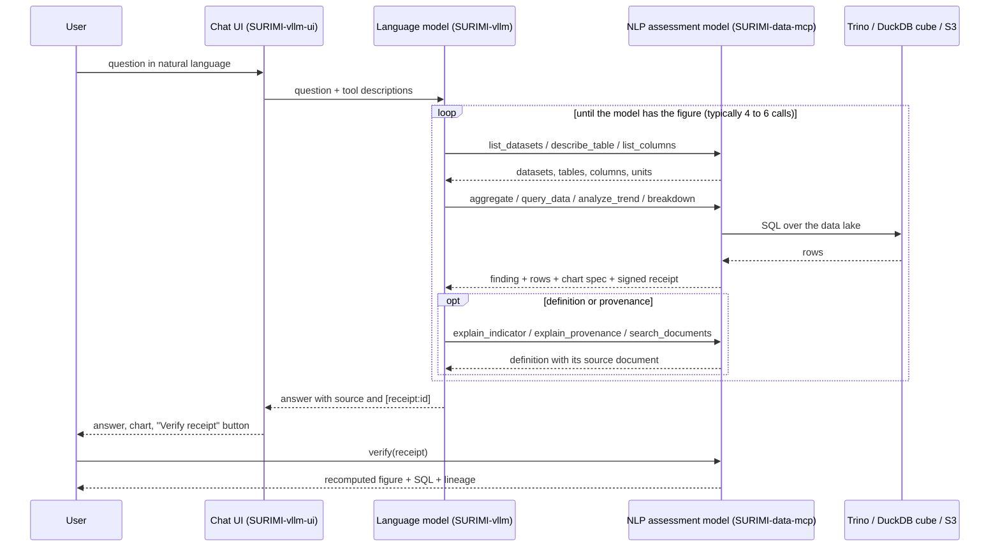

# D3.7 – NLP assessment model

## DOCUMENT INFORMATION

| Grant Agreement     | 101157456 |
| ------------------- | --------- |
| Project Acronym     | SURIMI |
| Project Title       | Integration of innovative and reliable socio-ecological models and user-driven solutions into the Digital Twin Ocean, to facilitate what-if scenarios and decision support, under a co-creation approach. |
| Deliverable Number  | D3.7 |
| Work Package Number | WP3 |
| Deliverable Title   | NLP assessment model |
| Lead Partner        | NORCE |
| Author(s)           | Hasan Asyari Arief |
| Due Date            | 31 October 2026 |
| Submission Date     | |
| Dissemination Level | Public |
| Type of Deliverable | Other |

| Version   | Summary of Changes |
| --------- | ------------------ |
| Version 0 | Initial version. Figures from the round-10 run of 23 September 2026. |

## Summary

|      |  |
| ------------------- | --------- |
| Programming language     | Python |
| Nr of kubernetes pods       | 2 (the server and its PostgreSQL) |
| Github repo       | https://github.com/SURIMI-Project/SURIMI-data-mcp |
| Ready-to-use wiring       | https://github.com/SURIMI-Project/SURIMI-vllm-ui (chat interface), https://github.com/SURIMI-Project/SURIMI-vllm (language model serving) |
| Licence       | to be declared |

The NLP assessment model is the **SURIMI data server**, SURIMI-data-mcp. The Grant Agreement gives SURIMI's assessment layer two component models: CMSY++ (D3.6), which estimates stock status from catch and abundance data, and this NLP assessment model, which explains SURIMI's data and results in text. The server holds the project's tabular data and documentation and exposes them to a language model as a catalogue of analytical tools. A user asks about a dataset, an indicator or a result in plain language and gets the figure, what it means, the file it came from, and a chart when one helps.

The model is deposited ready to use. A chat interface (SURIMI-vllm-ui) and a served open-weight language model (SURIMI-vllm) are deployed with it on EDITO, so the assessment model answers questions at `https://project-surimi-vllm-ui.lab.dive.edito.eu/` without further setup. Any other MCP-capable client can attach to the server in the same way.

Ten domain experts, from stock assessment to marine policy, tried the assistant and asked it the questions they would ask at work, 68 in all. For each question we first established what the data actually says, then put the question to the deployed system on its own. It answered 20 of the 54 questions the data can support correctly or in large part, and it declined 11 of the 14 questions the data cannot support instead of inventing an answer. Nothing it said was judged made up. Its main weakness is caution: 23 times it declined a question the data could have answered. Every question is on a public audit page, next to what the system said and what the data says.

## 1. Model purpose

The Grant Agreement places two NLP modules in the SURIMI model ensemble (T3.2). The assessment layer "will allow for CMSY++ (D3.6) and an additional NLP module for text-based assessment (D3.7)". Its advantage, in the agreement's words, is that "text summaries of simulation output" are "easily comprehensible even for users who lack detailed understanding of the quantitative models powering the simulation". The same passage gives NLP a second, "more traditional mission, outside of the model loop, as a helper for users to summarize and explain model runs, tables, charts and policy results in a way that is more friendly for less quantitative users". D3.7 is that helper, applied to SURIMI's data.

The consortium fixed the scope on 25 March 2026. The assessment module sits on the **data GUI** side of the platform and "assesses information from the data lake", which is broader than simulation output alone. It should explain what a user sees: indicators, units, confidence intervals, coverage and sources. It should retrieve and explain dataset metadata, and discover and recommend datasets for a question. It should produce charts through a pre-built tool catalogue and never by writing code, and it should answer "what can this tool do?" for a new user. It does not run simulations, does not generate or execute scripts, and does not read user-space data or the user's screen.

The model is therefore built as a **tool server**, not as a trained network. The AI-based part is the language model that drives the tools, and it is replaceable: the server has been driven by Muse-Glimmer-30B, Qwen3-Coder-30B and Claude Sonnet during development, with the same tools and the same receipts. What the deliverable fixes is the data, the tools, their prompts, and the guarantees around every figure. One design rule runs through them: observed facts, the model's interpretation and referenced definitions stay separate. A figure carries its source and a signed receipt. A definition names the document it came from. Where the data does not support an answer, the server says so and why, and the evaluation scores an unsupported answer more heavily against the model than a refusal.

## 2. Process overview and scheduling diagram

One question is one conversation turn. The client passes the question and the server's tool descriptions to the language model. The model calls tools until it has the figure, and the server signs every analytical result before returning it.

## 3. Configuration

Configuration is version-controlled in the repository and applied at deploy time. Nothing is edited in the running service.

### 3.1 The server

| Setting | Value |
| --- | --- |
| Entry point | `server.py`, FastMCP over SSE at `/sse` |
| Dataset registry | `catalog.py`, 28 registered datasets |
| Backend | Trino over the project data lake, or PostgreSQL, selected by `trino_client.py`; a DuckDB cube serves aggregates |
| Column names | every loader passes headers through `_sanitize_headers`, so all columns are `lower_snake_case` under the consortium naming convention |
| Receipt secret | `SURIMI_RECEIPT_SECRET`, shared with the model server (D3.9) so one `verify` flow covers both |
| Document corpus | the public SURIMI documentation, indexed with BM25; the internal development wiki is excluded |
| Capability registry | `capabilities.py` declares, per class of question, whether it is served, has no mechanism, or is not collected; CI fails when a tool exists that the registry does not claim |
| Deployed version | image `ghcr.io/surimi-project/surimidatamcp:1.2.23`; the result in section 6 was measured on 1.2.21 |

### 3.2 Ready-to-use wiring

The chat interface stores its model definition in its own database and loses it on redeploy, so `scripts/seed_openwebui.py` in SURIMI-vllm-ui re-applies the version-controlled definition at container start.

| Field | Value |
| --- | --- |
| Chat model id | `surimi-fisheries` |
| Tool servers | `server:mcp:surimi-data` at `https://project-surimi-surimi-data-mcp.lab.dive.edito.eu/sse`; `server:mcp:surimi-model` (D3.9) |
| System prompt | `openwebui_seed/surimi_fisheries.system.md`, see section 6.1 |
| Temperature | 0 |
| Language model | Muse-Glimmer-30B (W4A16), open weights, served by vLLM on the EDITO GPU node; a switch in the interface selects a NORCE-hosted Qwen3 instead |

The tool ids must match the `mcpServers` ids in `chart/values.yaml` exactly. When they disagree, the interface seeds a model with no tool servers and answers without data. A CI job asserts the match on every commit.

## 4. Inputs

The user gives one input: a question in natural language, through the chat interface or any MCP client. Everything else the model reads it holds itself.

### 4.1 Datasets

28 registered datasets: EU Data Collection Framework economic, catch, effort and employment tables by region, OECD fisheries support estimates, ICES stock assessments, MEDITS survey CPUE, and SURIMI's own tables. Each dataset carries its README metadata: source, temporal and spatial coverage, variable definitions, processing and citation.

### 4.2 Tools

Each analytical tool returns a signed receipt with its rows.

| Group | Tools | What they answer |
| --- | --- | --- |
| Discovery | `list_datasets`, `describe_table`, `list_columns`, `list_metrics`, `describe_data_capabilities`, `describe_models`, `data_list_functional_groups` | which data exists, its columns and units, and what the server can and cannot answer |
| Query | `query_data`, `query_metric`, `aggregate`, `breakdown`, `compare_countries`, `analyze_trend`, `generate_report` | the figure itself, grouped, filtered, compared or over time |
| Meaning | `explain_indicator`, `explain_species_code`, `explain_provenance`, `describe_quality`, `search_documents` | what a code or indicator means, where a table came from, and definitions from the public documentation |
| Verification | `verify` | recompute any receipted figure and return the SQL and lineage |

### 4.3 Documentation

The public SURIMI documentation corpus, for questions of definition and method.

## 5. Outputs

### 5.1 Finding envelope

Every server-executed skill returns one envelope: a plain-language finding, the rows it rests on, a chart specification, the parameters used, and a receipt. The chat interface renders the chart; another client can render its own.

### 5.2 Receipt

Every analytical figure carries an HMAC-signed receipt recording the query that produced it and the data it read. The `verify` tool, or the "Verify receipt" button in the chat interface, recomputes the figure and returns the SQL and the lineage. The signature covers the SQL, so a reader can check the number without trusting the transcript.

### 5.3 Refusal

Where the served data does not support the question, the capability registry says which of three cases applies: not served here, no mechanism exists, or never collected. The answer states that and, where it applies, where the data does live.

### 5.4 Audit page

The server publishes all 68 evaluation questions at `/audit/experts`. For each it shows the model's answer, the answer the data supports, the source files and the commands that reproduce its figures. Each released version keeps its own URL.

## 6. Objectives

The Grant Agreement asks this documentation for "objectives for each prompt". In this model the prompts are of three kinds: the server-side prompts fixed in each analytical skill, the tool descriptions the language model reads before each call, and the system prompt of the ready-to-use wiring. The overall objective is that the model explains what SURIMI's data can support, refuses what it cannot, and never presents an unsupported figure as fact.

### 6.1 Objectives for each prompt

The data server carries five server-executed skills whose prompts are fixed in `skills.py`, so their wording cannot drift between chat clients:

| Skill | Objective |
| --- | --- |
| `analyze_trend` | State the direction and size of change of one metric over time, with the coverage it rests on. |
| `compare_countries` | Compare one metric across countries for the same period, resolving the country column per dataset. |
| `breakdown` | Split one metric by a grouping column and rank the parts. |
| `explain_provenance` | Say where a dataset came from, who collected it and how it was processed, as one lineage sentence per source. |
| `generate_report` | Assemble the findings of the skills above into one dated report with its receipts. |

The tool descriptions steer discovery. `list_datasets` returns each table's exact name to be copied verbatim. `list_columns` says that it shows the commonly used columns and that a table has more. `describe_data_capabilities` states which classes of question the server does not serve, so the model can refuse with the reason.

The system prompt of the wiring, `openwebui_seed/surimi_fisheries.system.md` in SURIMI-vllm-ui, has these blocks:

| Prompt block | Objective |
| --- | --- |
| Register | Write for policy-makers and stakeholders, not only scientists. Lead with the direct answer in everyday words. Define each technical term at first use. Translate the engineering documentation into facts and keep ports, protocols and class names out of the answer. |
| Tabular data workflow | List datasets first and copy the table name verbatim. Treat every listed dataset as existing. Measure the real year coverage with a query, never from a label. Look codes up in their description column. Cast numeric text safely. |
| Rules | Never invent a path, variable or number. End every turn with a one-to-four-sentence answer. Gather every source before answering a multi-source question. Cite each figure with its receipt id. Say plainly when a tool reports no data. |
| Charts | Get the numbers from a tool first, then render them with the fixed chart template, then state the answer with its receipt. |

### 6.2 How the model is evaluated

Two evaluations exist. The first is the server's own behavioural benchmark, 105 cases in `benchmark/` of SURIMI-data-mcp, each with a grounding command that recomputes the expected figure from the data, scored by a deterministic numeric grader. It runs against every release.

The second puts expert questions through the ready-to-use wiring. Eleven domain experts reviewed the assistant between August and September 2026 and filed fifteen survey submissions. Ten contributed questions. Their questions were recorded as asked, then adjudicated into four classes according to whether SURIMI holds the data and whether a served tool reaches it. The expected answer for each was established independently of the model: three agents searched the raw data lake, a judge reconciled their findings, and an auditor checked the judge. Each expected answer is published with its source files and a command that reproduces its figures. Each question is then put to the deployed stack on its own, with no prior conversation, and the reply is judged against the expected answer.

### 6.3 Result

Round 10 of the expert evaluation, measured on 23 September 2026 against data-mcp 1.2.21 and model-mcp 1.2.5, with Muse-Glimmer-30B (W4A16) through the chat interface. Verdicts are the judged run `benchmark/runs/muse-r10-judged`, ledger entry `r10_muse`. The set is not split by server, so the figure is for the two servers together.

| | Count |
| --- | ---: |
| Answerable questions | 54 |
| Answered correctly | 11 |
| Answered in part | 9 |
| Refused although the data supports an answer | 23 |
| Refused, and the judge accepted the refusal | 1 |
| Wrong | 10 |
| Unanswerable questions | 14 |
| Correctly refused with an accurate reason | 11 |
| Answered a part they should not have | 3 |
| Answers judged fabricated | 0 |

### 6.4 Known limits

The 23 refusals are the largest limit. In each case the data is served and the answer reproducible, and the language model does not retrieve it. The audit page lists them individually, with the file that holds each answer.

The 12 wrong verdicts, 10 on answerable questions and 2 on unanswerable ones, are the second. Eight of the twelve come from two reviewers, the specialist E11 and the policy adviser E2. The audit page shows each wrong answer next to the answer the data gives.

The expert result measures the wiring end to end. A stronger language model on the same servers, without the chat interface, answered 31 of the 54 in the same round, so part of the gap is the served model and not the tools.

Verdicts are judgements made by a language model against the expected answer. Two runs of the same evaluation agree on about 75 per cent of them, so a change of fewer than three questions out of 68 is not evidence of a change in behaviour.

Three of the 68 questions open with a pronoun that has no antecedent when the question is asked on its own. They cannot be answered as written. Requiring an answer to them was measured to produce fabricated answers.
