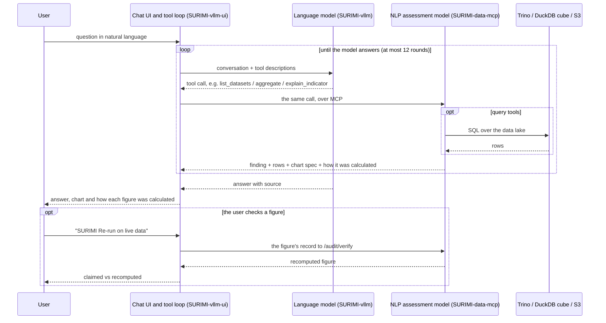

# D3.7 – NLP assessment model

## DOCUMENT INFORMATION

| Grant Agreement     | 101157456 |
| ------------------- | --------- |
| Project Acronym     | SURIMI |
| Project Title       | Integration of innovative and reliable socio-ecological models and user-driven solutions into the Digital Twin Ocean, to facilitate what-if scenarios and decision support, under a co-creation approach. |
| Deliverable Number  | D3.7 |
| Work Package Number | WP3 |
| Deliverable Title   | NLP assessment model |
| Lead Partner        | NORCE |
| Author(s)           | Hasan Asyari Arief, Önder Gürcan |
| Due Date            | 31 October 2026 |
| Submission Date     | |
| Dissemination Level | Public |
| Type of Deliverable | Other |

| Version   | Summary of Changes |
| --------- | ------------------ |
| Version 0 | Initial version. Figures from the evaluation of 23 September 2026. |
| Version 1 | Figures from three runs of the evaluation of 1 October 2026 on data-mcp 1.2.37 and 1.2.38, model-mcp 1.2.11 and the vllm-ui 0.2.79 configuration, over the 60 questions of the revised question set. |
| Version 2 | Restructured after the quality review of 12 October 2026: the position of the model in the SURIMI framework (Figure 1), §5 on benchmark accuracy, licence EUPL-1.2, a link to the architecture document, references to the literature and the data sources, links into the source code, and the text written in the register of the other deliverables. The figures are those of Version 1. |

## Summary

|      |  |
| ------------------- | --------- |
| Programming language     | Python |
| Nr of Kubernetes pods       | 2 (the server and its PostgreSQL database) |
| GitHub repo       | https://github.com/SURIMI-Project/SURIMI-data-mcp |
| Architecture       | [data_mcp_architecture.md](https://github.com/SURIMI-Project/SURIMI-data-mcp/blob/master/data_mcp_architecture.md) |
| Tools, in plain words       | [docs/tools.md](https://github.com/SURIMI-Project/SURIMI-data-mcp/blob/master/docs/tools.md) |
| Chat and language model       | [SURIMI-vllm-ui](https://github.com/SURIMI-Project/SURIMI-vllm-ui) (chat), [SURIMI-vllm](https://github.com/SURIMI-Project/SURIMI-vllm) (language model serving) |
| Licence       | EUPL-1.2 |

SURIMI-data-mcp is the natural language processing (NLP) assessment model of the SURIMI toolbox. It lets a user ask about the SURIMI data lake in plain language: which data exists, what a table or an indicator means, how complete the data is, and what the figures are. A large language model reads the question and calls the server's tools, which answer by querying the data itself. Under every figure, the chat says in plain words how it was calculated and from which table, and one click shows the SQL query the server ran. The model runs on the European Digital Twin of the Ocean (EDITO), where the language model is Muse-Glimmer-30B, an open-weight model from Red Hat. This document describes the model's purpose (§1), how a question is answered (§2), and its inputs (§3) and outputs (§4), and reports how well it answered the questions of ten domain experts (§5).

 <em>Figure 1. Position of the NLP assessment model (dark) within the SURIMI framework for the North-Western Mediterranean case study. It reads the data on EDITO that the models start from; the NLP policy model (D3.9) reads what the models produce.</em>

Ten domain experts contributed 60 questions, and each was put to the chat on EDITO three times. Of the 45 questions that SURIMI's data can answer, the chat answered 28 to 32, and 16 to 19 of them in full. It declined 14 of the 15 questions that the data cannot answer (§5.3).

A second NLP model, SURIMI-model-mcp (D3.9), answers questions about the simulation runs the SURIMI models produce and about gridded ocean and climate data. The chat is connected to both servers, and the language model decides which one to ask. Its integration into the model graphical user interface (GUI) comes later, in April 2027.

## 1. Model purpose

As the NLP assessment model of SURIMI, SURIMI-data-mcp's purpose is to make the data behind the SURIMI models usable by people who do not work with it every day. A fisheries manager or a policy officer can ask in their own words and get an answer they can follow without a detailed understanding of the quantitative models behind it, or of how the tables are laid out. The model works outside the simulation loop: it takes no part in a SURIMI experiment, and summarises and explains the tables, indicators and charts of the data lake.

In the data GUI, the part of the SURIMI platform for exploring the data lake, a user can ask the model which data exists for a topic and which dataset fits the question. The model explains what a table, an indicator, a code, a unit or a confidence interval means, where the data came from, and how complete it is. It also computes the figures themselves, as a number, a table or a chart, and tells a new user what it can do. It draws charts only from the data the server returns, never from code of its own, and it does not run simulations, execute scripts, or read the user's own data or screen.

For a question such as how much Spain landed in 2022, the language model first looks up which dataset holds landings. It then asks the server's `aggregate` tool to add up Spain's 2022 landings in the EU catch table by country, quarter, gear and species, and answers with the total: 749,178 tonnes. Under the answer the chat shows how the figure was calculated: "Sum of `total_live_weight_landed` in “EU DCF FDI Catches by Country, Quarter, Gear and Species”, where `country` is `'Spain'` and `year` is 2022. This is a lower bound: 59956 matching rows reported no value and are left out." The second sentence comes from the server, not from the language model: rows that report no value are left out, so the total can only be a minimum.

A language model asked for a figure from memory may state one that no data supports ([Ji et al., 2023](https://doi.org/10.1145/3571730)). SURIMI-data-mcp is therefore not a trained network, but a server whose tools look each figure up in the data. The language model does not hold the data: it decides which tool to call, the server runs the tool against the data, and the model writes its answer from the result. Language models that act through tools in this way are described by [Yao et al. (2022)](https://doi.org/10.48550/arXiv.2210.03629) and [Schick et al. (2023)](https://doi.org/10.48550/arXiv.2302.04761), and the definitions the model gives are retrieved from the public SURIMI documentation, following [Lewis et al. (2020)](https://doi.org/10.48550/arXiv.2005.11401). Because the data and the rules sit in the tools, the language model can be replaced; during development the server was driven by Muse-Glimmer-30B, Qwen3-Coder-30B and Claude Sonnet.

In practice, the NLP assessment model that constitutes this deliverable consists of three closely coupled parts:

- **SURIMI-data-mcp** ([SURIMI-Project/SURIMI-data-mcp](https://github.com/SURIMI-Project/SURIMI-data-mcp)), the data server. It holds the catalogue of 28 datasets and offers 20 tools over the Model Context Protocol (MCP; [Anthropic, 2025](https://modelcontextprotocol.io/specification/2025-06-18)), an open standard through which a language model calls outside tools. It is written in Python on FastMCP, keeps its tables in PostgreSQL, and computes totals, averages and counts in DuckDB ([Raasveldt and Mühleisen, 2019](https://doi.org/10.1145/3299869.3320212)).

- **SURIMI-vllm-ui** ([SURIMI-Project/SURIMI-vllm-ui](https://github.com/SURIMI-Project/SURIMI-vllm-ui)), the chat on EDITO. It is Open WebUI, deployed unchanged, with a SURIMI assistant ([`surimi_pipe.py`](https://github.com/SURIMI-Project/SURIMI-vllm-ui/blob/master/openwebui_functions/surimi_pipe.py)) that passes the question to the language model, runs the tools it asks for on both SURIMI servers, and shows under each answer how every figure was calculated.

- **SURIMI-vllm** ([SURIMI-Project/SURIMI-vllm](https://github.com/SURIMI-Project/SURIMI-vllm)), which serves the language model on the EDITO graphics processing unit (GPU) node with vLLM ([Kwon et al., 2023](https://doi.org/10.1145/3600006.3613165)).

SURIMI-data-mcp is the model itself; the other two parts make it usable from a browser on EDITO, without installing anything. Each part is installed from its own entry in the EDITO service catalogue.

The technical documentation of SURIMI-data-mcp is its [architecture document](https://github.com/SURIMI-Project/SURIMI-data-mcp/blob/master/data_mcp_architecture.md), which follows a request through the server, and its [tool reference](https://github.com/SURIMI-Project/SURIMI-data-mcp/blob/master/docs/tools.md), which describes every tool in plain words. Its [README](https://github.com/SURIMI-Project/SURIMI-data-mcp/blob/master/README.md) lists the MCP clients that can attach to it, among them Claude.ai, ChatGPT, Mistral Chat and opencode, and the [workshop cheat sheet](https://github.com/SURIMI-Project/SURIMI-data-mcp/blob/master/docs/workshop-cheatsheet.md) walks through attaching it to Claude Desktop.

## 2. Process overview and scheduling diagrams

The sequence diagram below shows how one question is answered. The chat passes the question and the descriptions of the server's tools to the language model. The model then either answers or asks for a tool call. The chat runs each call against the server and returns the result to the model, and this goes on until the model writes its answer, for at most 12 rounds by default. When the user presses "SURIMI Re-run on live data" under a figure from the `aggregate` tool, the server runs the same query again on the live data, and the chat shows the new value next to the one in the answer. The architecture document follows one `aggregate` call through the server step by step ([request flow](https://github.com/SURIMI-Project/SURIMI-data-mcp/blob/master/data_mcp_architecture.md#request-flow-for-aggregate)).

### 2.1 The tools

The 20 tools fall into five groups, each in its own module (Table 1), and the [tool reference](https://github.com/SURIMI-Project/SURIMI-data-mcp/blob/master/docs/tools.md) describes each of them. Discovery tools tell the language model what exists before it asks for a figure, and explanation tools answer the questions that need words, not numbers.

*Table 1. The 20 tools, one module per group.*

| Group | Module | Tools | What they answer |
| --- | --- | --- | --- |
| Discovery | [`discovery.py`](https://github.com/SURIMI-Project/SURIMI-data-mcp/blob/master/surimi_data_mcp/tools/discovery.py) | `list_datasets`, `describe_table`, `list_columns`, `list_metrics`, `describe_data_capabilities`, `describe_quality` | Which data exists, its columns, units and quality, and what the server can and cannot answer. |
| Figures | [`figures.py`](https://github.com/SURIMI-Project/SURIMI-data-mcp/blob/master/surimi_data_mcp/tools/figures.py) | `aggregate`, `query_metric`, `query_data` | The figure itself, grouped and filtered. |
| Analyses | [`analyses.py`](https://github.com/SURIMI-Project/SURIMI-data-mcp/blob/master/surimi_data_mcp/tools/analyses.py) | `analyze_trend`, `compare_countries`, `breakdown`, `generate_report` | A figure over time, across countries, split by a category, or as a report. |
| Explanation | [`explain.py`](https://github.com/SURIMI-Project/SURIMI-data-mcp/blob/master/surimi_data_mcp/tools/explain.py) | `explain_indicator`, `explain_species_code`, `explain_provenance`, `search_documents`, `describe_models`, `data_list_functional_groups` | What a code or indicator means, where a table came from, and definitions from the public documentation. |
| Verification | [`verify.py`](https://github.com/SURIMI-Project/SURIMI-data-mcp/blob/master/surimi_data_mcp/tools/verify.py) | `verify` | Runs a figure's query again on the live data and confirms that its record is unchanged. |

### 2.2 Ready to use on EDITO

The two SURIMI servers, the chat and the language model run as services of the SURIMI project on the [EDITO Datalab](https://dive.edito.eu/), launched from the EDITO service catalogue (Figure 2). Because SURIMI-data-mcp speaks MCP, it is not tied to the EDITO chat: any other MCP client, such as Claude.ai or ChatGPT, can use the same tools by connecting to its `/mcp` address.

*Figure 2. The chat, the language model and the two SURIMI servers, as they run on EDITO.*

*Table 2. Configuration. The full list of settings is in the architecture documents of the [data server](https://github.com/SURIMI-Project/SURIMI-data-mcp/blob/master/data_mcp_architecture.md#environment-variables), the [chat](https://github.com/SURIMI-Project/SURIMI-vllm-ui/blob/master/vllm_ui_architecture.md#environment-variables) and the [language model](https://github.com/SURIMI-Project/SURIMI-vllm/blob/master/vllm_architecture.md#server-arguments).*

| Setting | Value |
| --- | --- |
| Entry point | The `surimi_data_mcp` package, started with `python -m surimi_data_mcp` ([`server.py`](https://github.com/SURIMI-Project/SURIMI-data-mcp/blob/master/surimi_data_mcp/server.py)); Streamable HTTP at `/mcp` and SSE at `/sse`. |
| Dataset registry | [`datasets/datasets.yaml`](https://github.com/SURIMI-Project/SURIMI-data-mcp/blob/master/surimi_data_mcp/datasets/datasets.yaml), 28 registered datasets. |
| Backend | PostgreSQL on EDITO, or Trino for a partner database ([`engine/databases.py`](https://github.com/SURIMI-Project/SURIMI-data-mcp/blob/master/surimi_data_mcp/engine/databases.py)); a DuckDB cube serves aggregates ([`engine/cube.py`](https://github.com/SURIMI-Project/SURIMI-data-mcp/blob/master/surimi_data_mcp/engine/cube.py)); SQL from the language model is read-only. |
| Column names | Every loader passes headers through `_sanitize_headers` ([`loader/load_csv.py`](https://github.com/SURIMI-Project/SURIMI-data-mcp/blob/master/surimi_data_mcp/loader/load_csv.py)), so all columns are `lower_snake_case`. |
| Receipt secret | `SURIMI_RECEIPT_SECRET`, shared with the model server (D3.9) and the chat. |
| Document corpus | The public SURIMI documentation, indexed with BM25 ([Robertson and Zaragoza, 2009](https://doi.org/10.1561/1500000019); [`knowledge/docsearch.py`](https://github.com/SURIMI-Project/SURIMI-data-mcp/blob/master/surimi_data_mcp/knowledge/docsearch.py)); the internal development wiki is excluded. |
| Chat assistant | The SURIMI assistant ([`surimi_pipe.py`](https://github.com/SURIMI-Project/SURIMI-vllm-ui/blob/master/openwebui_functions/surimi_pipe.py)), connected to both servers over MCP as listed under `mcpServers` in [`chart/values.yaml`](https://github.com/SURIMI-Project/SURIMI-vllm-ui/blob/master/chart/values.yaml); [`seed_openwebui.py`](https://github.com/SURIMI-Project/SURIMI-vllm-ui/blob/master/scripts/seed_openwebui.py) installs it again after every redeploy. |
| System prompt | `SYSTEM_PROMPT` in `surimi_pipe.py`, 29,367 characters including the data catalogue block (§5.1); temperature 0. |
| Language models | [Muse-Glimmer-30B (W4A16)](https://huggingface.co/RedHatAI/Muse-Glimmer-30B-W4A16), open weights, served by vLLM on the EDITO GPU node; the model picker also offers Muse-Glimmer-30B and Qwen3.8-27B hosted at NORCE, each marked with a dot that shows whether it is reachable. |
| Deployed version | Image `ghcr.io/surimi-project/surimidatamcp:1.2.53`, with the chat on chart 0.2.94; the evaluation in §5 ran on 1.2.37 and 1.2.38, with model-mcp 1.2.11 and the chat at 0.2.79, and the later versions change the published audit page, add a read-only copy of the data lake behind sign-in, state what SURIMI documents about the use of each dataset, make SQL queries read-only, arrange the code as one package, correct the tool and dataset descriptions the language model reads, keep only the final results in the repository, and say under each figure in plain words what was calculated from which table. |

## 3. Inputs

Apart from the user's question, everything the model reads is held by the server: the 28 datasets of its catalogue and the public SURIMI documentation. Each dataset carries the README that the data lake keeps next to it, with its source, its coverage in time and space, its variables, how it was processed and how it should be cited. Table 3 groups the datasets by family and cites each source as its README asks.

*Table 3. The 28 registered datasets by family.*

| Family | Datasets | Examples | Source |
| --- | ---: | --- | --- |
| EU Data Collection Framework, economic and fleet | 11 | economic performance (Aegean Sea, national, 2013-2023), fleet capacity, fuel costs, revenue and gross profit, FDI (Fisheries Dependent Information) catches and effort by country, quarter, gear and species | [STECF, 2024a](https://data.europa.eu/doi/10.2760/5037826); [STECF, 2025](https://data.europa.eu/doi/10.2760/3446647) |
| EU Data Collection Framework, social and employment | 4 | employment by gender, by nationality, full-time equivalents | [STECF, 2024b](https://data.europa.eu/doi/10.2760/982497) |
| OECD fisheries support estimates | 3 | support by country and year, breakdown by fisheries support estimate (FSE) category, subsidies in million euro | [OECD, 2025](https://doi.org/10.1787/560cd8fc-en) |
| ICES stock database | 2 | latest assessment per stock, every assessment year per stock | [ICES, 2024a](https://stockdatabase.ices.dk/default.aspx) |
| Fisheries landings | 2 | tonnes live weight by FAO area 37 and ICES division | [FAO, 2025](https://www.fao.org/fishery/en/statistics/software/fishstatj); [ICES, 2024b](https://www.ices.dk/data/dataset-collections/Pages/Fish-catch-and-stock-assessment.aspx) |
| SURIMI's own and simulated tables | 4 | empirical biomass surveys (Western Mediterranean), MEDITS bottom-trawl catch per unit of effort (CPUE), simulated Aegean sales output | SURIMI project; [MEDITS Working Group, 2017](https://doi.org/10.25607/OBP-1931) |
| Energy | 1 | energy cost, consumption and landings income by country | [STECF, 2024a](https://data.europa.eu/doi/10.2760/5037826) |
| Species traits | 1 | FishBase and SeaLifeBase thermal range and trophic level | [Froese and Pauly, 2025](https://www.fishbase.org); [Palomares and Pauly, 2025](https://www.sealifebase.org) |

## 4. Outputs

### 4.1 Analyses run on the server

Five of the tools run a complete analysis on the server ([`engine/skills.py`](https://github.com/SURIMI-Project/SURIMI-data-mcp/blob/master/surimi_data_mcp/engine/skills.py)): `analyze_trend`, `compare_countries`, `breakdown`, `explain_provenance` and `generate_report`. Each returns the finding in plain language, with the rows it rests on, a chart specification, the settings it used and the record of how each figure was calculated (§4.2). The chat draws the chart from the specification, and any other MCP client can draw its own.

### 4.2 How each figure was calculated

Every figure the server calculates with a query comes with a record of how it was calculated ([`provenance/`](https://github.com/SURIMI-Project/SURIMI-data-mcp/tree/master/surimi_data_mcp/provenance)), written for a person to read. It has three parts: a sentence saying what the query did and on which table, the SQL query with its values filled in, and, where the figure came from a file of the data lake, that file. The sentence is written by the server from the query it actually ran, not by the language model, so it states what the query did and cannot give an invented reason. Under each answer the chat shows the sentence and the source, with a link to the server's audit page ([`static/audit.html`](https://github.com/SURIMI-Project/SURIMI-data-mcp/blob/master/static/audit.html)). There the query can be read, copied and run again on the live data, next to what the catalogue says about the table, for example that its totals are a lower bound. Inside the chat, the "SURIMI Show the query" button displays the sentence, the SQL and the source, and the "SURIMI Re-run on live data" button computes the figure again on the live data. The record is also signed with a key that the two servers and the chat share (HMAC; [Krawczyk et al., 1997](https://doi.org/10.17487/RFC2104)), so that any change to a figure after the server produced it is detected, as in the tool receipts described by [Basu (2026)](https://doi.org/10.48550/arXiv.2603.10060).

### 4.3 Refusal

When the data on the server cannot answer a question, the model says so and says why. The server keeps a register of what it cannot answer ([`sources.py`](https://github.com/SURIMI-Project/SURIMI-data-mcp/blob/master/surimi_data_mcp/sources.py), [`capabilities.py`](https://github.com/SURIMI-Project/SURIMI-data-mcp/blob/master/surimi_data_mcp/capabilities.py)), which separates three cases: the data exists but is not on this server, no SURIMI model computes it, or it was never collected. Where the data does exist elsewhere, the answer says where.

### 4.4 Audit page

The server publishes the evaluation of §5 on its audit page, `/audit/experts`. For each of the 60 questions it shows the model's answer, the answer the data supports, the source files and the commands that reproduce the figures ([`audit-repro/`](https://github.com/SURIMI-Project/SURIMI-data-mcp/tree/master/audit-repro)), and each released version keeps its own address.

## 5. Benchmark accuracy

Even with tools, a language model can misread a question, overlook data the server holds, or state a figure no tool returned. Three kinds of prompt steer it away from these errors: the prompts of the five analyses, the description the language model reads for each tool, and the chat's system prompt. All three ask the model to explain what SURIMI's data supports, to decline what it does not, and never to present an unsupported figure as fact.

### 5.1 Objectives for each prompt

The five analyses have their prompts set in [`engine/skills.py`](https://github.com/SURIMI-Project/SURIMI-data-mcp/blob/master/surimi_data_mcp/engine/skills.py), so that their wording does not change from one MCP client to another:

| Tool | Objective |
| --- | --- |
| `analyze_trend` | State the direction and size of change of one metric over time, with the coverage it rests on. |
| `compare_countries` | Compare one metric across countries for the same period, resolving the country column per dataset. |
| `breakdown` | Split one metric by a grouping column and rank the parts. |
| `explain_provenance` | Say where a dataset came from, who collected it and how it was processed, as one lineage sentence per source. |
| `generate_report` | Assemble the findings of the analyses above into one dated report, with the query behind each figure. |

The tool descriptions mainly guide the model to the right data. `list_datasets` returns the exact name of each table, and `list_columns` returns a table's columns, read from the database, and flags a table that keeps each year in its own column. `describe_data_capabilities` lists the kinds of question the server cannot answer, so that the model can decline with a reason.

The chat's system prompt (`SYSTEM_PROMPT` in [`surimi_pipe.py`](https://github.com/SURIMI-Project/SURIMI-vllm-ui/blob/master/openwebui_functions/surimi_pipe.py)) has six blocks:

| Prompt block | Objective |
| --- | --- |
| Register | Write for policy-makers and stakeholders, not only scientists. Lead with the direct answer in everyday words. Define each technical term at first use. Keep ports, protocols and class names out of the answer. |
| Gridded ocean data | Find the NetCDF file, pick the variable, and resolve a named region with `model_list_regions`, never by guessing it. Then call the analytic tool: top regions, time series, period comparison or trend. |
| Tabular fisheries, economics and employment | For a whole analysis, prefer the guided tools: `analyze_trend` for change over time, `compare_countries` across countries, `generate_report` for a report, `explain_provenance` for sources and method. Otherwise query with SQL. |
| Rules | Never invent a path, variable, region, column or number. Write species, gear and country codes verbatim unless a tool returned the name. State each figure plainly and leave its record to the chat, which adds it under the answer. Say plainly when a tool reports no data. |
| Informal-name routing | Map the user's everyday words to the dataset that answers them, for example fleet capacity to the AER capacity table and subsidies to the OECD support view. |
| Data catalogue | List the only tables and columns that exist, each with its real year coverage, so that a sum without a year filter is recognised as adding years together. |

### 5.2 How the model is evaluated

The model is evaluated in two ways. A benchmark of 105 test cases runs against every release of the server and is kept in the project's internal repository. For each case, a command computes the expected figure directly from the data, and a grader compares it with the number in the model's answer, with no language model involved.

In the second, eleven domain experts, from stock assessment to marine policy, reviewed the assistant between August and September 2026, and ten of them contributed 60 questions of the kind they would ask at work (Table 4). Language-model agents derived the expected answer to each question from the raw data lake, without the SURIMI servers, and three independent reviewers re-derived twenty of them figure by figure on 30 September 2026. Of the 60 questions, 45 can be answered from the data and 15 should be declined. Each question was put to the chat on its own, and a language-model judge ([Zheng et al., 2023](https://doi.org/10.48550/arXiv.2306.05685)) graded each reply against the expected answer as correct, partial, refused or wrong. All questions, answers and verdicts are on the audit page (§4.4).

*Table 4. The reviewers and the questions they asked.*

| Reviewer | Role | Questions |
| --- | --- | ---: |
| E1 | fisheries economist, who also filled in the marine spatial planning form | 8 |
| E2 | marine science policy adviser, fisheries policy and subsidies | 6 |
| E3 | ecosystem modelling lead | 10 |
| E4 | model integration engineer | 4 |
| E5 | ecosystem modeller, methods and reporting | 7 |
| E6 | ecosystem modeller, species and biodiversity | 6 |
| E7 | stock assessment scientist | 5 |
| E8 | independent reviewer, provenance and audit | 0 |
| E9 | ecosystem modeller, scenarios and fleet dynamics | 5 |
| E10 | science policy officer | 5 |
| E11 | fisheries economist, data quality and verification | 4 |
| | | **60** |

*Three questions recorded in two or three parts are counted once.*

### 5.3 Result

The evaluation was run three times on 1 October 2026, with Muse-Glimmer-30B answering through the chat and a maximum of 6000 tokens per reply (versions in Table 2). The questions are not split by server, so the figures below count the two servers together. As a reference, the same language model answered the same questions once through opencode, a terminal client, and was judged in the same way. The audit page of this evaluation is `/audit/experts/v_dm1.2.39_mm1.2.11` on the data server.

| | Chat, three runs | Reference, one run |
| --- | ---: | ---: |
| Answerable questions | 45 | 45 |
| Answered correctly | 16 to 19 | 20 |
| Answered in part | 11 to 14 | 16 |
| Refused although the data supports an answer | 13 to 16 | 7 |
| Wrong | 0 to 1 | 2 |
| Unanswerable questions | 15 | 15 |
| Correctly refused | 14 | 14 |
| Answers judged fabricated | 0 to 1 | 0 |

*Figure 3. The 45 expert questions SURIMI's data can answer, 1 October 2026. The top three bars are the three runs of Muse-Glimmer-30B through the chat on EDITO, and the bottom bar is the opencode reference.*

The three runs differ by up to four answers (Figure 3), and only on a few questions: of the 45, 27 were answered in every run and 11 in none, which leaves 7 answered in one or two runs. Fourteen questions were answered in full every time, and 20 at least once.

Two changes to the chat were also tested against the previous version, with all answers judged together, on the 44 answerable questions that every run completed. Listing every table of the data server in the system prompt raised the number answered from 26 to 31, and the number answered in full from 16 to 18. It also removed the one wrong answer, so it was released. Removing the limit of 12 rounds of tool calls, and the refusal the chat forces when the limit is reached, raised the number answered to 32 but cut the full answers to 13, so it was not released.

### 5.4 Known limits

The main weakness is that the chat is too careful. In 13 to 16 of the 45 answerable questions, the data was on the server and the answer could be computed from it, but the language model did not look it up and declined. Driven through opencode, the same model declined only 7. That gap is larger than the variation between the chat's own runs, so most of it lies in how the chat drives the model, not in the data or the tools. The chat also stops after 12 rounds of tool calls and asks the model to answer from what it has.

## References

### Literature

- Anthropic (2025). Model Context Protocol specification, version 2025-06-18. https://modelcontextprotocol.io/specification/2025-06-18
- Basu (2026). Tool Receipts, Not Zero-Knowledge Proofs: Practical Hallucination Detection for AI Agents. https://doi.org/10.48550/arXiv.2603.10060
- Ji, Z., Lee, N., Frieske, R. et al. (2023). Survey of Hallucination in Natural Language Generation. ACM Computing Surveys. https://doi.org/10.1145/3571730
- Krawczyk, H., Bellare, M. and Canetti, R. (1997). HMAC: Keyed-Hashing for Message Authentication. RFC 2104. https://doi.org/10.17487/RFC2104
- Kwon, W., Li, Z., Zhuang, S. et al. (2023). Efficient Memory Management for Large Language Model Serving with PagedAttention. Proceedings of the 29th Symposium on Operating Systems Principles. https://doi.org/10.1145/3600006.3613165
- Lewis, P., Perez, E., Piktus, A. et al. (2020). Retrieval-Augmented Generation for Knowledge-Intensive NLP Tasks. https://doi.org/10.48550/arXiv.2005.11401
- Raasveldt, M. and Mühleisen, H. (2019). DuckDB: an Embeddable Analytical Database. Proceedings of the 2019 International Conference on Management of Data. https://doi.org/10.1145/3299869.3320212
- Robertson, S. and Zaragoza, H. (2009). The Probabilistic Relevance Framework: BM25 and Beyond. Foundations and Trends in Information Retrieval. https://doi.org/10.1561/1500000019
- Schick, T., Dwivedi-Yu, J., Dessì, R. et al. (2023). Toolformer: Language Models Can Teach Themselves to Use Tools. https://doi.org/10.48550/arXiv.2302.04761
- Yao, S., Zhao, J., Yu, D. et al. (2022). ReAct: Synergizing Reasoning and Acting in Language Models. https://doi.org/10.48550/arXiv.2210.03629
- Zheng, L., Chiang, W.-L., Sheng, Y. et al. (2023). Judging LLM-as-a-Judge with MT-Bench and Chatbot Arena. https://doi.org/10.48550/arXiv.2306.05685

### Data sources

- FAO (2025). FishStat: GFCM capture production 1970-2022. In: FishStatJ. www.fao.org/fishery/en/statistics/software/fishstatj. Licence: CC-BY-4.0.
- Froese, R. and Pauly, D. (eds) (2025). FishBase. www.fishbase.org. Licence: CC-BY-NC.
- ICES (2024a). ICES Stock Database. In: ICES Dataset Collections. https://stockdatabase.ices.dk/default.aspx. Licence: CC-BY-4.0.
- ICES (2024b). Catch statistics datasets (1903-1949; 1950-2010; 2006-2022). In: ICES Dataset Collections: Fish catch and stock assessment. https://www.ices.dk/data/dataset-collections/Pages/Fish-catch-and-stock-assessment.aspx. Licence: CC-BY-4.0.
- MEDITS Working Group (2017). MEDITS-Handbook. Version n. 9. MEDITS Project. https://doi.org/10.25607/OBP-1931
- OECD (2025). OECD Review of Fisheries 2025. OECD Publishing, Paris. https://doi.org/10.1787/560cd8fc-en
- Palomares, M.L.D. and Pauly, D. (eds) (2025). SeaLifeBase. www.sealifebase.org. Licence: CC-BY-NC.
- STECF (2024a). The 2024 Annual Economic Report on the EU Fishing Fleet (STECF-24-03 and STECF-24-07). Prellezo, R., Sabatella, E.C., Virtanen, J., Tardy Martorell, M. and Guillen, J. (eds). Publications Office of the European Union. https://data.europa.eu/doi/10.2760/5037826
- STECF (2024b). Social Data in Fisheries (STECF 23-17). Van Hoof, L., Goti, L., Tardy Martorell, M. and Guillen, J. (eds). Publications Office of the European Union. https://data.europa.eu/doi/10.2760/982497
- STECF (2025). Evaluation of Fisheries Dependent Information (FDI) for EU Fleets (STECF 24-11). Zanzi, A., Motova-Surmava, A. and Hekim, Z. (eds). Publications Office of the European Union. https://data.europa.eu/doi/10.2760/3446647

### Software and source code

- SURIMI-data-mcp: https://github.com/SURIMI-Project/SURIMI-data-mcp, with its [architecture document](https://github.com/SURIMI-Project/SURIMI-data-mcp/blob/master/data_mcp_architecture.md) and [tool reference](https://github.com/SURIMI-Project/SURIMI-data-mcp/blob/master/docs/tools.md)
- SURIMI-vllm-ui: https://github.com/SURIMI-Project/SURIMI-vllm-ui, with its [architecture document](https://github.com/SURIMI-Project/SURIMI-vllm-ui/blob/master/vllm_ui_architecture.md)
- SURIMI-vllm: https://github.com/SURIMI-Project/SURIMI-vllm, with its [architecture document](https://github.com/SURIMI-Project/SURIMI-vllm/blob/master/vllm_architecture.md)
- FastMCP: https://github.com/jlowin/fastmcp
- Open WebUI: https://github.com/open-webui/open-webui
- vLLM: https://github.com/vllm-project/vllm
- Red Hat AI. Muse-Glimmer-30B-W4A16 model card. https://huggingface.co/RedHatAI/Muse-Glimmer-30B-W4A16
