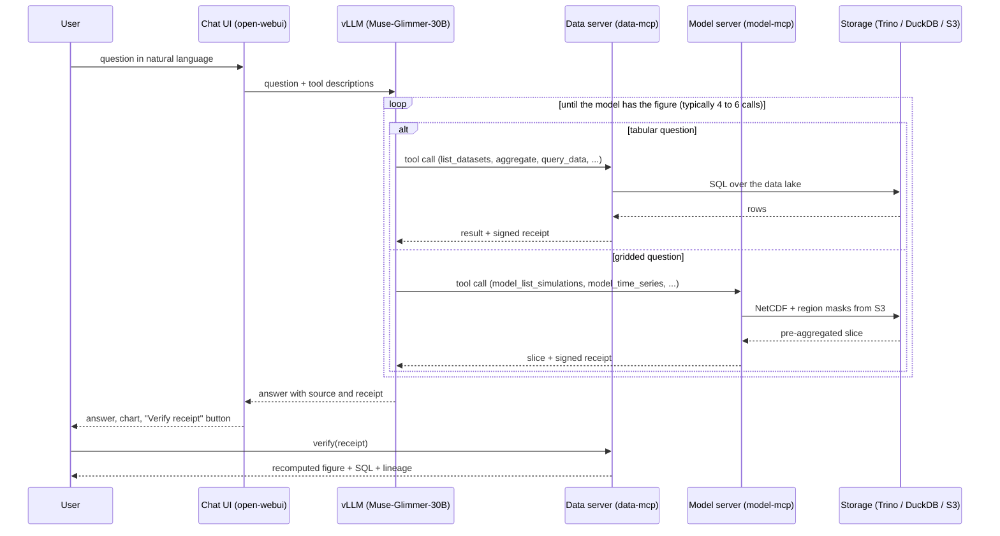

# D3.7 – NLP assessment model

## DOCUMENT INFORMATION

| Grant Agreement     | 101157456 |
| ------------------- | --------- |
| Project Acronym     | SURIMI |
| Project Title       | Integration of innovative and reliable socio-ecological models and user-driven solutions into the Digital Twin Ocean, to facilitate what-if scenarios and decision support, under a co-creation approach. |
| Deliverable Number  | D3.7 |
| Work Package Number | WP3 |
| Deliverable Title   | NLP assessment model |
| Lead Partner        | NORCE |
| Author(s)           | Hasan Asyari Arief |
| Due Date            | 31 October 2026 |
| Submission Date     | |
| Dissemination Level | Public |
| Type of Deliverable | Other |

| Version   | Summary of Changes |
| --------- | ------------------ |
| Version 0 | Initial version. Figures from the round-10 run of 23 September 2026. |

## Summary

|      |  |
| ------------------- | --------- |
| Programming language     | Python |
| Nr of kubernetes pods       | 5 (data server, its PostgreSQL, model server, chat UI, vLLM) |
| Github repos       | https://github.com/SURIMI-Project/SURIMI-data-mcp, https://github.com/SURIMI-Project/SURIMI-model-mcp, https://github.com/SURIMI-Project/SURIMI-vllm-ui, https://github.com/SURIMI-Project/SURIMI-vllm |
| Language model       | Muse-Glimmer-30B, open weights, served by vLLM on the EDITO GPU node |
| Licence       | to be declared |

The NLP assessment model answers questions about SURIMI's data in ordinary language. A user asks a plain question. The model finds the figure, states it, and names the file it came from.

It is evaluated against 68 questions from ten domain experts. SURIMI's servers can answer 54 of them. The other 14 concern data SURIMI does not hold, and a refusal is the correct answer to those.

The deployed model answers 20 of the 54 and correctly refuses 11 of the 14. No answer was judged fabricated. Of the 34 it does not answer, 23 are refusals of questions the data supports, 10 are wrong, and 1 is a refusal the judge accepted. A public audit page lists all 68, each with the answer the data gives and the file that holds it.

## 1. Model purpose

The NLP assessment model gives a person who cannot write SQL a defensible number from SURIMI's data. The user asks a question in their own words. The model picks the dataset, runs the query, and returns the figure in a sentence with its source named.

Where the data does not support an answer, the model says so and states why. The evaluation scores an unsupported answer more heavily against the model than a refusal.

The model is not a component of the gRPC simulation loop. It does not run simulations, and it does not generate or execute user code. It reads only what two SURIMI services publish: the **data server** (SURIMI-data-mcp) for tabular observations and the **model server** (SURIMI-model-mcp) for gridded simulation output. Both expose their tools over the Model Context Protocol (MCP). A chat interface (SURIMI-vllm-ui, built on open-webui) attaches both servers to the language model, which vLLM serves on EDITO (SURIMI-vllm).

## 2. Process overview and scheduling diagram

One question is one conversation turn. The chat UI passes the question and the tool list to vLLM. The language model calls tools until it has the figure, and the servers sign every analytical result before it returns.

The two servers share one receipt secret. Any figure either server produced can be re-verified through the same `verify` tool, or through the one-click button in the chat UI.

## 3. Configuration

Configuration is version-controlled in the repositories and applied at deploy time. Nothing is edited in the running services.

### 3.1 Chat model definition

open-webui stores its model definition in its database and loses it on redeploy. `scripts/seed_openwebui.py` in SURIMI-vllm-ui re-applies `openwebui_seed/surimi_fisheries.model.json` at container start. The system prompt lives in the same directory.

| Field | Value |
| --- | --- |
| `id` | `surimi-fisheries` |
| `base_model_id` | the vLLM-served model |
| `meta.toolIds` | `server:mcp:surimi-data`, `server:mcp:surimi-model` |
| temperature | 0 |

The tool ids must match the `mcpServers` ids in `chart/values.yaml` exactly. When they disagree, open-webui seeds a model with no tool servers and the chat answers without data. A CI job (`check:vllm-ui-wiring`) asserts the match on every commit.

### 3.2 Tool servers

| Id | Name in the UI | Endpoint |
| --- | --- | --- |
| `surimi-data` | SURIMI Data (observations) | `https://project-surimi-surimi-data-mcp.lab.dive.edito.eu/sse` |
| `surimi-model` | SURIMI Model (simulation output) | `https://project-surimi-surimi-model-mcp.lab.dive.edito.eu/mcp` |

### 3.3 Data server

| Setting | Value |
| --- | --- |
| Dataset registry | `catalog.py`, 28 registered datasets |
| Backend | Trino over the project data lake, or PostgreSQL, selected by `trino_client.py`; a DuckDB cube serves aggregates |
| Receipt secret | `SURIMI_RECEIPT_SECRET`, shared with the model server |
| Document corpus | public SURIMI documentation only; the internal development wiki is excluded |
| Deployed version | chart and image `surimidatamcp:1.2.23` from `ghcr.io/surimi-project`; the result in section 6 was measured on 1.2.21 |

### 3.4 Model server

| Setting | Value |
| --- | --- |
| Input | NetCDF files and region masks in the `project-surimi` bucket on EDITO MinIO, prefix `netcdf/` |
| Database | none |
| Cache | a persistent prefetch cache, so the server survives the 24-hour expiry of the EDITO storage token |
| Receipt secret | `SURIMI_RECEIPT_SECRET` |
| Deployed version | chart and image `surimimodelmcp:1.2.5` from `ghcr.io/surimi-project` |

## 4. Inputs

The user gives the model one input: a question in natural language. Everything else the model reads comes from the two servers, and the user supplies none of it.

### 4.1 Tabular observations (data server)

28 registered datasets: EU Data Collection Framework economic and catch tables, OECD support estimates, ICES stock assessments, MEDITS survey CPUE and SURIMI's own tables. The loaders normalise every column name to `lower_snake_case` under the consortium naming convention.

The language model reaches them through these tools. Each analytical tool returns a signed receipt with its rows.

| Group | Tools | What they answer |
| --- | --- | --- |
| Discovery | `list_datasets`, `describe_table`, `list_columns`, `list_metrics`, `describe_data_capabilities`, `describe_models`, `data_list_functional_groups` | which data exists, and its columns and units |
| Query | `query_data`, `query_metric`, `aggregate`, `breakdown`, `compare_countries`, `analyze_trend`, `generate_report` | the figure itself, grouped, filtered or over time |
| Meaning | `explain_indicator`, `explain_species_code`, `explain_provenance`, `describe_quality`, `search_documents` | what a code or indicator means, where a table came from, and definitions from the public documentation |
| Verification | `verify` | recompute any receipted figure and return the SQL and lineage |

### 4.2 Gridded simulation output (model server)

The model server reads NetCDF and region masks from object storage and returns pre-aggregated, pivotable slices, so raw grid cardinality never reaches the language model.

| Group | Tools | What they answer |
| --- | --- | --- |
| Files and coverage | `model_list_files`, `model_describe_file`, `model_list_variables`, `model_list_regions`, `model_get_time_range`, `model_get_spatial_bounds`, `model_get_coverage_summary`, `model_check_cf_compliance`, `model_validate_alignment` | what a file holds and whether it aligns |
| Series | `model_time_series`, `model_trend`, `model_compare_periods`, `model_top_regions` | a regional series, its trend, a period comparison, a ranking |
| Simulations | `model_list_simulations`, `model_describe_simulation`, `model_get_artifact`, `model_get_stock_status`, `model_get_stock_trajectory`, `model_explain_assessment_field` | the SURIMI runs on the bucket and their stock assessment fields |
| Reference | `model_describe_ecosystem_model`, `model_get_contract`, `model_lookup_code`, `model_search_taxon` | the ecosystem model, the SURIMI contract, species and gear codes |
| Verification | `model_verify` | recompute any receipted slice |

### 4.3 Documentation

The public SURIMI documentation corpus, indexed for `search_documents` with BM25. It answers questions of definition and method. The corpus excludes the internal development wiki.

## 5. Outputs

### 5.1 Answer

A sentence in plain language that states the figure and names its source dataset, and a chart where the tool result has a natural axis.

### 5.2 Receipt

Every analytical figure carries an HMAC-signed receipt recording the query that produced it and the data it read. The `verify` tool, or the "Verify receipt" button in the chat UI, recomputes the figure from the receipt and returns the SQL and the lineage. The signature covers the SQL, so a reader can check the number without trusting the chat transcript.

### 5.3 Refusal

Where the served data does not support the question, the model states that and gives the reason. A refusal with an accurate reason scores as correct on an unanswerable question.

### 5.4 Audit page

A public page carries all 68 evaluation questions. For each it shows the model's answer, the answer the data supports, the source files and the commands that reproduce its figures. It is served by the data server at `https://project-surimi-surimi-data-mcp.lab.dive.edito.eu/audit/experts`, and each released version keeps its own URL.

## 6. Objectives

The model should answer what SURIMI's data can answer, refuse what it cannot, and never present an unsupported figure as fact.

### 6.1 How the model is evaluated

Eleven domain experts reviewed the assistant between August and September 2026 and filed fifteen survey submissions. Ten of them contributed questions. Their questions were recorded as asked, then adjudicated into four classes according to whether SURIMI holds the data and whether a served tool reaches it.

The expected answer for each question was established independently of the model. Three agents searched the raw project data lake, a judge reconciled their findings, and an auditor checked the judge. Each expected answer is published with its source files and a command that reproduces its figures. The question set, the expected answers and the judge live in `benchmark/` in SURIMI-data-mcp, and the 33 model-server cases in `benchmark/` in SURIMI-model-mcp.

Each question is then put to the deployed system on its own, with no prior conversation and no follow-up. The reply is compared against the expected answer.

### 6.2 Result

Round 10 of the evaluation, measured on 23 September 2026 against the deployed servers, data-mcp 1.2.21 and model-mcp 1.2.5, with Muse-Glimmer-30B (W4A16) as the language model, through the chat UI. Verdicts are the judged run `benchmark/runs/muse-r10-judged` in SURIMI-data-mcp, ledger entry `r10_muse`.

| | Count |
| --- | ---: |
| Answerable questions | 54 |
| Answered correctly | 11 |
| Answered in part | 9 |
| Refused although the data supports an answer | 23 |
| Refused, and the judge accepted the refusal | 1 |
| Wrong | 10 |
| Unanswerable questions | 14 |
| Correctly refused with an accurate reason | 11 |
| Answered a part they should not have | 3 |
| Answers judged fabricated | 0 |

### 6.3 Known limits

The 23 refusals are the largest limit. In each case the data is served and the answer reproducible, and the model does not retrieve it. The audit page lists them individually, with the file that holds each answer.

The 12 wrong verdicts, 10 on answerable questions and 2 on unanswerable ones, are the second. Eight of the twelve come from two reviewers, the specialist E11 and the policy adviser E2. The audit page shows each wrong answer next to the answer the data gives.

Verdicts are judgements made by a language model against the expected answer. Two runs of the same evaluation agree on about 75 per cent of them, so a change of fewer than three questions out of 68 is not evidence of a change in behaviour.

Three of the 68 questions open with a pronoun that has no antecedent when the question is asked on its own. They cannot be answered as written. Requiring an answer to them was measured to produce fabricated answers.

The evaluation set is not tagged by deliverable. This document therefore reports one figure for the model as a whole, and not separate figures for assessment and for policy use.
