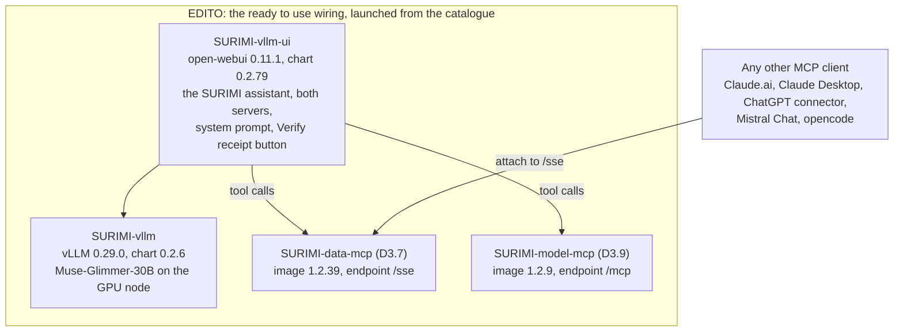
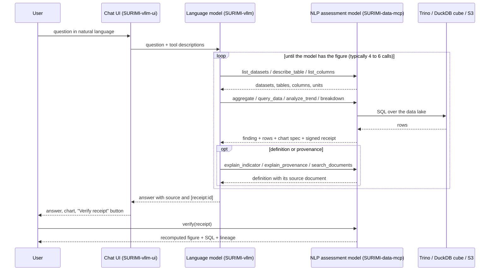

# D3.7 – NLP assessment model

## DOCUMENT INFORMATION

| Grant Agreement     | 101157456 |
| ------------------- | --------- |
| Project Acronym     | SURIMI |
| Project Title       | Integration of innovative and reliable socio-ecological models and user-driven solutions into the Digital Twin Ocean, to facilitate what-if scenarios and decision support, under a co-creation approach. |
| Deliverable Number  | D3.7 |
| Work Package Number | WP3 |
| Deliverable Title   | NLP assessment model |
| Lead Partner        | NORCE |
| Author(s)           | Hasan Asyari Arief |
| Due Date            | 31 October 2026 |
| Submission Date     | |
| Dissemination Level | Public |
| Type of Deliverable | Other |

| Version   | Summary of Changes |
| --------- | ------------------ |
| Version 0 | Initial version. Figures from the evaluation of 23 September 2026. |
| Version 1 | Figures from three runs of the evaluation of 1 October 2026 on data-mcp 1.2.37 and 1.2.38, model-mcp 1.2.11 and the vllm-ui 0.2.79 configuration, over the 60 questions of the revised question set. |

## Summary

|      |  |
| ------------------- | --------- |
| Programming language     | Python |
| Nr of kubernetes pods       | 2 (the server and its PostgreSQL) |
| Github repo       | https://github.com/SURIMI-Project/SURIMI-data-mcp |
| Ready-to-use wiring       | https://github.com/SURIMI-Project/SURIMI-vllm-ui (chat interface), https://github.com/SURIMI-Project/SURIMI-vllm (language model serving) |
| Licence       | Apache-2.0 |

The NLP assessment model surfaced as the **SURIMI data server**, under the tag SURIMI-data-mcp. This assessment model exposes the SURIMI data lake and its toolboxes, data quality and definitions, as well as general terminology and related items, that can be accessed via natural language using an EDITO-hosted open weight large language model, called Muse-Glimmer-30B from Meta.

While the main deliverable of this SURIMI-data-mcp is limited to exposing and serving the tools and the data lake (the EU DCF, OECD, ICES and MEDITS tables and SURIMI's own tables, together with the SURIMI documentation), it is also baked in inside a proper wiring UI called SURIMI-vllm-ui. This is a chat interface built on open-webui, which seeds the chat model definition on start-up, attaches the SURIMI servers as its tool servers, carries the system prompt, with the language model served by SURIMI-vllm on the EDITO GPU node. Thus an EDITO user can run and deploy this ready to use setup via their browser, without installing anything.

Important to understand that SURIMI-data-mcp is a Model Context Protocol server, meaning the protocol is not isolated in EDITO, but can also be wired within a frontier model, like Claude.ai and ChatGPT, as well as Mistral Chat or a terminal client such as opencode.[^1] The tools and the refusals stay the same whichever model is driving them, only the quality of the driving changes, and that is what the evaluation below is measuring.

*Figure 1. The ready to use wiring on EDITO: the chat interface and the served model, the two SURIMI servers. Any other MCP client attaches to the same endpoint.*

The server provides a catalogue and a set of tools that the language model can call. The catalogue registers 28 datasets, namely the EU Data Collection Framework economic, catch, effort and employment tables per region, the OECD fisheries support estimates, the ICES stock assessments, the MEDITS survey CPUE, as well as SURIMI's own tables, each of them with the README metadata that the data lake keeps next to it. On top of this sit 20 tools in four groups: discovery tools, which report which data exists, its columns and units, and what the server cannot answer; query tools, which return the figure itself, grouped, filtered, compared or over time; explanation tools, which define a code or an indicator, state where a table came from, and search the public SURIMI documentation; and one verification tool, which recomputes any figure from its receipt. Every analytical call returns a single response containing the finding in plain language, the underlying rows, a chart specification and a signed receipt.

*Table 1. The 28 registered datasets by family.*

| Family | Datasets | Examples |
| --- | ---: | --- |
| EU Data Collection Framework, economic and fleet | 11 | economic performance (Aegean Sea, national, 2013-2023), fleet capacity, fuel costs, revenue and gross profit, FDI catches and effort by country, quarter, gear and species |
| EU Data Collection Framework, social and employment | 4 | employment by gender, by nationality, full-time equivalents |
| OECD fisheries support estimates | 3 | support by country and year, FSE category breakdown, subsidies in MEUR |
| ICES stock database | 2 | latest assessment per stock, every assessment year per stock |
| Fisheries landings | 2 | tonnes live weight by FAO area 37 and ICES division |
| SURIMI's own and simulated tables | 4 | empirical biomass surveys (Western Mediterranean), MEDITS bottom-trawl CPUE, simulated Aegean sales output |
| Energy | 1 | energy cost, consumption and landings income by country |
| Species traits | 1 | FishBase and SeaLifeBase thermal range and trophic level |

*Table 2. The 20 tools by group.*

| Group | Tools | What they answer |
| --- | --- | --- |
| Discovery | `list_datasets`, `describe_table`, `list_columns`, `list_metrics`, `describe_data_capabilities`, `describe_models`, `data_list_functional_groups` | which data exists, its columns and units, and what the server can and cannot answer |
| Query | `query_data`, `query_metric`, `aggregate`, `breakdown`, `compare_countries`, `analyze_trend`, `generate_report` | the figure itself, grouped, filtered, compared or over time |
| Explanation | `explain_indicator`, `explain_species_code`, `explain_provenance`, `describe_quality`, `search_documents` | what a code or indicator means, where a table came from, and definitions from the public documentation |
| Verification | `verify` | recompute any receipted figure and return the SQL and lineage |

Quality is assessed in two ways: a behavioural benchmark and an expert evaluation. The benchmark comprises 105 cases, each with a grounding command that recomputes the expected figure directly from the data, and it is scored by a deterministic grader on every release. The expert evaluation draws on eleven domain experts, from stock assessment to marine policy, who reviewed the assistant between August and September 2026 and submitted fifteen survey forms. Ten of them contributed questions, 60 in total once questions asked once but recorded in several parts are counted once, of the kind they ask in their own work. For each question the expected answer was established from the data, independently of the model, and published with its source files; the deployed system was then asked the same question in isolation. In the evaluation of 1 October 2026, run three times on the same system, the system answered 28 to 32 of the 45 questions the data supports, 16 to 19 of them in full, and declined 14 of the 15 it does not support in every run. At most one answer in a run was wrong, and in one run one answer was graded made up. The principal limitation is over-caution: in 13 to 16 cases the system declined a question the data could have answered. Twenty-seven of the 45 questions were answered in all three runs, 11 in none and 7 in one or two, so a question can pass once and fail the next time. The same language model, reaching the same servers through another MCP client, answered 36 of the 45 in one run, 20 of them in full, so part of the gap lies in how the chat interface drives the model and not in the tools. All 60 questions, with the system's answer and the answer the data gives, are published on the audit page.

*Table 3. The reviewers and the questions they asked.*

| Reviewer | Role | Questions |
| --- | --- | ---: |
| E1 | fisheries economist, also the marine spatial planning form | 8 |
| E2 | marine science policy adviser, fisheries policy and subsidies | 6 |
| E3 | ecosystem modelling lead | 10 |
| E4 | model integration engineer | 4 |
| E5 | ecosystem modeller, methods and reporting | 7 |
| E6 | ecosystem modeller, species and biodiversity | 6 |
| E7 | stock assessment scientist | 5 |
| E8 | independent reviewer, provenance and audit | 0 |
| E9 | ecosystem modeller, scenarios and fleet dynamics | 5 |
| E10 | science policy officer | 5 |
| E11 | fisheries economist, data quality and verification | 4 |
| | | **60** |

*Figure 2. The 45 expert questions SURIMI's data can answer, 1 October 2026. The top three bars are three runs of the deployed setup, Muse-Glimmer-30B through the EDITO chat (vllm-ui 0.2.79). The bottom bar is one run of the same model reaching the same two servers through opencode. Each answer is graded three times and the majority verdict counts. Section 6.3 gives the full count per class.*

This data server is wired together with the other NLP deliverable, SURIMI-model-mcp, which is the NLP policy model (D3.9) serving the simulation output and the gridded forcing data, and which is meant for the model GUI side. The ready to use wiring toolbox attaches both servers at the same time, and the language model picks the server based on the question. Integration into the model GUI itself, which is due in April 2027, is outside this deliverable, the wiring is what an EDITO user has today.

[^1]: The `README.md` of SURIMI-data-mcp lists the supported MCP clients, and `docs/workshop-cheatsheet.md` in the same repository walks through attaching the server to Claude Desktop in a few steps.

## 1. Model purpose

The Grant Agreement places two NLP modules inside the SURIMI model ensemble under task T3.2, where the assessment layer "will allow for CMSY++ (D3.6) and an additional NLP module for text-based assessment (D3.7)". The advantage the agreement sees in this is that "text summaries of simulation output" become "easily comprehensible even for users who lack detailed understanding of the quantitative models powering the simulation", and the same passage gives NLP a second, "more traditional mission, outside of the model loop, as a helper for users to summarize and explain model runs, tables, charts and policy results in a way that is more friendly for less quantitative users". D3.7 is that helper, applied to the SURIMI data lake.

The scope was fixed by the consortium on 25 March 2026, when the assessment module was placed on the data GUI side of the platform with the remit to "assess information from the data lake", which is wider than simulation output alone. Under that remit the module explains what a user is looking at, namely indicators, units, confidence intervals, coverage and sources, retrieves and explains the metadata of a dataset, discovers and recommends datasets for a given question, produces charts through a pre-built tool catalogue and never by writing code, and answers "what can this tool do?" for a new user. Equally, it does not run simulations, does not generate or execute scripts, and does not read user-space data or the user's screen.

For this reason the model is built as a tool server and not as a trained network. The AI-based part is the language model that drives the tools, and it is replaceable, as the server has been driven by Muse-Glimmer-30B, Qwen3-Coder-30B and Claude Sonnet during development.

## 2. Process overview and scheduling diagram

Every question is handled as one conversation turn, in which the client passes the question together with the server's tool descriptions to the language model, and the model calls tools until it has the figure it needs, as the diagram below shows.

## 3. Configuration

All configuration is version-controlled in the repository and applied at deploy time, so that nothing is edited in the running service.

### 3.1 The server

| Setting | Value |
| --- | --- |
| Entry point | `server.py`, FastMCP over SSE at `/sse` |
| Dataset registry | `catalog.py`, 28 registered datasets |
| Backend | Trino over the project data lake, or PostgreSQL, selected by `trino_client.py`; a DuckDB cube serves aggregates |
| Column names | every loader passes headers through `_sanitize_headers`, so all columns are `lower_snake_case` under the consortium naming convention |
| Receipt secret | `SURIMI_RECEIPT_SECRET`, shared with the model server (D3.9) |
| Document corpus | the public SURIMI documentation, indexed with BM25; the internal development wiki is excluded |
| Capability registry | `capabilities.py` declares, per class of question, whether it is served, has no mechanism, or is not collected; CI fails when a tool exists that the registry does not claim |
| Deployed version | image `ghcr.io/surimi-project/surimidatamcp:1.2.39`; the evaluation in section 6 was run on 1.2.37 and 1.2.38, and 1.2.39 changes only the published audit page |

### 3.2 Ready to use wiring

Since the chat interface keeps its configuration in its own database and loses it on every redeploy, `scripts/seed_openwebui.py` in SURIMI-vllm-ui re-applies the version-controlled configuration each time the container starts.

| Field | Value |
| --- | --- |
| Assistant | the SURIMI Pipe, an open-webui function in `openwebui_functions/surimi_pipe.py`, which runs the tool loop and connects to both servers over MCP |
| Servers | `surimi-data` at `https://project-surimi-surimi-data-mcp.lab.dive.edito.eu/sse`; `surimi-model` (D3.9) at `https://project-surimi-surimi-model-mcp.lab.dive.edito.eu/mcp`; both listed under `mcpServers` in `chart/values.yaml` |
| System prompt | `SYSTEM_PROMPT` in `surimi_pipe.py`, 25,717 characters including the data catalogue block, see section 6.1 |
| Temperature | 0 |
| Language models | Muse-Glimmer-30B (W4A16), open weights, served by vLLM on the EDITO GPU node; the model picker also offers Muse-Glimmer-30B and Qwen3.8-27B hosted at NORCE, each marked with a dot that shows whether it is reachable |

The tool ids have to match the `mcpServers` ids in `chart/values.yaml` exactly, because when they disagree the interface seeds a model without tool servers and answers without any data, which is why a CI job asserts the match on every commit.

## 4. Inputs

The user provides a single input, a question in natural language, either through the chat interface or through any other MCP client, while everything else the model reads is held by the server itself.

### 4.1 Datasets

The catalogue registers 28 datasets, namely the EU Data Collection Framework economic, catch, effort and employment tables by region, the OECD fisheries support estimates, the ICES stock assessments, the MEDITS survey CPUE, as well as SURIMI's own tables, and each dataset carries the README metadata the data lake keeps next to it, which covers source, temporal and spatial coverage, variable definitions, processing and citation. Table 1 gives the count per family.

### 4.2 Tools

The 20 tools are listed by group in Table 2 above.

### 4.3 Documentation

The public SURIMI documentation corpus serves questions of definition and method.

## 5. Outputs

### 5.1 Finding envelope

Every server-executed skill returns a single response that holds a plain-language finding, the rows it rests on, a chart specification, the parameters that were used, and a receipt, which the chat interface renders as a chart while any other client is free to render its own.

### 5.2 Receipt

Every analytical figure carries an HMAC-signed receipt recording the query that produced it and the data it read, and either the `verify` tool or the "Verify receipt" button in the chat interface recomputes the figure and returns the SQL and the lineage.

### 5.3 Refusal

Where the served data does not support a question, the capability registry states which of three cases applies, namely that the data is not served here, that no mechanism exists, or that it was never collected, and the answer says so and, where it applies, where the data does live.

### 5.4 Audit page

The server publishes all 60 evaluation questions at `/audit/experts`, showing for each the model's answer, the answer the data supports, the source files and the commands that reproduce its figures, and every released version keeps its own URL.

## 6. Objectives

The Grant Agreement asks this documentation for "objectives for each prompt", and in this model the prompts are of three kinds, namely the server-side prompts fixed in each analytical skill, the tool descriptions the language model reads before each call, and the system prompt of the ready to use wiring. The overall objective is that the model explains what SURIMI's data can support, refuses what it cannot, and never presents an unsupported figure as fact.

### 6.1 Objectives for each prompt

The data server carries five server-executed skills whose prompts are fixed in `skills.py`, so that their wording cannot drift between chat clients:

| Skill | Objective |
| --- | --- |
| `analyze_trend` | State the direction and size of change of one metric over time, with the coverage it rests on. |
| `compare_countries` | Compare one metric across countries for the same period, resolving the country column per dataset. |
| `breakdown` | Split one metric by a grouping column and rank the parts. |
| `explain_provenance` | Say where a dataset came from, who collected it and how it was processed, as one lineage sentence per source. |
| `generate_report` | Assemble the findings of the skills above into one dated report with its receipts. |

The tool descriptions steer discovery, in that `list_datasets` returns each table's exact name to be copied verbatim, `list_columns` states that it shows the commonly used columns and that a table has more, and `describe_data_capabilities` states which classes of question the server does not serve, so that the model can refuse with the reason.

The system prompt of the wiring, `SYSTEM_PROMPT` in `openwebui_functions/surimi_pipe.py` of SURIMI-vllm-ui, consists of the following blocks:

| Prompt block | Objective |
| --- | --- |
| Register | Write for policy-makers and stakeholders, not only scientists. Lead with the direct answer in everyday words. Define each technical term at first use. Keep ports, protocols and class names out of the answer. |
| Gridded ocean data | Find the NetCDF file, pick the variable, and resolve a named region with `model_list_regions`, never by guessing it. Then call the analytic tool: top regions, time series, period comparison or trend. |
| Tabular fisheries, economics and employment | Prefer the guided skills for a whole analysis: `analyze_trend` for change over time, `compare_countries` across countries, `generate_report` for a report, `explain_provenance` for sources and method. Otherwise query with SQL. |
| Rules | Never invent a path, variable, region, column or number. Write species, gear and country codes verbatim unless a tool returned the name. Cite each figure with its receipt id. Say plainly when a tool reports no data. |
| Informal-name routing | Map the user's everyday words to the dataset that answers them, for example fleet capacity to the AER capacity table and subsidies to the OECD support view. |
| Data catalogue | List the only tables and columns that exist, each with its real year coverage, so that a sum without a year filter is recognised as adding years together. |

### 6.2 How the model is evaluated

The model is evaluated in two ways. The first is the server's own behavioural benchmark of 105 cases in `benchmark/` of SURIMI-data-mcp, each with a grounding command that recomputes the expected figure from the data and scored by a deterministic numeric grader, which runs against every release.

The second puts the expert questions through the ready to use wiring. Eleven domain experts reviewed the assistant between August and September 2026 and filed fifteen survey submissions, ten of them contributed questions, and these were recorded as asked and then adjudicated into four classes according to whether SURIMI holds the data and whether a served tool reaches it. The expected answer for each question was established independently of the model, in that three agents searched the raw data lake, a judge reconciled their findings and an auditor checked the judge, and each expected answer is published with its source files and a command that reproduces its figures. Each question was then put to the deployed stack on its own, with no prior conversation, and the reply was graded three times by a language-model judge against the expected answer, with the majority verdict counting. An answer counts as correct when it delivers what the question asks with the right figures, and as partial when a central part of the question goes unanswered. A refusal that surrounds its refusal with context, a restatement of the question's premise, a listing of tables where an analysis was asked, and a significance claim that ignores autocorrelation in the data are not credited as answers.

The expected answers were re-derived on 30 September 2026. Twenty of them were re-established from the raw data lake and the partner code by three agents and then re-derived figure by figure by three independent reviewers, and three questions that the experts had asked once but that had been recorded in two or three parts were merged. Of the 60 questions, 45 should be answered from the data and 15 should be declined.

### 6.3 Result

The evaluation of 1 October 2026 was run three times against data-mcp 1.2.37 and 1.2.38 (the second differs only by the published audit page) and model-mcp 1.2.11, with Muse-Glimmer-30B (W4A16) through the chat interface in the configuration released as vllm-ui 0.2.79, which runs each model call with a budget of 6000 tokens as the evaluation did. Every question, the answer of the first run, its verdict and how often the question passed in the three runs are published at `/audit/experts/v_dm1.2.39_mm1.2.11` on the data server. As the question set is not split by server, the figures below are for the two servers together. The reference column is one run of the same model reaching the same two servers through opencode, judged in the same way.

| | Chat, three runs | Reference, one run |
| --- | ---: | ---: |
| Answerable questions | 45 | 45 |
| Answered correctly | 16 to 19 | 20 |
| Answered in part | 11 to 14 | 16 |
| Refused although the data supports an answer | 13 to 16 | 7 |
| Wrong | 0 to 1 | 2 |
| Unanswerable questions | 15 | 15 |
| Correctly refused | 14 | 14 |
| Answers judged fabricated | 0 to 1 | 0 |

The three runs of the chat differ by up to four answers on the 45, which is the variation of the system and not an effect of any change. Fourteen questions were answered in full in all three runs and 20 in at least one. The comparison with opencode rests on a single run of the reference, so a difference of three or four answers between the two is not evidence of a difference.

Two changes were measured against the previous chat in the same judging batch, on the 44 answerable questions all three runs completed. Listing every table the data server holds in the chat's system prompt raised the count answered from 26 to 31 (16 to 18 in full) and removed the one wrong answer; it was released as vllm-ui 0.2.79. Removing the 12-round limit and the forced refusal raised it to 32 but lowered the full answers to 13, and it was not released.

### 6.4 Known limits

The largest limitation is the 13 to 16 refusals, where the data is served and the answer reproducible while the language model does not retrieve it. The audit page lists each of them with the file that holds the answer. The reference client refuses 7 of the same 45 with the same model in its single run, so most of the gap lies in how the chat interface drives the model. The chat stops a turn after 12 rounds of tool calls and then asks the model to answer from what it has; allowing more rounds turned refusals into partial answers, not complete ones.

From 22 to 29 September 2026 the chat interface did not connect to the model server (D3.9). A change to its connection code rejected an argument that the model server's transport passes, and the interface answered with the data server's tools alone. vllm-ui 0.2.77 corrected it on 29 September, and the figures in section 6.3 are measured after it.

The expert result measures the wiring end to end. The verdicts are judgements made by a language model against the expected answer; graded three times, the three verdicts agree on 50 to 59 of the 60 answers in each run. The count answered moved by up to four between three runs of the same system, so a change of fewer than five questions is not evidence of a change in behaviour. An earlier evaluation on 29 September reported 39 of 50 answered and 24 in full. It used a more lenient rubric and expected answers that in part described what the tools return, and it is superseded by the figures above.
