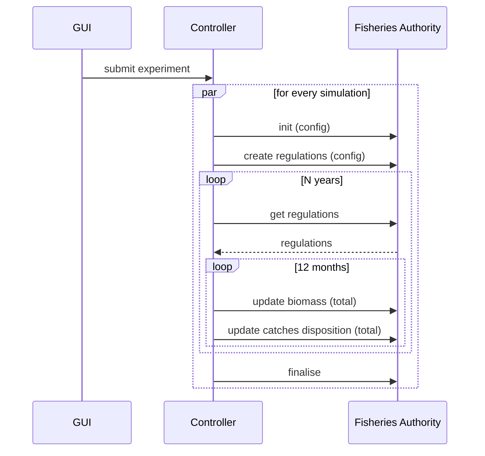
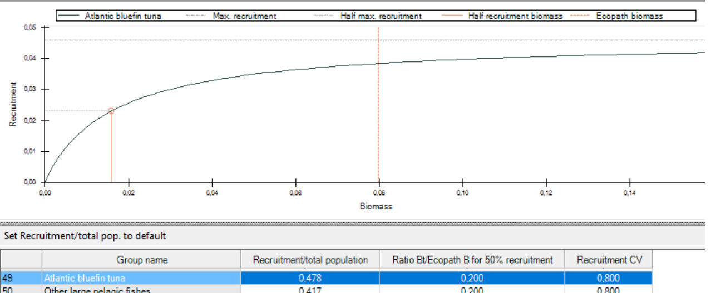
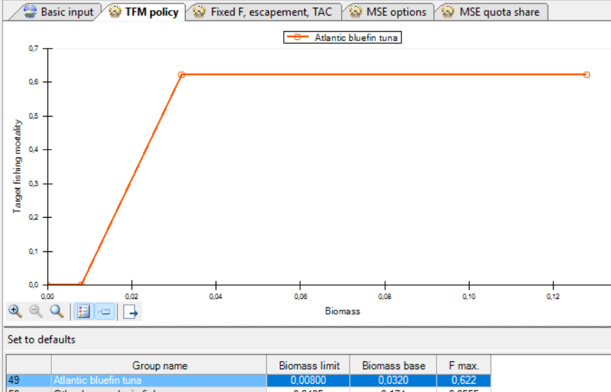

# D3.8 – MSE policy model

## DOCUMENT INFORMATION

| Grant Agreement     | 101157456 |
| ------------------- | --------- |
| Project Acronym     | SURIMI |
| Project Title       | Integration of innovative and reliable socio-ecological models and user-driven solutions into the Digital Twin Ocean, to facilitate what-if scenarios and decision support, under a co-creation approach. |
| Deliverable Number  | D3.8 |
| Work Package Number | WP3 |
| Deliverable Title   | MSE policy model |
| Lead Partner        | UOXF |
| Author(s)           | Rik Kreeftenberg, Jeroen Steenbeek, Villy Christensen (EII) |
| Due Date            | 31 October 2026 |
| Submission Date     | |
| Dissemination Level | Public |
| Type of Deliverable | Other |

| Version   | Summary of Changes |
| --------- | ------------------ |
| Version 0 | Initial version    |

## Summary
|      |  |
| ------------------- | --------- |
| Programming language     | C# .Net |
| Nr of kubernetes pods       | 1 |
| Github repo       | https://github.com/SURIMI-project/SURIMI-fisheries-authority |
| Licence       | EUPL-1.2 |

## 1. Model purpose
Management Strategy Evaluation (**MSE**) is a simulation-based approach used in fisheries management to test and compare alternative management strategies under uncertainty. In SURIMI it runs many simulations with varying assumptions about stock biomass, recruitment, catches, quotas, observation errors, and environmental conditions to evaluate which strategies are most likely to achieve objectives such as sustainable harvests and stock conservation.

The **MSE Policy model** is implemented by the **Fisheries Authority** service that is a component of the **SURIMI** simulation framework. SURIMI is a multi-model system that simulates marine fisheries ecosystems. All models — including this one — communicate exclusively with the **SURIMI Controller** over **gRPC**, using a shared Protobuf-based protocol (`BSR.Surimi.Surimi-Protocol`).

The Fisheries Authority model represents the regulatory authority in the simulation. It provides fishing regulations (Total Allowable Catches) to other models and receives updates on biomass, catch dispositions, and fishing activity from the Controller, which aggregates data from the ecology and fleet models.

## 2. Process overview and scheduling diagrams
The sequence diagram below focusses on the communication with the Fisheries Authority service. It only communicates with the Controller. 

One experiment runs many MSE simulations in parallel. 

## 3. Configuration
The Fisheries Authority service needs to be configured to be able to do its calculations. The configuration depends on the scenario (nortwestern_med, anchovy_bay or aegean_sea) which is passed at the beginning of the simulation.
At that moment, the configuration files are downloaded from the corresponding directory in the S3 bucket, into the Kubernetes pod. And from there they are used by the Fisheries Authority service.
The following configuration files are necessary:

### 3.1 Recruitment
The estimated growth of the biomass is calculated via simple stock-recruitment curve. These species-specific curves are configured via three parameters:
* RstockRatio: Determines the overall height (maximum recruitment level) of the curve.
* RHalfB0Ratio: Determines the position of the half-recruitment point (orange vertical line).
* cvRec: Does not change the curve itself; it controls year-to-year recruitment variability around the curve.

The MSE recruitment logic was lifted from the Ecopath with Ecosim (EwE) software, where the graph and table below are used to configure the recruitment dynamics. For a description of the underlying calculations see Szurma et al. [(2018)](https.doi.org/10.1371/journal.pone.0196307)

An example of the recruitement.csv file is shown below. The species_code and life_stage columns are used to identify the species and life stage for which the parameters are defined.

| species\_code | life\_stage | RstockRatio | RHalfB0Ratio |       cvRec |
| ------------- | ----------- | ----------: | -----------: | ----------: |
| BOG           |             |       0.893 |          0.2 |         0.8 |
| HKE           | ADULT       |   0.7134952 |  0.200000003 | 0.800000012 |
| HKE           | JUVENILE    |   0.7677637 |  0.200000003 | 0.800000012 |
| PIL           | ADULT       |    0.760691 |  0.200000003 | 0.800000012 |
| MUT           | ADULT       |    0.700308 |  0.200000003 | 0.800000012 |
| BFT           |             |   0.4779542 |  0.200000003 | 0.800000012 |

### 3.2 QuotaShare
The quota for a species can be shared among fleets, and this is configured in the quotashare.csv file. All fleets (combination of gear_code and country_code) have their own column and the fraction for every species (combination of species_code and life_stage)
When this file is loaded, it is validated that the sum of all fractions should be 1.

| species\_code | life\_stage |    ART\|ESP |    ART\|FRA |   RECT\|ESP |    LLS\|ESP |    OTB\|ESP |    OTB\|FRA |      PS\|ESP |     PS\|FRA |     TM\|FRA |
| ------------- | ----------- | ----------: | ----------: | ----------: | ----------: | ----------: | ----------: | -----------: | ----------: | ----------: |
| BOG           |             |       0.893 |    0.000902 |     0.00191 |       0.102 |    0.002188 |           0 |            0 |           0 |           0 |
| HKE           | ADULT       | 0.288042551 | 0.175846451 | 0.000185151 | 0.138019551 | 0.204072351 | 0.191925651 |  0.001908294 |           0 |           0 |
| HKE           | JUVENILE    |           0 |           0 |           0 |           0 |   0.5593836 |   0.4406164 |            0 |           0 |           0 |
| PIL           | ADULT       | 0.001531402 | 0.001792785 |           0 |  0.00042525 | 0.008162616 |           0 |  0.446605249 | 0.302094849 | 0.239387849 |
| MUT           | ADULT       |  0.04309707 | 0.001818013 |           0 | 0.002574048 |   0.8295135 |    0.122493 | 0.0005043912 |           0 |           0 |
| BFT           |             |  0.06074393 |   0.2440297 |  0.02454434 |  0.08319749 | 0.009978897 |           0 |  0.005768434 |   0.5717372 |           0 |

### 3.3 Initial Quota
At the beginning of the simulation, an initial quota should be sent to EwE and POSEIDON. And because no Biomass and CatchDisposition messages have been sent yet, the initial quota can't be calculated, and should be configured. 
The quota is expressed in kilogram.

| species\_code | life\_stage |    TAC |
| ------------- | ----------- | ----------: |
| BOG           |             |       50000 |
| HKE           | ADULT       | 200000 | 
| HKE           | JUVENILE    | 14000 | 
| PIL           | ADULT       | 60000 | 
| MUT           | ADULT       |  60000 | 
| BFT           |             |  100000 | 

## 4. Inputs

### 4.1 [InitialiseSimulation](https://buf.build/surimi/surimi-protocol/docs/main%3Asurimi.v1#surimi.v1.FisheriesAuthorityService.InitialiseSimulation)
This message contains the contract of the simulation 

### 4.2 [CreateRegulations](https://buf.build/surimi/surimi-protocol/docs/main%3Asurimi.v1#surimi.v1.FisheriesAuthorityService.CreateRegulations)

At the start of the simulation, the CreateRegulations message is sent to the Fisheries Authority service. It contains the Harvest control rules with which the Total Allowable Catch is calculated at the beginning of the year.

With a harvest control rule, the Fisheries Authority can implement a feedback mechanism that adjusts TACs based on observed biomass levels. For example, if the biomass of a particular species falls below a predefined threshold, the harvest control rule may reduce the TAC for that species to prevent overfishing. Conversely, if biomass is above the threshold, the TAC may be increased to allow for sustainable harvesting.

The image below shows a harvest control rule as configured in Ecopath with Ecosim for the Atlantic Bluefin Tuna (BFT).

Only for the species that have harvest control rules are taken into account in the quota calculation. For the other species, there is no quota.

### 4.3 [UpdateBiomass message](https://buf.build/surimi/surimi-protocol/docs/main%3Asurimi.v1#surimi.v1.FisheriesAuthorityService.UpdateBiomass)

Every month the Biomass of every applicable species is saved.  

### 4.4 [Update CatchDisposition](https://buf.build/surimi/surimi-protocol/docs/main%3Asurimi.v1#surimi.v1.FisheriesAuthorityService.UpdateCatchDisposition) (total)
The gross catch - live discards of all the cells is summed up, per species. This is aggregated every month, so when the new year starts the total amount of fish that has been harvested can be used in the calculation. 

## 5. Outputs

### 5.1 [GetRegulations](https://buf.build/surimi/surimi-protocol/docs/main%3Asurimi.v1#surimi.v1.FisheriesAuthorityService.GetRegulations) 
At the start of every year, the new quota for every applicable species is calculated and is sent to the EWE service and the POSEIDON service. This is done in the GetRegulations message.

