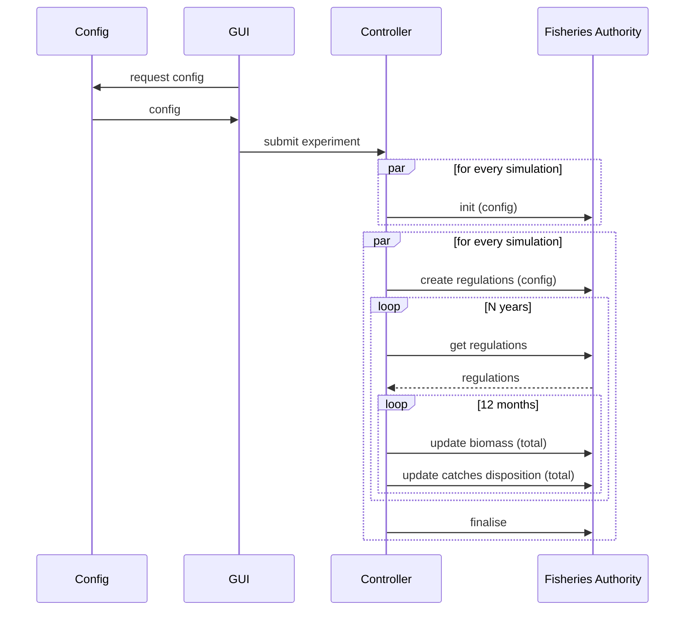

# D3.8 – MSE policy model

## DOCUMENT INFORMATION

| Grant Agreement     | 101157456 |
| ------------------- | --------- |
| Project Acronym     | SURIMI |
| Project Title       | Integration of innovative and reliable socio-ecological models and user-driven solutions into the Digital Twin Ocean, to facilitate what-if scenarios and decision support, under a co-creation approach. |
| Deliverable Number  | D3.8 |
| Work Package Number | WP3 |
| Deliverable Title   | MSE policy model |
| Lead Partner        | UOXF |
| Author(s)           |  |
| Due Date            | 31 October 2026 |
| Submission Date     | |
| Dissemination Level | Public |
| Type of Deliverable | Other |

| Version   | Summary of Changes |
| --------- | ------------------ |
| Version 0 | Initial version    |

## Summary
|      |  |
| ------------------- | --------- |
| Programming language     | C# .Net |
| Nr of kubernetes pods       | 1 |
| Github repo       | https://github.com/Official-EwE/SURIMI-fisheries-authority |

## 1. Model purpose

## 2. Process overview and scheduling diagrams

## 3. Configuration
The Fisheries Authority service needs to be configured to be able to do its calculations. The configuration depends on the scenario (nortwestern_med, anchovy_bay or aegean_sea) which is passed at the beginning of the simulation.
At that moment, the configuration files are downloaded from the corresponding directory in the S3 bucket, into the Kubernetes pod. And from there they are used by the Fisheries Authority service.
The following configuration files are necessary:

### 3.1 Recruitement
The growth of the biomass is calculated by the recruitement. It is specific for every species and is cofigured by a couple of parameters.

| species\_code | life\_stage | RstockRatio | RHalfB0Ratio |       cvRec |
| ------------- | ----------- | ----------: | -----------: | ----------: |
| BOG           |             |       0.893 |          0.2 |         0.8 |
| HKE           | ADULT       |   0.7134952 |  0.200000003 | 0.800000012 |
| HKE           | JUVENILE    |   0.7677637 |  0.200000003 | 0.800000012 |
| PIL           | ADULT       |    0.760691 |  0.200000003 | 0.800000012 |
| MUT           | ADULT       |    0.700308 |  0.200000003 | 0.800000012 |
| BFT           |             |   0.4779542 |  0.200000003 | 0.800000012 |

### 3.2 QuotaShare
The quota for a species can be shared among fleets, and this is configured in the quotashare.csv file. All fleets (combination of gear_code and coountry_code) have their own column and the fraction for every species (combination of species_code and live_stage)
When this file is loaded, it is validated that the sum of all fractions should be 1.

| species\_code | life\_stage |    ART\|ESP |    ART\|FRA |   RECT\|ESP |    LLS\|ESP |    OTB\|ESP |    OTB\|FRA |      PS\|ESP |     PS\|FRA |     TM\|FRA |
| ------------- | ----------- | ----------: | ----------: | ----------: | ----------: | ----------: | ----------: | -----------: | ----------: | ----------: |
| BOG           |             |       0.893 |    0.000902 |     0.00191 |       0.102 |    0.002188 |           0 |            0 |           0 |           0 |
| HKE           | ADULT       | 0.288042551 | 0.175846451 | 0.000185151 | 0.138019551 | 0.204072351 | 0.191925651 |  0.001908294 |           0 |           0 |
| HKE           | JUVENILE    |           0 |           0 |           0 |           0 |   0.5593836 |   0.4406164 |            0 |           0 |           0 |
| PIL           | ADULT       | 0.001531402 | 0.001792785 |           0 |  0.00042525 | 0.008162616 |           0 |  0.446605249 | 0.302094849 | 0.239387849 |
| MUT           | ADULT       |  0.04309707 | 0.001818013 |           0 | 0.002574048 |   0.8295135 |    0.122493 | 0.0005043912 |           0 |           0 |
| BFT           |             |  0.06074393 |   0.2440297 |  0.02454434 |  0.08319749 | 0.009978897 |           0 |  0.005768434 |   0.5717372 |           0 |

### 3.3 Initial Quota

## 4. Inputs

### 4.1 UpdateBiomass message

### 4.2 Update CatchDisposition message (total)

## 5. Outputs

### 5.1 CreatRegulations message

### 5.2 GetRegulations message  

