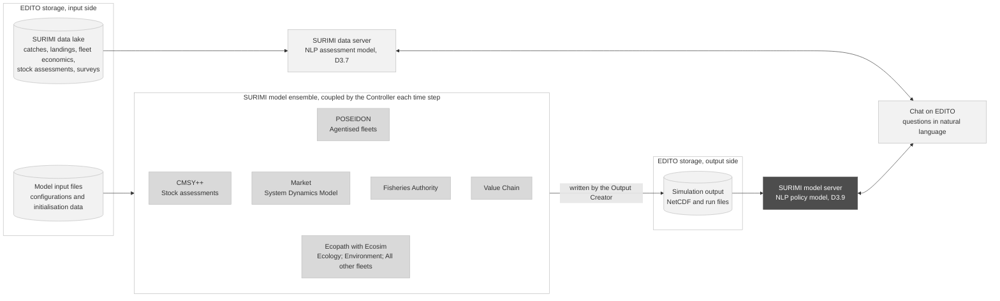
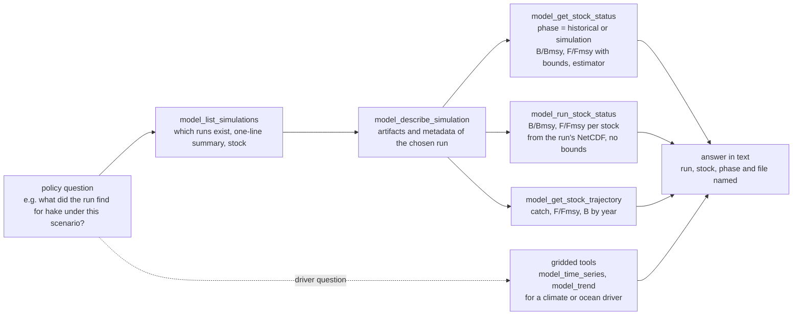
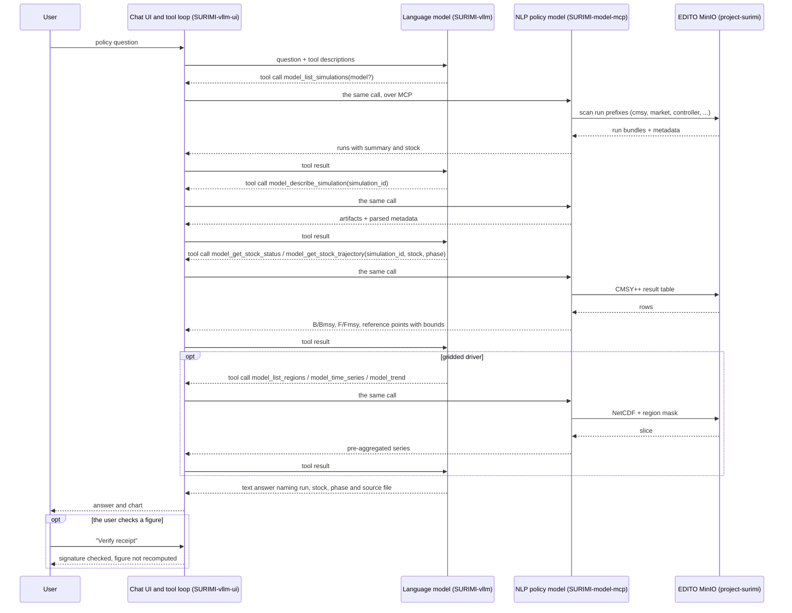
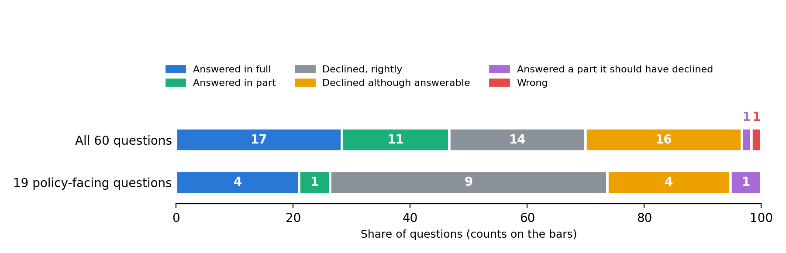

# D3.9 – NLP policy model

## DOCUMENT INFORMATION

| Grant Agreement     | 101157456 |
| ------------------- | --------- |
| Project Acronym     | SURIMI |
| Project Title       | Integration of innovative and reliable socio-ecological models and user-driven solutions into the Digital Twin Ocean, to facilitate what-if scenarios and decision support, under a co-creation approach. |
| Deliverable Number  | D3.9 |
| Work Package Number | WP3 |
| Deliverable Title   | NLP policy model |
| Lead Partner        | NORCE |
| Author(s)           | Hasan Asyari Arief, Önder Gürcan |
| Due Date            | 31 October 2026 |
| Submission Date     | |
| Dissemination Level | Public |
| Type of Deliverable | Other |

| Version   | Summary of Changes |
| --------- | ------------------ |
| Version 0 | Initial version. Figures from the evaluation of 23 September 2026. |
| Version 1 | Figures from three runs of the evaluation of 1 October 2026 on data-mcp 1.2.37 and 1.2.38, model-mcp 1.2.11 and the vllm-ui 0.2.79 configuration, over the 60 questions of the revised question set. Adds the stock status tool that reads a run's NetCDF, and records that the earlier figures were measured while the chat did not reach this server. |
| Version 2 | Restructured after the quality review of 12 October 2026: the position of the model in the SURIMI framework (Figure 1), section 6 on benchmark accuracy, licence EUPL-1.2, a link to the architecture document, the content of the model output file, and the runs in the bucket on 12 October 2026. The figures are those of Version 1. |

## Summary

|      |  |
| ------------------- | --------- |
| Programming language     | Python |
| Nr of kubernetes pods       | 1 |
| Github repo       | https://github.com/SURIMI-Project/SURIMI-model-mcp |
| Ready-to-use wiring       | https://github.com/SURIMI-Project/SURIMI-vllm-ui (chat interface), https://github.com/SURIMI-Project/SURIMI-vllm (language model serving) |
| Architecture       | https://github.com/SURIMI-Project/SURIMI-model-mcp/blob/master/model_mcp_architecture.md |
| Licence       | EUPL-1.2 |

The NLP policy model surfaced as the **SURIMI model server**, under the tag SURIMI-model-mcp. Where the assessment model (D3.7) answers from the tables of the data lake, this policy model answers from what the simulation models produced, meaning the runs that the CMSY++, market, controller and fisheries authority models upload to the project bucket, the stock assessment results inside them, and the gridded forcing files next to them, all of which can be asked about in natural language through the same EDITO-hosted open weight large language model, Muse-Glimmer-30B from Red Hat.

*Figure 1. The NLP policy model (dark) in the SURIMI framework. It answers from what the models produce, on the output side of the model ensemble; its sibling, the NLP assessment model (D3.7), answers from the SURIMI data lake.*

The model server does not run a simulation. A SURIMI experiment takes one to two days, so the assistant works over runs that already exist.

The server ships in the ready to use wiring documented in D3.7, as its second tool server, and runs as a service of the SURIMI project on the EDITO Datalab, launched from the EDITO service catalogue. As a Model Context Protocol server it can also be wired into a frontier model such as Claude.ai or ChatGPT.[^1]

*Figure 2. How a policy question is answered: discovery of the runs, one run opened and the stock result read with its bounds.*

Of the 60 expert questions, 19 were asked from a policy position, and these are the ones this deliverable is for. Over three runs the system answered 5 or 6 of them, declined the 9 it was right to decline, and gave no wrong answer (section 6.3).

Integration into the model GUI, due in April 2027, is outside this deliverable.

[^1]: The `README.md` of SURIMI-data-mcp lists the supported MCP clients, and `docs/workshop-cheatsheet.md` in the same repository walks through attaching a SURIMI server to Claude Desktop in a few steps; the model server attaches in the same way at its `/mcp` endpoint.

## 1. Model purpose

The NLP policy model explains in plain language what SURIMI's simulations found about a policy choice, so that users without a detailed understanding of the quantitative models can follow why a policy performs as it does. The policy layer of the SURIMI ensemble has two component models: the MSE policy model (D3.8), which computes regulations from harvest control rules inside the simulation, and this one.

This model works outside the simulation loop, as a helper that summarises and explains model runs, tables, charts and policy results; it does not take part in the simulation itself. In SURIMI a policy choice is a management strategy (a harvest control rule, a quota, a subsidy or an effort limit) tested by simulation across the ensemble (D3.1 to D3.8).

The model sits on the model GUI side of the platform, where what-if scenarios and policy measures live, with D3.7 on the data GUI side. It tells a user what simulations exist, explains their parameters, helps choose or compare scenarios, explains what-if results and trade-offs, and answers "what can this tool do?", while it does not write to storage or read data the user supplies. Like D3.7 it is built as a tool server, and the language model that drives it is replaceable.

## 2. Process overview and scheduling diagram

A policy question usually starts with discovery, in which the language model lists the runs, picks one and pulls the result it needs, while a question about a climate or ocean driver goes to the gridded tools of the same server, as the diagram below shows.

## 3. Configuration

All configuration is version-controlled in the repository and applied at deploy time. The tables below keep what a reader needs; the full configuration, environment variables and deployment are in the repository's architecture document.

### 3.1 The server

| Setting | Value |
| --- | --- |
| Entry point | `server.py`, FastMCP; three registering modules (`nc_tools`, `sim_tools`, `reference_tools`) and CI asserts that every declared tool is defined and namespaced `model_*` |
| Storage | the `project-surimi` bucket on EDITO MinIO; no database |
| Gridded prefix | `netcdf/`, with the legacy `NetCDF/` reachable only through a transitional fallback |
| Run layout | `<model>/<scenario_name>/...`; model directories `cmsy`, `market`, `controller`, `fisheries_authority`, `output_creator`, all `lower_snake_case` |
| Excluded prefixes | housekeeping and lake prefixes (`raw/`, `processed/`) are never scanned for runs, and the listing reports how many run-like objects sit there |
| Cache | at launch the server copies the NetCDF catalogue, the simulation artifacts and the reference files (species codes, ecosystem models, case-study contracts, about 14 MB) onto its volume and reads through that copy, so it keeps answering after the 24-hour expiry of the EDITO storage token; `stale=true` marks a listing served after storage became unreachable, and an object uploaded after launch is not seen until the next restart with a valid token |
| Receipt secret | `SURIMI_RECEIPT_SECRET`, shared with the data server (D3.7) |
| Deployed version | image `ghcr.io/surimi-project/surimimodelmcp:1.2.11`; the evaluation in section 6 was run on this version |

### 3.2 Stock assessment reading

A run is read the way the CMSY++ script wrote it.

| Setting | Value |
| --- | --- |
| Source | the CMSY++ result table of a run (`Out_..._id_file.csv`) |
| Phase | required argument, `historical` (assessed from observed catch and abundance) or `simulation` (assessed from ecosystem-model output); a run without that split is refused by file name |
| Estimator | reported per run, CMSY (catch only) or BSM (catch plus abundance index), decided by the same rule the CMSY++ script uses |
| Bounds | every point estimate carries `lcl` and `ucl`, stated as the 2.5th and 97.5th percentile of the MCMC posterior and not as a confidence interval |

### 3.3 Ready to use wiring

The wiring is the one documented in D3.7, section 3.2, and this server is attached to it as `server:mcp:surimi-model` at `https://project-surimi-surimi-model-mcp.lab.dive.edito.eu/mcp`.

## 4. Inputs

The user provides a single input, a policy question in natural language, and everything else the model reads sits in the bucket. The tools that read it are listed in Table 1.

*Table 1. The 26 tools by group.*

| Group | Tools | What they answer |
| --- | --- | --- |
| Simulation | `model_list_simulations`, `model_describe_simulation`, `model_get_artifact`, `model_get_stock_status`, `model_get_stock_trajectory`, `model_run_stock_status`, `model_explain_assessment_field` | which runs exist and what each is about, one run's artifacts and metadata, the Kobe status and trajectory of a stock with bounds from a result table or from a run's NetCDF, what a CMSY++ field means |
| Gridded files and coverage | `model_list_files`, `model_describe_file`, `model_list_variables`, `model_list_regions`, `model_get_time_range`, `model_get_spatial_bounds`, `model_get_coverage_summary`, `model_check_cf_compliance`, `model_validate_alignment` | what a file holds, its regions and period, and whether two files align |
| Gridded series | `model_time_series`, `model_trend`, `model_compare_periods`, `model_top_regions` | a regional series, its trend, a period comparison, a ranking of regions |
| Reference | `model_describe_ecosystem_model`, `model_get_contract`, `model_lookup_code`, `model_search_taxon`, `describe_model_capabilities` | the ecosystem model behind a run, the scenario contract, species and gear codes, what the server serves |
| Verification | `model_verify` | check the signature of any receipted slice or figure |

### 4.1 Simulation runs

The runs are per-model bundles in the layout of section 3.1, and the seven simulation tools of Table 1 read them, from the listing with its one-line summary and assessed stock per run, through one run's artifacts and parsed metadata, to the Kobe status and the year-indexed trajectory of a stock out of its CMSY++ result table or out of the run's NetCDF, and the meaning of any CMSY++ input or result column.

The runs that the output creator writes carry the CMSY++ result as arrays inside the NetCDF file, not as a result table, and `model_run_stock_status` reads those: B/Bmsy and F/Fmsy for each stock, and with a stock named its trajectory and Kobe position. When the evaluation was run the bucket held one such run, with 47 western Mediterranean stocks up to 2013; on 12 October 2026 it held eight. The file has no uncertainty bounds and does not mark which years are historical and which simulated, and the tool says so in every response. The harvest-control-rule runs of the fisheries authority model, 35 when the evaluation was run and 54 on 12 October 2026, are served as artifacts through `model_get_artifact`.

The output file of an experiment is written by the Output Creator after the experiment ends, as one NetCDF4 file under `output_creator/experiments/<id>/`. It holds biomass, gross catch and live and dead discards on the model grid by species and fleet, with their totals per species and fleet. It also holds prices, sales value and sales quantity by market, and fishing activity by fleet. When the experiment includes stock assessments it adds stock status and exploitation by year and species, which `model_run_stock_status` reads. The value chain model is not finished, so no output file carries value-chain results yet.

### 4.2 Gridded forcing and observations

The files under `netcdf/` are external forcing and observation datasets on the same grid conventions as the ensemble, and the thirteen gridded tools of Table 1 return pre-aggregated, pivotable slices over them, so that raw grid cardinality never reaches the language model.

### 4.3 Reference and contract

The reference tools of Table 1 name the ecosystem model behind a run, return the SURIMI scenario contract, and resolve species and gear codes, while `describe_model_capabilities` states which classes of question this server serves and which it does not.

## 5. Outputs

### 5.1 Run discovery

A list of the SURIMI runs that bear on the question, each with the model, the scenario, the stock and the year range, flagged when the listing is stale or partial (section 3.1).

### 5.2 Stock status and trajectory

The status of a stock in a given run and phase, as B/Bmsy and F/Fmsy with the bounds and estimator of section 3.2, and its trajectory over the years. The answer names the source file.

### 5.3 Gridded slice and explanation

A series, trend, period comparison or ranking over named regions, with the file, variable and mask it came from, and a definition of any assessment field, code or contract element the user names, taken from the CMSY++ documentation, the SURIMI protocol or the reference tables.

### 5.4 Receipt and refusal

Every figure carries a signed receipt whose signature `model_verify` checks; the model server has no path to recompute a figure. Where no run or file supports the question the capability registry says so and the answer states what was looked for.

## 6. Benchmark accuracy

A language model can misread a question, miss what the data holds, or state a figure the data does not support. This section reports how often that happens with the deployed setup, so a reader knows what to expect from it and where it falls short. It starts with the prompts that steer the model, because they decide what the model is asked to do. On this server the prompts are the tool descriptions the language model reads before each call, together with the system prompt of the ready to use wiring. Together they aim for one behaviour: the model answers only from SURIMI's runs and files and refuses what they do not support.

### 6.1 Objectives for each prompt

| Prompt | Objective |
| --- | --- |
| `model_list_simulations` description | Call first for any question about a run. Answer "which models have runs" from the scanned list, and "what is run X about" from the run's own summary and stock, without opening every run. Treat a null summary as unknown, never as a guess. Say when the listing is stale or partial. |
| `model_describe_simulation` description | Open one run only after the listing has picked it. Report artifacts and parsed metadata. |
| `model_get_stock_status` and `model_get_stock_trajectory` descriptions | Require the phase, historical or simulation, and refuse a run that has no such split, naming the file to fetch instead. Report every estimate with its bounds and say what the bounds are. Name the estimator, CMSY or BSM, and why. |
| `model_get_artifact` description | Fetch one file and say when the content is a cut prefix, never present it as the whole file. |
| `model_explain_assessment_field` description | Define a CMSY++ input or result column and how the script uses it, from the script's own documentation. |
| Gridded tool descriptions | Find the file, then the variable, then the exact region name from the mask, then call one analytic tool. Never guess a region name. Answer from the pre-aggregated summary. Prefer `model_trend` for "is it increasing" questions. |
| System prompt of the wiring, gridded workflow block | The same four-step order, stated once for every client that uses the shared prompt. |
| System prompt of the wiring, register and rules blocks | Lead with the answer in everyday words for policy-makers and stakeholders. Define terms at first use. Never invent a run, stock, file or number. Cite every figure with its receipt id. End every turn with a plain answer. |

### 6.2 How the model is evaluated

The model is evaluated in two ways. The first is the server's own behavioural benchmark of 33 cases in `benchmark/` of SURIMI-model-mcp, each with a grounding command that recomputes the expected figure from the files and scored by the same deterministic grader as D3.7, which runs against every release.

The second is the expert evaluation described in D3.7, section 6.2. Three of the ten reviewers asked from a policy position, the fisheries economist E1 on the marine spatial planning form, the marine science policy adviser E2 and the science policy officer E10, and their 19 questions form the policy-facing subset reported below, while the whole-model figure remains the primary result for D3.9 as it is for D3.7, because the set is not split by server.

### 6.3 Result

The evaluation is the one reported in D3.7, section 6.3: three runs on 1 October 2026, here against model-mcp 1.2.11. Its audit page is `/audit/experts/v_dm1.2.39_mm1.2.11` on the data server.

| | All 60 | Policy-facing 19 |
| --- | ---: | ---: |
| Answered correctly | 16 to 19 | 4 to 5 |
| Answered in part | 11 to 14 | 1 to 2 |
| Refused although the data supports an answer | 13 to 16 | 3 to 4 |
| Wrong | 0 to 1 | 0 |
| Correctly refused, unanswerable question | 14 | 9 |
| Answered a part they should have declined | 0 to 1 | 0 to 1 |
| Answers judged fabricated | 0 to 1 | 0 to 1 |

E10 asked what data is available, where it came from, how far it can be trusted and what a species code refers to. The system answered three of the four in two runs and all four in the third, asking which dataset was meant when it did not answer. Her fifth question, what the data was used for within the project, it answered in part from the architecture documents in two runs and in the third run the answer was graded made up. In all three it did not say that no document records the use of each dataset. E2 asked how Belgian catches will change with climate change, and the system declined, which is right because SURIMI holds no North Sea case study and no projection. It also declined one or two questions the data could have answered, on the biodiversity implications of Belgian catches and on whether subsidies help Belgian fishers be sustainable. E1's five spatial planning questions, on housing, infrastructure and development priorities, lie outside any SURIMI dataset and were all declined. So was her question on the effect of a Greek diesel price rise over ten years, for which no model carries a fuel cost. Her question on the most profitable fishing sector in Italy was answered in full. Her question on trawling revenue in Spain under a January to March closure was declined although the data holds the revenue at stake.

*Table 2. The three policy-facing reviewers and their questions.*

| Reviewer | Role | Questions | Answered | Declined correctly | Declined although answerable | Answered a part it should have declined | Wrong |
| --- | --- | ---: | ---: | ---: | ---: | ---: | ---: |
| E1 | fisheries economist, marine spatial planning form | 8 | 1 | 6 | 1 | 0 | 0 |
| E2 | marine science policy adviser, fisheries policy and subsidies | 6 | 1 to 2 | 3 | 1 to 2 | 0 | 0 |
| E10 | science policy officer | 5 | 3 to 4 | 0 | 0 to 1 | 1 | 0 |
| | | **19** | **5 to 6** | **9** | **3 to 4** | **1** | **0** |

*Counts are the lowest and highest of three runs.*

*Figure 3. Verdicts on all 60 expert questions next to the 19 from the policy-facing reviewers, first of three runs, Muse-Glimmer-30B through the EDITO chat, 1 October 2026.*

The figures of the first version of this deliverable, from 23 September, were measured while the chat did not reach this server (D3.7, section 6.4), and are superseded by the table above.

### 6.4 Known limits

The model does not act inside the simulation: it does not read the state of the simulated fishery or emit regulations through the SURIMI protocol, and every answer about a scenario is an answer about a run that a modeller has already completed and uploaded.

The runs observed live carry one unlabelled CMSY++ result table and no historical or simulation split, so `model_get_stock_status` and `model_get_stock_trajectory` refuse them by name. Since model-mcp 1.2.8 the output runs are read from their NetCDF instead (section 4.1). In the same way, the bucket holds per-model run bundles named by scenario directory, not a catalogue of pre-run scenarios with a region, a climate scenario, a policy measure and a duration for each. When runs arrive in that shape, discovery works over them without a code change. The output run is on the model's own grid, 82 by 109 cells for the western Mediterranean, and no region mask on that grid is served, so a question about which areas a result applies to cannot be split by area with the tools.

The policy-facing subset is 19 questions and the count answered moved by up to four between runs, so a change of one or two questions in it is noise and the subset is reported as counts, not as a rate. The questions declined although answerable are all data-server questions, so none is a limit of the model server.
