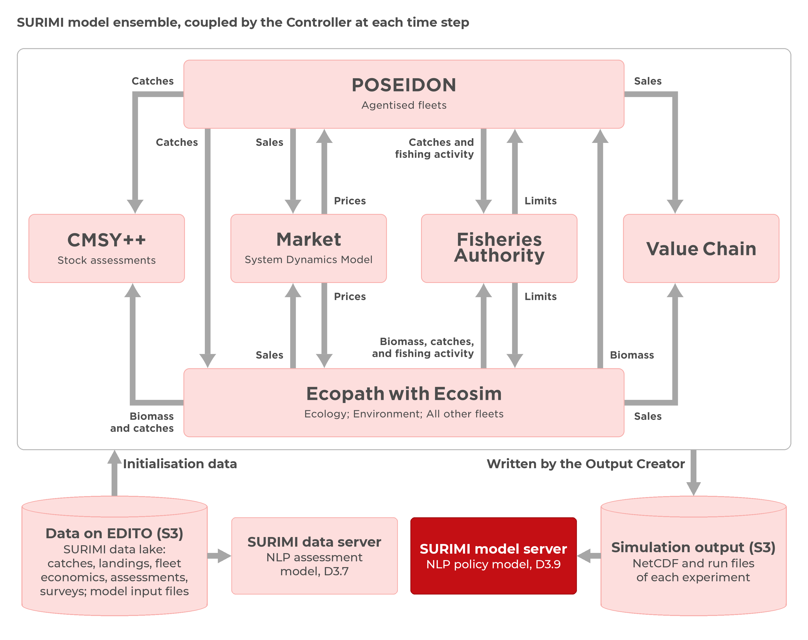
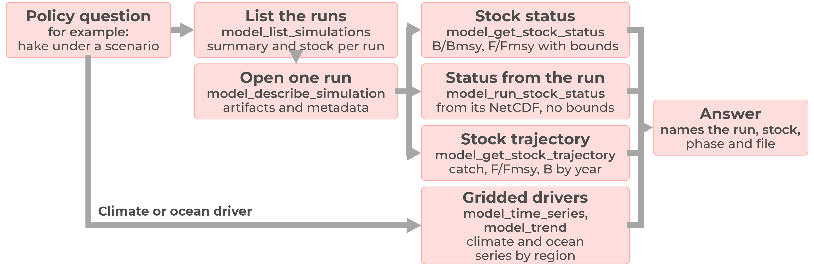
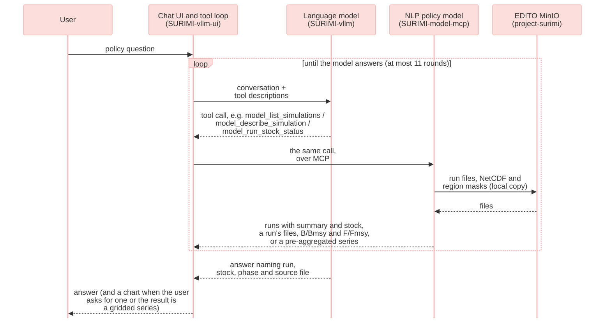

# D3.9 – NLP policy model

## DOCUMENT INFORMATION

| Grant Agreement | 101157456 |
|----|----|
| Project Acronym | SURIMI |
| Project Title | Integration of innovative and reliable socio-ecological models and user-driven solutions into the Digital Twin Ocean, to facilitate what-if scenarios and decision support, under a co-creation approach. |
| Deliverable Number | D3.9 |
| Work Package Number | WP3 |
| Deliverable Title | NLP policy model |
| Lead Partner | NORCE |
| Author(s) | Hasan Asyari Arief, Önder Gürcan |
| Due Date | 31 October 2026 |
| Submission Date | 30 October 2026 |
| Dissemination Level | Public |
| Type of Deliverable | Other |

| Version   | Summary of Changes                         |
|---------------|------------------------------------------------|
| Version 0     | Initial version, submitted on 23 October 2026. |
| Version 1     | Addition of figures                            |
| Final Version | Revision of sections 1 and 2                   |

## Summary

|  |  |
|----|----|
| Programming language | Python |
| Number of Kubernetes pods | 1 |
| GitHub repo | <https://github.com/SURIMI-Project/SURIMI-model-mcp> |
| Architecture | [model_mcp_architecture.md](https://github.com/SURIMI-Project/SURIMI-model-mcp/blob/master/model_mcp_architecture.md) |
| Tools, in plain words | [docs/tools.md](https://github.com/SURIMI-Project/SURIMI-model-mcp/blob/master/docs/tools.md); behaviour in detail in [docs/behaviour.md](https://github.com/SURIMI-Project/SURIMI-model-mcp/blob/master/docs/behaviour.md) |
| Chat and language model | [SURIMI-vllm-ui](https://github.com/SURIMI-Project/SURIMI-vllm-ui) and [SURIMI-vllm](https://github.com/SURIMI-Project/SURIMI-vllm), shared with D3.7 |
| Licence | EUPL-1.2 |

SURIMI-model-mcp is the natural language processing (NLP) policy model of the SURIMI toolbox. Its job is to help users to interpret the results of SURIMI simulations through a chat interface. For example, a policy officer can ask what quota a harvest control rule set for a stock in a run, or what the result of a simulation run shows for a particular stock. The model provides a clear, plain-language answer that points back to the simulation run it is based on.

Behind the chat interface, a large language model (LLM) interprets what the user is asking and selects the appropriate server tools to retrieve information, and the chat then runs them. The runs come from the SURIMI models, which store their results on the European Digital Twin of the Ocean (EDITO). Users access SURIMI-model-mcp through the SURIMI chat interface (SURIMI-vllm-ui), whose default language model is Muse-Glimmer-30B, the same open-weight LLM from Red Hat described in D3.7. The questions the model can answer depend on the information available from each simulation run and the server’s access to EDITO storage, which expires a day after launch (§5.4).

A second NLP model, SURIMI-data-mcp (D3.7), complements it by answering questions about the SURIMI data lake, the data the models start from (Figure 1).

 <em>Figure 1. Position of the NLP policy model (red) within the SURIMI framework. It reads the NetCDF and run files that the SURIMI models write to EDITO storage (S3), while the NLP assessment model (D3.7) reads the raw data and metadata on EDITO data storage (S3) that the SURIMI models use.</em>

SURIMI-model-mcp does not run simulations itself. Instead, it works with results from completed simulation runs, as running a new experiment can be time-consuming.

## 1. Model purpose

SURIMI-model-mcp is the NLP policy model of SURIMI, implemented as a server. Its purpose is to help users explore and understand simulation results, including how different policy choices affect fisheries outcomes. In SURIMI, a policy choice refers to a management strategy, whose effects are evaluated through simulations. While the management strategy evaluation (MSE) policy model (D3.8) applies these strategies during simulations, SURIMI-model-mcp (D3.9) helps users interpret the results afterwards by providing tools to retrieve, read, and explain simulation results.

Users interact with SURIMI-model-mcp through the SURIMI chat interface (SURIMI-vllm-ui), where they can ask questions in plain language. An LLM hosted by SURIMI-vllm interprets their questions and selects the appropriate tools provided by the server. These tools retrieve the relevant simulation results, which the LLM then uses to generate an answer[^1].

For example, a user can ask the chat to compare the 2016 bluefin tuna quota in two runs of the Fisheries Authority model, and whether the two runs used different harvest control rules. The LLM opens the assessment file of each run with `model_get_artifact` and reads a quota of 52,492 in one and 32,642 in the other. It reports that the two runs used the same rule parameters and that the quotas differ because the stock’s biomass was estimated at 70,528 in one and 59,171 in the other. The files do not record why the two estimates differ.

The stock results it reads come from CMSY++ (D3.6), which estimates biomass and fishing pressure relative to maximum sustainable yield from catch and, where available, an abundance index ([Froese et al., 2023](https://doi.org/10.3897/aiep.53.105910)). The gridded results are NetCDF files, which the server reads with xarray ([Hoyer and Hamman, 2017](https://doi.org/10.5334/jors.148)).

SURIMI-model-mcp is implemented in Python using FastMCP and provides 26 tools through the Model Context Protocol (MCP) ([Anthropic, 2025](https://modelcontextprotocol.io/specification/2025-06-18)). It accesses simulation results directly from the `project-surimi` bucket in EDITO object storage, without an intermediate database. The server only reads stored simulation results; it neither modifies files nor processes user-supplied data.

## 2. Process overview and scheduling diagrams

Most policy questions require identifying the relevant simulation run. The LLM lists available runs, opens one and retrieves its results, as shown in Figures 2 and 3. Questions about climate or ocean conditions are handled by the gridded tools provided by the same server.

 <em>Figure 2. Sequence of steps used to retrieve stock status from a simulation run, including uncertainty bounds when the result comes from a CMSY++ table.</em>

*Figure 3. Messages between the user, the chat, the language model and SURIMI-model-mcp when a policy question is answered.*

### 2.1 The tools

SURIMI-model-mcp provides 26 tools organised into five groups (Table 1): seven read simulation runs, nine describe gridded files, four summarise gridded files, five look up reference information, and one checks that the record of a gridded result has not changed.

*Table 1. The 26 tools by group.*

| Group | What they answer |
|----|----|
| Simulation | Available simulation runs and what each is about, the files and metadata of a run, the stock on the Kobe plot (B/Bmsy against F/Fmsy) and its trajectory, and the definition of a CMSY++ field. |
| Gridded files and coverage | The contents of a gridded file, its spatial and temporal coverage, and whether two files align. |
| Gridded series | Series, trends, comparisons between periods, and rankings of regions. |
| Reference | The structure of an ecosystem model file, the scenario contract, species and gear codes, and the questions the server can and cannot answer. |
| Verification | Checks that the record of a gridded result has not changed since the server produced it. |

### 2.2 Ready to use on EDITO

The model server runs on the EDITO Datalab and is launched from the EDITO service catalogue. Like the data server, it can also be accessed by any other MCP client through its `/mcp` address.[^2]

*Table 2. Configuration overview. The complete list of settings and environment variables is provided in the [architecture document](https://github.com/SURIMI-Project/SURIMI-model-mcp/blob/master/model_mcp_architecture.md#environment-variables).*

| Setting | Value |
|----|----|
| Entry point | The `surimi_model_mcp` package, started with `python -m surimi_model_mcp` ([`server.py`](https://github.com/SURIMI-Project/SURIMI-model-mcp/blob/master/surimi_model_mcp/server.py)) and built on FastMCP. Its tools are in [`surimi_model_mcp/tools/`](https://github.com/SURIMI-Project/SURIMI-model-mcp/tree/master/surimi_model_mcp/tools) (gridded, runs, lookups, overview), and an automatic test checks that every tool declared by the gridded, runs and lookups modules is defined and carries the `model_` namespace. |
| Run layout | `<model>/.../<uuid>/...` (a run is grouped by its first UUID, and the Fisheries Authority writes flat `<uuid>_<name>` files); model directories include `cmsy`, `market`, `controller`, `fisheries_authority`, `output_creator`, all `lower_snake_case`. |
| Cache | At launch, the server copies the NetCDF catalogue, the simulation files and the reference files (species codes, ecosystem models, case-study contracts, about 14 MB) onto its volume and reads through that copy, so it keeps answering after the 24-hour expiry of the EDITO storage token; `stale=true` marks a listing served after storage became unreachable, and an object uploaded after the token has expired is not seen until the next restart with a valid token ([local copies](https://github.com/SURIMI-Project/SURIMI-model-mcp/blob/master/model_mcp_architecture.md#local-copies)). |
| Chat | Attached to the chat of D3.7 as `surimi-model` at `https://project-surimi-surimi-model-mcp.lab.dive.edito.eu/mcp`. |
| Deployed version | Image `ghcr.io/surimi-project/surimimodelmcp:1.2.12`. The evaluation in §5 used 1.2.11. Version 1.2.12 restructured the code as one package, with the tools and their addresses unchanged. |

## 3. Inputs

SURIMI-model-mcp retrieves data exclusively from the `project-surimi` bucket on EDITO: simulation runs, gridded files and reference tables.

### 3.1 Simulation runs

Each model uploads its runs to a directory of its own, and a run is a subdirectory named by a UUID (the Fisheries Authority writes flat files prefixed by the UUID; Table 2). These runs are read by the seven simulation tools ([`simulations/`](https://github.com/SURIMI-Project/SURIMI-model-mcp/tree/master/surimi_model_mcp/simulations)). `model_list_simulations` gives a one-line summary of each run that has a parser (the stock, years and biomass type for a CMSY run), and `model_describe_simulation` lists the files and metadata of a single run. The stock tools then report a stock’s status and its year-by-year trajectory, read either from a CMSY++ result table or from the run’s NetCDF file. `model_explain_assessment_field` explains a fixed set of CMSY++ fields (`btype`, `force.cmsy`, Resilience, N bt, last B/Bmsy, last F/Fmsy and the year-indexed columns) and, for any other field, returns an error that lists the fields it can explain. `model_get_artifact` returns a text file from a run inline (cut at a size cap) and any binary file as a download link.

The Output Creator, the SURIMI component that writes an experiment’s output file, stores the CMSY++ results as arrays inside the NetCDF file rather than as a result table. `model_run_stock_status` reads B/Bmsy and F/Fmsy for each stock. Without a stock name it gives every stock’s position on the Kobe plot, which places a stock by B/Bmsy against F/Fmsy, for a given year, and the count per quadrant; for a named stock it adds the trajectory. The file has no uncertainty bounds and does not explain which years are historical and which are simulated, and the tool states this in every answer. At the time of the evaluation, the bucket held one such run, covering 47 western Mediterranean stocks up to 2013; by 9 October 2026, it held eight. The Fisheries Authority model had uploaded 35 harvest-control-rule runs at the time of the evaluation and 54 by 9 October 2026. These are served as files through `model_get_artifact`.

The Output Creator writes the output file once the experiment has ended, as a NetCDF4 file, together with the raw recording (`.bin`) of the experiment, under `output_creator/experiments/<id>/`. The file holds biomass on the model grid by species; gross catch and live and dead discards on the grid by species and fleet; and totals per species and per fleet. It also holds prices, sales value and sales quantity by market, and fishing activity by fleet. If the experiment includes stock assessments, the file also carries stock status and exploitation by year and species, which is what `model_run_stock_status` reads. The output file carries no value-chain results.

### 3.2 Gridded files and region masks

The files under `netcdf/` come from outside SURIMI: gridded data (currently an EcoOcean/FishMIP biomass density file) and the region masks used to summarise them. The thirteen gridded tools never pass the grid cells to the LLM. The analytic ones return a summary over a named region, such as a series, a trend or a ranking of regions, and the others return file metadata ([`netcdf/`](https://github.com/SURIMI-Project/SURIMI-model-mcp/tree/master/surimi_model_mcp/netcdf)).

### 3.3 Reference and contract

The reference tools describe the structure of an EwE ecosystem model file and resolve species, gear and country codes, and taxon names. They also return the SURIMI scenario contract, which lists markets, currencies and fleet segments, gives the number of species, and states the code standards and units; it is the northwestern_med contract. `describe_model_capabilities` states which kinds of questions the server can and cannot answer ([`reference/`](https://github.com/SURIMI-Project/SURIMI-model-mcp/tree/master/surimi_model_mcp/reference)).

## 4. Outputs

### 4.1 Run discovery

`model_list_simulations` returns the runs in the bucket, newest first, optionally filtered by model, each with its model, run id, number of files, last-modified time and, where a parser exists, a one-line summary and the stock. If some objects could not be listed, the tool marks the list as partial.

### 4.2 Stock status and trajectory

`model_get_stock_status` and `model_get_stock_trajectory` return the status of a stock in a given run and phase (`historical` or `simulation`, Table 3) as B/Bmsy and F/Fmsy, together with their bounds and the estimator that produced them, and its trajectory over the years. They read the result exactly as the CMSY++ script wrote it (Table 3), and the answer names the file it came from. No CMSY++ result table that these tools accept is currently in the bucket, so only `model_run_stock_status` (point values, no bounds) returns stock status.

*Table 3. How a stock result is read.*

| Setting | Value |
|----|----|
| Source | `CMSY_output_historical.csv` or `CMSY_output.csv` of a run, written by the CMSY service. A run with only the older `Out_..._id_file.csv` is not used as a source. |
| Phase | Required argument, `historical` (assessed from observed catch and abundance) or `simulation` (assessed from ecosystem-model output). |
| Estimator | Reported per stock result, CMSY (catch only) or BSM (catch plus abundance index), decided by the rule in the CMSY++ script (BSM when an abundance index has at least 5 years); the tool cannot determine whether `force.cmsy` was set. |
| Bounds | Every point estimate carries `lcl` and `ucl`, stated as the 2.5th and 97.5th percentiles of the Markov chain Monte Carlo (MCMC) posterior and not as a confidence interval. |

### 4.3 Gridded summary and definitions

The gridded tools return a series, a trend, a comparison between two periods or a ranking of named regions. Each result identifies the file, the variable and the region mask it came from. A region mask is the set of grid cells that make up a named region. When the user asks about an assessment field, a code or an element of the scenario contract, the model defines it from the CMSY++ input description and script, the code tables, or the scenario contract.

### 4.4 Refusal

When no run or file can answer the question, the server returns an error or a capability record naming what it cannot answer and why ([`sources.py`](https://github.com/SURIMI-Project/SURIMI-model-mcp/blob/master/surimi_model_mcp/sources.py), [`capabilities.py`](https://github.com/SURIMI-Project/SURIMI-model-mcp/blob/master/surimi_model_mcp/capabilities.py)), and the chat states what was searched for.

## 5. Benchmark accuracy

As in D3.7, the LLM can misread a question, miss a run the server holds, or give a number that no tool returned. Two sets of prompts are used to reduce these errors: the tool descriptions that the LLM reads, and the system prompt of the chat (Table 4). Together, they tell the model to answer only from SURIMI’s runs and files and to decline answering irrelevant questions.

### 5.1 Objectives for each prompt

*Table 4. The prompts and what each one tells the model.*

| Prompt | Objective |
|----|----|
| `model_list_simulations` description | Call first for any question about a run. Answer “which models have runs” from the scanned list, and “what is run X about” from the run’s own summary and stock, without opening every run. Treat a null summary as unknown, never as a guess. Explain when the listing is stale or partial. |
| `model_describe_simulation` description | Open one run only after the listing has picked it. Report the run’s files and parsed metadata. |
| `model_get_stock_status` and `model_get_stock_trajectory` descriptions | Require the phase, historical or simulation, and refuse a run that has no such split, naming the file to fetch instead. For `model_get_stock_status` only: report every estimate with its bounds and explain what the bounds are, and name the estimator, CMSY or BSM, and why. |
| `model_get_artifact` description | Fetch one file and flag when the content is a cut prefix, never present it as the whole file. |
| `model_explain_assessment_field` description | Define a CMSY++ input or result column and how the script uses it, from the script’s own documentation. |
| Gridded tool descriptions | Find the file, then choose the variable, then look up the exact region name in the mask, then call the matching analysis tool. Never guess a region name. Answer from the pre-aggregated summary. Prefer `model_trend` for “is it increasing” questions. |
| Chat system prompt, register and rules blocks | Give the answer first, in everyday language, for policy-makers and stakeholders. Define terms at first use. Never invent a file path, variable, region or column name, or number. Give every number with the dataset or report it came from and the period it covers. End every turn with a plain answer. |

### 5.2 How the model is evaluated

The server has its own benchmark of 54 test cases, built in the same way as that of D3.7. For each numeric turn, the expected number is the output of a grounding command run against the live server and recorded in the case, and a deterministic script compares it with the numbers in the model’s answer. No language model is involved in this step. Turns the script cannot verify are left ungraded.

The server also takes part in the expert evaluation of D3.7 (§5.2). Three of the ten experts asked their questions from a policy perspective: a fisheries economist who also filled in the marine spatial planning form (E1), a marine science policy adviser (E2) and a science policy officer (E10). Between them they asked 19 of the 60 questions (Table 6).

### 5.3 Result

The results come from the three runs of 1 October 2026 reported in D3.7 (§5.3), graded again on 2 October 2026 after seven expected answers were corrected. The results of the first run are shown in Figure 4. The questions, expected answers and verdicts are available to SURIMI partners on request.

*Table 5. Verdicts on all 60 expert questions and on the 19 policy-facing questions, lowest and highest of three runs.*

|  | All 60 (45 answerable, 15 not) | Policy-facing 19 (9 answerable, 10 not) |
|----|---:|---:|
| Answered correctly | 16 to 20 | 4 to 6 |
| Answered in part | 11 to 15 | 1 to 3 |
| Refused although the data supports an answer | 12 to 16 | 2 to 4 |
| Wrong | 0 to 1 | 0 |
| Correctly refused | 14 | 9 |
| Answered a part it should have declined | 0 to 1 | 0 to 1 |
| Answers judged fabricated | 0 to 1 | 0 to 1 |

E10 asked what data is available, where it came from, how far it can be trusted and what a species code refers to. The chat answered three of these four in two runs and all four in the third; when it did not answer, it asked which dataset was meant. E10’s remaining question was what the data had been used for within the project. In two runs, the chat gave a partial answer based on the project wiki, and in the third, its answer was judged invented. In the second run, its reply was that the documents give no purpose beyond the exchange between models; in the other two runs, it did not explain that no document records how each dataset is used.

E2 asked how Belgian catches will change with climate change. The chat declined, which is correct, since SURIMI holds no North Sea case study and no projection. It also declined questions that the data could have answered, on the biodiversity implications of Belgian catches and on whether subsidies help Belgian fishers be sustainable. Both were declined in the first run, both were answered in part in the second, and in the third, the subsidy question was answered in full and the biodiversity question declined.

E1’s five spatial planning questions, on housing, infrastructure and development priorities, fall outside every SURIMI dataset, and all were declined. The same went for E1’s question on the effect of a rise in Greek diesel prices over ten years, as no model carries a fuel cost. E1’s question on the most profitable fishing sector in Italy was answered in full. E1’s question on trawling revenue in Spain under a January to March closure was declined, even though the data holds the revenue at stake.

*Table 6. The three policy-facing reviewers and their questions.*

| Reviewer | Role | Questions | Answered | Declined correctly | Declined although answerable | Answered a part it should have declined | Wrong |
|----|----|---:|---:|---:|---:|---:|---:|
| E1 | fisheries economist, who also filled in the marine spatial planning form | 8 | 1 | 6 | 1 | 0 | 0 |
| E2 | marine science policy adviser, fisheries policy and subsidies | 6 | 1 to 3 | 3 | 0 to 2 | 0 | 0 |
| E10 | science policy officer | 5 | 3 to 4 | 0 | 0 to 1 | 0 to 1 | 0 |
|  |  | **19** | **5 to 7** | **9** | **2 to 4** | **0 to 1** | **0** |

*Counts are the lowest and highest of three runs.*

*Figure 4. Verdicts on all 60 expert questions and on the 19 from the policy-facing reviewers, in the first of three runs of Muse-Glimmer-30B through the chat on EDITO, 1 October 2026.*

### 5.4 Known limits

The model does not read the state of a running simulation, and it does not send regulations to the other models through the SURIMI protocol.

The CMSY++ runs in the bucket carry a single unlabelled result table and do not separate historical from simulated years. `model_get_stock_status` and `model_get_stock_trajectory` therefore decline them and name the file to fetch instead. The runs in the bucket are also filed by model and run identifier, not in a catalogue that records the region, climate scenario, policy measure and duration of each scenario. Runs filed in a new layout are found without a code change, but `model_list_simulations` has no field for region, climate scenario, policy measure or duration. The output of a run is on the model’s own grid, 82 by 109 cells for the western Mediterranean. Because the server has no map of named regions on that grid, the tools cannot break a result down by area.

The server reads the bucket with a temporary storage token that the EDITO launcher issues for about 24 hours. At launch, the server copies the runs, the NetCDF catalogue and the reference files onto its own volume. After the token expires, it keeps answering from that copy and marks its listings as stale. The language model is instructed to report this in its answer, and a request for a file the server never copied is refused with a message that the server must be launched again on EDITO. Runs uploaded after the token has expired are not seen until the server is launched again, so a listing can be several days out of date.

The server reads the NetCDF files from the `netcdf/` folder of the `project-surimi` bucket, both set in its Helm chart. If the bucket is restructured, the server has to be reconfigured and launched again.

Many runs hold only the models’ raw output. For such a run, the server can describe which variables, species, fleets and years the file holds and, where it carries stock assessments, report stock status by year. It cannot explain what the simulation found about a policy or why.

With only 19 questions, the policy subset is small, and the number answered ranged from 5 to 7 between runs. All the questions that the chat declined but could have answered belong to the data server, not to this one.

## References

### Literature

- Anthropic (2025). Model Context Protocol specification, version 2025-06-18. https://modelcontextprotocol.io/specification/2025-06-18
- Froese, R., Winker, H., Coro, G. et al. (2023). New developments in the analysis of catch time series as the basis for fish stock assessments: The CMSY++ method. Acta Ichthyologica et Piscatoria. https://doi.org/10.3897/aiep.53.105910
- Hoyer, S. and Hamman, J. (2017). xarray: N-D labeled Arrays and Datasets in Python. Journal of Open Research Software. https://doi.org/10.5334/jors.148

[^1]: The chat interface (SURIMI-vllm-ui) and the language model service (SURIMI-vllm) are shared with D3.7 and support the server, but they are not part of this deliverable.

[^2]: The [`README.md`](https://github.com/SURIMI-Project/SURIMI-data-mcp/blob/master/README.md) of SURIMI-data-mcp lists the supported MCP clients, and [`docs/workshop-cheatsheet.md`](https://github.com/SURIMI-Project/SURIMI-data-mcp/blob/master/docs/workshop-cheatsheet.md) in the same repository shows how to connect a SURIMI server to Claude Desktop.
