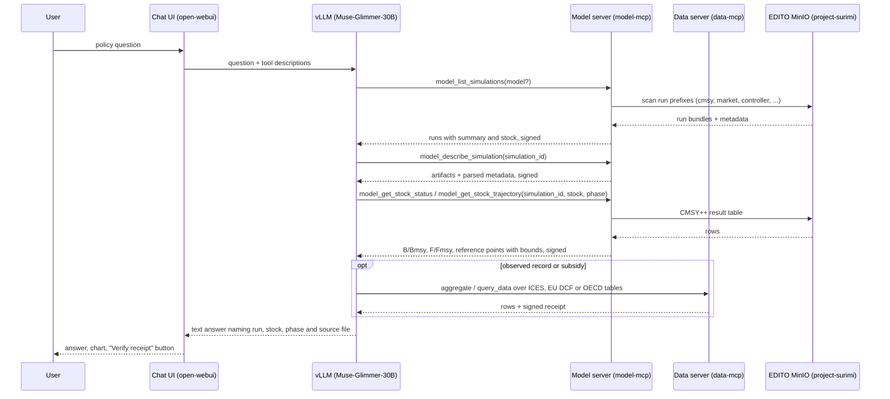

# D3.9 – NLP policy model

## DOCUMENT INFORMATION

| Grant Agreement     | 101157456 |
| ------------------- | --------- |
| Project Acronym     | SURIMI |
| Project Title       | Integration of innovative and reliable socio-ecological models and user-driven solutions into the Digital Twin Ocean, to facilitate what-if scenarios and decision support, under a co-creation approach. |
| Deliverable Number  | D3.9 |
| Work Package Number | WP3 |
| Deliverable Title   | NLP policy model |
| Lead Partner        | NORCE |
| Author(s)           | Hasan Asyari Arief |
| Due Date            | 31 October 2026 |
| Submission Date     | |
| Dissemination Level | Public |
| Type of Deliverable | Other |

| Version   | Summary of Changes |
| --------- | ------------------ |
| Version 0 | Initial version. Figures from the round-10 run of 23 September 2026. |

## Summary

|      |  |
| ------------------- | --------- |
| Programming language     | Python |
| Nr of kubernetes pods       | shares the 5 pods of D3.7 (data server, its PostgreSQL, model server, chat UI, vLLM) |
| Github repos       | https://github.com/SURIMI-Project/SURIMI-model-mcp, https://github.com/SURIMI-Project/SURIMI-data-mcp, https://github.com/SURIMI-Project/SURIMI-vllm-ui, https://github.com/SURIMI-Project/SURIMI-vllm |
| Language model       | Muse-Glimmer-30B, open weights, served by vLLM on the EDITO GPU node |
| Licence       | to be declared |

The NLP policy model gives a policy question a text answer grounded in SURIMI's simulation runs and policy data. A user asks about a management measure, a stock, a fleet or a subsidy in plain language. The model finds the SURIMI run or the table that bears on it, states what it says, and names the file.

The model does not launch simulations. A SURIMI experiment takes one to two days to run, so the consortium decided on 25 March 2026 that the policy assistant works over runs that already exist. It discovers them in object storage, explains their inputs and their stock assessment results, and reads the policy tables on the data side.

D3.7 and D3.9 are one deployed assistant with one evaluation. Round 10 of that evaluation, on 23 September 2026, put 68 expert questions to it. It answered 20 of the 54 answerable ones and correctly refused 11 of the 14 unanswerable ones. Of the 23 questions that came from the three policy-facing reviewers, it answered 6, refused 8 it could have answered, refused 5 correctly and got 4 wrong.

## 1. Model purpose

The Grant Agreement describes D3.9 as text descriptions that justify policy choices. In SURIMI a policy choice is a management strategy: a harvest control rule, a quota, a subsidy, an effort limit, tested by simulation across the model ensemble (D3.1 to D3.8). The NLP policy model is the text layer over those simulations. It tells a user which runs exist, what each one assumed, what it found for a stock, and how a result compares with the observed record.

The consortium mapped this module to the **model GUI** side of the platform, where what-if scenarios and policy measures live. D3.7, the assessment model, was mapped to the data GUI side. The two share one chat interface, one language model and two tool servers. What differs is the question the user asks and the tools the model reaches for.

The model reads two sources. The **model server** (SURIMI-model-mcp) lists and describes SURIMI simulation runs in object storage and serves stock assessment results from them. The **data server** (SURIMI-data-mcp) serves the policy tables: OECD fisheries support estimates, EU Data Collection Framework fleet economics and catch, ICES stock assessments. The model does not run simulations, does not write to storage and does not read data the user supplies.

## 2. Process overview and scheduling diagram

A policy question usually starts with discovery. The model lists the runs, picks one by its summary, then pulls the result it needs. A question about the observed record, or about a subsidy, goes to the data server instead.

Every analytical result is signed with the same receipt secret on both servers. The `model_verify` and `verify` tools recompute any signed figure.

## 3. Configuration

The deployment is the one described in D3.7, section 3: the seeded chat model `surimi-fisheries` with tool ids `server:mcp:surimi-data` and `server:mcp:surimi-model`, temperature 0, and the two tool-server endpoints on EDITO. This section lists only what the policy side adds.

### 3.1 Simulation run discovery

| Setting | Value |
| --- | --- |
| Bucket | `project-surimi` on EDITO MinIO |
| Run layout | `<model>/<scenario_name>/...`, model directories `cmsy`, `market`, `controller`, `fisheries_authority`, `output_creator`, all `lower_snake_case` under the consortium naming convention |
| Excluded prefixes | housekeeping and lake prefixes (`raw/`, `processed/`) are never scanned for runs; the listing reports how many run-like objects sit there |
| Summaries | built from each run's own metadata: for CMSY++ the stock, year range and biomass type; for market its config coverage. Null means unknown, never a guess |
| Cache | listing and summaries are cached; `stale=true` marks a listing served after storage became unreachable |

### 3.2 Stock assessment reading

| Setting | Value |
| --- | --- |
| Source | the CMSY++ result table of a run (`Out_..._id_file.csv`) |
| Phase | required argument, `historical` (assessed from observed catch and abundance) or `simulation` (assessed from ecosystem-model output). A run without that split is refused by file name |
| Estimator | reported per run: CMSY (catch only) or BSM (catch plus abundance index), decided by the same rule the CMSY++ script uses |
| Bounds | every point estimate carries `lcl` and `ucl`, stated as the 2.5th and 97.5th percentile of the MCMC posterior |

### 3.3 Policy tables (data server)

| Table | Content |
| --- | --- |
| OECD fisheries support estimates | support to fisheries by country, policy and year, including the 23 Belgian policy rows |
| EU DCF fleet economics | income, costs and employment by fleet segment, from the `eu_dcf.fleet_economics` table introduced in data-mcp 1.2.23 |
| EU DCF catch | landings and effort by fleet, gear and species |
| ICES stock assessments | SSB, F and reference points by stock and year |

## 4. Inputs

The user gives one input: a policy question in natural language. The model reads the following, all published by SURIMI services.

### 4.1 Simulation runs

| Tool | What it answers |
| --- | --- |
| `model_list_simulations` | which models have runs, newest first, with a one-line summary and the assessed stock |
| `model_describe_simulation` | one run's artifacts and parsed metadata |
| `model_get_artifact` | one file from a run, capped at a fixed byte length and marked as a prefix when cut |
| `model_get_stock_status` | Kobe status of a stock in a run: B/Bmsy, F/Fmsy and reference points, each with bounds |
| `model_get_stock_trajectory` | the year-indexed catch, F/Fmsy and biomass series of that stock |
| `model_explain_assessment_field` | what a CMSY++ input or result column means and how it is used |

### 4.2 Reference and contract

| Tool | What it answers |
| --- | --- |
| `model_describe_ecosystem_model` | which ecosystem model a run rests on |
| `model_get_contract` | the SURIMI scenario contract |
| `model_lookup_code`, `model_search_taxon` | species and gear codes and their names |

### 4.3 Gridded forcing and observations

The files under the `netcdf/` prefix are external forcing and observation datasets, served by the same gridded tools D3.7 lists (`model_list_files`, `model_time_series`, `model_trend`, `model_compare_periods`, `model_top_regions`). A policy question about a climate driver reaches them.

### 4.4 Policy tables

The data-server tools D3.7 lists in section 4.1, in particular `aggregate`, `breakdown`, `compare_countries`, `analyze_trend`, `explain_indicator` and `explain_provenance`, over the tables in section 3.3 above.

## 5. Outputs

### 5.1 Run discovery

A list of the SURIMI runs that bear on the question, each with the model, the scenario, the stock and the year range, and a statement of what the listing could not see (stale, partial, or run-like objects outside the scanned area).

### 5.2 Stock status and trajectory

The status of a stock in a named run and phase, as B/Bmsy and F/Fmsy with their bounds and the estimator that produced them, and the trajectory over years. The answer names the source file. A run that does not carry the phase asked for is refused by name.

### 5.3 Explanation

A definition of any assessment field, indicator or code the user names, from the CMSY++ documentation or the public SURIMI documentation corpus.

### 5.4 Receipt

Every figure carries a signed receipt. `model_verify` and `verify` recompute it and return the source and, for tabular figures, the SQL.

### 5.5 Refusal

Where no run or table supports the question, the model says so and states what it looked for. A refusal with an accurate reason scores as correct on an unanswerable question.

## 6. Objectives

The model should tell a user which SURIMI runs exist and what they say about a stock or a measure, ground every figure in a named run or table, and refuse what the runs and tables do not support.

### 6.1 How the model is evaluated

The evaluation is the one described in D3.7, section 6.1: 68 questions from ten domain experts, adjudicated into four classes, each with an expected answer established from the raw data lake and published with its source files. Three of the ten reviewers asked from a policy position: a marine spatial planner (E1), a fisheries policy and subsidies adviser (E2) and a science policy officer (E10). Their 23 questions are the policy-facing subset reported below. The set is not tagged by deliverable, so the whole-model figure is the primary result for D3.9 as it is for D3.7.

### 6.2 Result

Round 10, measured on 23 September 2026 against data-mcp 1.2.21 and model-mcp 1.2.5, with Muse-Glimmer-30B (W4A16) through the chat UI. Verdicts are the judged run `benchmark/runs/muse-r10-judged` in SURIMI-data-mcp.

| | All 68 | Policy-facing 23 |
| --- | ---: | ---: |
| Answered correctly | 11 | 4 |
| Answered in part | 9 | 2 |
| Refused although the data supports an answer | 23 | 8 |
| Refused, and the judge accepted the refusal | 1 | 0 |
| Wrong | 12 | 4 |
| Correctly refused, unanswerable question | 11 | 5 |
| Answers judged fabricated | 0 | 0 |

Five of the spatial planner's questions ask about housing, infrastructure and development priorities, which no SURIMI dataset covers. The model refused three of the five correctly.

### 6.3 Known limits

The model does not set up or launch a simulation. Every answer about a scenario is an answer about a run that a modeller has already completed and uploaded.

The runs observed live carry one unlabelled CMSY++ result table and no historical or simulation split. The stock status and trajectory tools refuse them by name, and the model falls back to fetching the result table as an artifact. Until the runs carry the split, a question about a stock's status in a scenario is answered from the raw table, not from the typed tool.

The policy-facing subset is 23 questions. Two runs of the same evaluation agree on about 75 per cent of verdicts, so a change of one or two questions in that subset is noise. The subset is reported as counts and not as a rate.

The 23 refusals of answerable questions across the whole set are the largest limit, as in D3.7. Three of the four wrong policy answers are the subsidies adviser's: her questions need a join between the OECD support table and a sustainability measure that the model did not make.

The scenario catalogue the stakeholders described on 25 March 2026, with a region, a climate scenario, a policy measure and a duration for each pre-run scenario, is not yet what the bucket holds. The runs there are per-model bundles named by scenario directory. When the consortium's runs arrive in that shape, discovery works over them without a code change, because the listing reads the run's own metadata.
