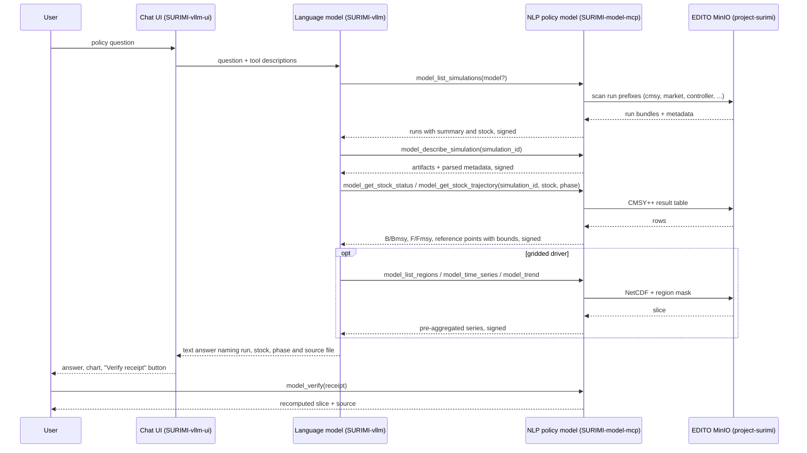

# D3.9 – NLP policy model

## DOCUMENT INFORMATION

| Grant Agreement     | 101157456 |
| ------------------- | --------- |
| Project Acronym     | SURIMI |
| Project Title       | Integration of innovative and reliable socio-ecological models and user-driven solutions into the Digital Twin Ocean, to facilitate what-if scenarios and decision support, under a co-creation approach. |
| Deliverable Number  | D3.9 |
| Work Package Number | WP3 |
| Deliverable Title   | NLP policy model |
| Lead Partner        | NORCE |
| Author(s)           | Hasan Asyari Arief |
| Due Date            | 31 October 2026 |
| Submission Date     | |
| Dissemination Level | Public |
| Type of Deliverable | Other |

| Version   | Summary of Changes |
| --------- | ------------------ |
| Version 0 | Initial version. Figures from the round-10 run of 23 September 2026. |

## Summary

|      |  |
| ------------------- | --------- |
| Programming language     | Python |
| Nr of kubernetes pods       | 1 |
| Github repo       | https://github.com/SURIMI-Project/SURIMI-model-mcp |
| Ready-to-use wiring       | https://github.com/SURIMI-Project/SURIMI-vllm-ui (chat interface), https://github.com/SURIMI-Project/SURIMI-vllm (language model serving) |
| Licence       | to be declared |

The NLP policy model is the **SURIMI model server**, SURIMI-model-mcp. It is the text-based module of SURIMI's policy layer, beside the MSE policy model (D3.8). It reads the output of SURIMI's simulation models and the gridded forcing data from object storage, and exposes them to a language model as a catalogue of tools, so that a user can ask what a scenario assumed and what it found for a stock, a fleet or a measure, and get the answer in words with its source file and its bounds.

The model is deposited ready to use. The same chat interface (SURIMI-vllm-ui) and served open-weight language model (SURIMI-vllm) that carry D3.7 attach this server too, at `https://project-surimi-vllm-ui.lab.dive.edito.eu/`. It has no database: everything it serves it reads from the `project-surimi` bucket on EDITO.

The model does not launch simulations. A SURIMI experiment takes one to two days, so the consortium decided on 25 March 2026 that the policy assistant works over runs that already exist. In round 10 of the expert evaluation, put through the wiring, the deployed stack answered 20 of 54 answerable questions and correctly refused 11 of 14 unanswerable ones. Of the 23 questions from the three policy-facing reviewers it answered 6, refused 8 it could have answered, refused 5 correctly and got 4 wrong.

## 1. Model purpose

The Grant Agreement places D3.9 in the policy layer of the model ensemble (T3.2): the layer "will use either a state-of-the-art R library or extract management procedures from the POSEIDON model (D3.8) and an additional NLP module using text-descriptions to justify policy choices (D3.9)". The deliverable description calls it an "AI-based management procedure model". What that buys, in the agreement's words, is "text justification of future policies" that is "easily comprehensible even for users who lack detailed understanding of the quantitative models powering the simulation".

The agreement describes two roles for NLP in SURIMI. One is inside the model loop, "simulating the process of assessment and selection of KPIs, and simulating their influence on management procedures and decisions". The other is outside the loop, "as a helper for users to summarize and explain model runs, tables, charts and policy results". D3.9 as delivered fills the second role for simulation output. The first, an NLP management procedure that takes part in the simulation and emits regulations, is not implemented; section 6.4 states this as a limit.

In SURIMI a policy choice is a management strategy: a harvest control rule, a quota, a subsidy, an effort limit, tested by simulation across the ensemble (D3.1 to D3.8). The model server is the text layer over those simulations. It tells a user which runs exist, what each one assumed, what it found for a stock, with what confidence, and how a gridded driver behaved over a region and a period.

The consortium fixed the scope on 25 March 2026. This module sits on the **model GUI** side of the platform, where what-if scenarios and policy measures live, and D3.7 on the data GUI side. Its confirmed behaviours are to tell a user what simulations exist, explain their parameters (region, climate scenario, policy measure, simulation length), help choose or compare scenarios, explain what-if results and trade-offs, and answer "what can this tool do?". It does not launch simulations, does not write to storage, and does not read data the user supplies.

Like D3.7, the model is built as a **tool server**. The language model that drives it is replaceable; what the deliverable fixes is the reading of SURIMI's simulation output, the tools, their prompts, and the guarantees around every figure. Every analytical result is signed with the same receipt secret as the data server, so one `verify` flow covers both.

## 2. Process overview and scheduling diagram

A policy question usually starts with discovery. The language model lists the runs, picks one by its summary, then pulls the result it needs. A question about a climate or ocean driver goes to the gridded tools of the same server.

## 3. Configuration

Configuration is version-controlled in the repository and applied at deploy time.

### 3.1 The server

| Setting | Value |
| --- | --- |
| Entry point | `server.py`, FastMCP; three registering modules (`nc_tools`, `sim_tools`, `reference_tools`) and CI asserts that every declared tool is defined and namespaced `model_*` |
| Storage | the `project-surimi` bucket on EDITO MinIO; no database |
| Gridded prefix | `netcdf/`, with the legacy `NetCDF/` reachable only through a transitional fallback |
| Run layout | `<model>/<scenario_name>/...`; model directories `cmsy`, `market`, `controller`, `fisheries_authority`, `output_creator`, all `lower_snake_case` under the consortium naming convention |
| Excluded prefixes | housekeeping and lake prefixes (`raw/`, `processed/`) are never scanned for runs, and the listing reports how many run-like objects sit there |
| Cache | a persistent prefetch cache, so the server survives the 24-hour expiry of the EDITO storage token; `stale=true` marks a listing served after storage became unreachable |
| Receipt secret | `SURIMI_RECEIPT_SECRET`, shared with the data server (D3.7) |
| Deployed version | image `ghcr.io/surimi-project/surimimodelmcp:1.2.5` |

### 3.2 Stock assessment reading

| Setting | Value |
| --- | --- |
| Source | the CMSY++ result table of a run (`Out_..._id_file.csv`) |
| Phase | required argument, `historical` (assessed from observed catch and abundance) or `simulation` (assessed from ecosystem-model output). A run without that split is refused by file name |
| Estimator | reported per run: CMSY (catch only) or BSM (catch plus abundance index), decided by the same rule the CMSY++ script uses |
| Bounds | every point estimate carries `lcl` and `ucl`, stated as the 2.5th and 97.5th percentile of the MCMC posterior, not as a confidence interval |

### 3.3 Ready-to-use wiring

The wiring is the one documented in D3.7, section 3.2. This server is attached as `server:mcp:surimi-model` at `https://project-surimi-surimi-model-mcp.lab.dive.edito.eu/mcp`.

## 4. Inputs

The user gives one input: a policy question in natural language, through the chat interface or any MCP client. Everything else the model reads sits in the bucket.

### 4.1 Simulation runs

| Tool | What it answers |
| --- | --- |
| `model_list_simulations` | which models have runs, newest first, with a one-line summary and the assessed stock |
| `model_describe_simulation` | one run's artifacts and parsed metadata |
| `model_get_artifact` | one file from a run, capped at a fixed byte length and marked as a prefix when cut |
| `model_get_stock_status` | Kobe status of a stock in a run: B/Bmsy, F/Fmsy and reference points, each with bounds |
| `model_get_stock_trajectory` | the year-indexed catch, F/Fmsy and biomass series of that stock |
| `model_explain_assessment_field` | what a CMSY++ input or result column means and how the script uses it |

### 4.2 Gridded forcing and observations

The files under `netcdf/` are external forcing and observation datasets on the same grid conventions as the ensemble. The server returns pre-aggregated, pivotable slices, so raw grid cardinality never reaches the language model.

| Group | Tools | What they answer |
| --- | --- | --- |
| Files and coverage | `model_list_files`, `model_describe_file`, `model_list_variables`, `model_list_regions`, `model_get_time_range`, `model_get_spatial_bounds`, `model_get_coverage_summary`, `model_check_cf_compliance`, `model_validate_alignment` | what a file holds, its regions and period, and whether two files align |
| Series | `model_time_series`, `model_trend`, `model_compare_periods`, `model_top_regions` | a regional series, its trend, a period comparison, a ranking of regions |

### 4.3 Reference and contract

| Tool | What it answers |
| --- | --- |
| `model_describe_ecosystem_model` | which ecosystem model a run rests on |
| `model_get_contract` | the SURIMI scenario contract |
| `model_lookup_code`, `model_search_taxon` | species and gear codes and their names |
| `describe_model_capabilities` | which classes of question this server serves and which it does not |

### 4.4 Verification

`model_verify` recomputes any signed slice or figure from its receipt.

## 5. Outputs

### 5.1 Run discovery

A list of the SURIMI runs that bear on the question, each with the model, the scenario, the stock and the year range, and a statement of what the listing could not see: stale, partial, or run-like objects outside the scanned area.

### 5.2 Stock status and trajectory

The status of a stock in a named run and phase, as B/Bmsy and F/Fmsy with their bounds and the estimator that produced them, and the trajectory over years. The answer names the source file. A run that does not carry the phase asked for is refused by name.

### 5.3 Gridded slice

A pre-aggregated series, trend, period comparison or ranking over named regions, with the file, variable and mask it came from.

### 5.4 Explanation

A definition of any assessment field, code or contract element the user names, from the CMSY++ documentation, the SURIMI protocol or the reference tables.

### 5.5 Receipt and refusal

Every figure carries a signed receipt that `model_verify` recomputes. Where no run or file supports the question, the capability registry says so and the answer states what was looked for.

## 6. Objectives

The Grant Agreement asks this documentation for "objectives for each prompt". On this server the prompts are the tool descriptions the language model reads before each call, and the system prompt of the ready-to-use wiring. The overall objective is that the model tells a user which SURIMI runs exist and what they say about a stock or a measure, grounds every figure in a named run or file, and refuses what the runs and files do not support.

### 6.1 Objectives for each prompt

| Prompt | Objective |
| --- | --- |
| `model_list_simulations` description | Call first for any question about a run. Answer "which models have runs" from the scanned list, and "what is run X about" from the run's own summary and stock, without opening every run. Treat a null summary as unknown, never as a guess. Say when the listing is stale or partial. |
| `model_describe_simulation` description | Open one run only after the listing has picked it. Report artifacts and parsed metadata. |
| `model_get_stock_status` and `model_get_stock_trajectory` descriptions | Require the phase, historical or simulation, and refuse a run that has no such split, naming the file to fetch instead. Report every estimate with its bounds and say what the bounds are. Name the estimator, CMSY or BSM, and why. |
| `model_get_artifact` description | Fetch one file and say when the content is a cut prefix, never present it as the whole file. |
| `model_explain_assessment_field` description | Define a CMSY++ input or result column and how the script uses it, from the script's own documentation. |
| Gridded tool descriptions | Find the file, then the variable, then the exact region name from the mask, then call one analytic tool. Never guess a region name. Answer from the pre-aggregated summary. Prefer `model_trend` for "is it increasing" questions. |
| System prompt of the wiring, gridded workflow block | The same four-step order, stated once for every client that uses the shared prompt. |
| System prompt of the wiring, register and rules blocks | Lead with the answer in everyday words for policy-makers and stakeholders. Define terms at first use. Never invent a run, stock, file or number. Cite every figure with its receipt id. End every turn with a plain answer. |

### 6.2 How the model is evaluated

Two evaluations exist. The first is the server's own behavioural benchmark, 33 cases in `benchmark/` of SURIMI-model-mcp, each with a grounding command that recomputes the expected figure from the files, scored by the same deterministic grader as D3.7. It runs against every release.

The second is the expert evaluation described in D3.7, section 6.2: 68 questions from ten domain experts, adjudicated into four classes, each with an expected answer established from the raw data and published with its source files, put through the ready-to-use wiring one question at a time. Three of the ten reviewers asked from a policy position: a marine spatial planner (E1), a fisheries policy and subsidies adviser (E2) and a science policy officer (E10). Their 23 questions are the policy-facing subset reported below. The set is not split by server, so the whole-stack figure is the primary result for D3.9 as it is for D3.7.

### 6.3 Result

Round 10, measured on 23 September 2026 against data-mcp 1.2.21 and model-mcp 1.2.5, with Muse-Glimmer-30B (W4A16) through the chat interface. Verdicts are the judged run `benchmark/runs/muse-r10-judged` in SURIMI-data-mcp.

| | All 68 | Policy-facing 23 |
| --- | ---: | ---: |
| Answered correctly | 11 | 4 |
| Answered in part | 9 | 2 |
| Refused although the data supports an answer | 23 | 8 |
| Refused, and the judge accepted the refusal | 1 | 0 |
| Wrong | 12 | 4 |
| Correctly refused, unanswerable question | 11 | 5 |
| Answers judged fabricated | 0 | 0 |

Five of the spatial planner's questions ask about housing, infrastructure and development priorities, which no SURIMI dataset covers. The model refused three of the five correctly.

### 6.4 Known limits

The model does not set up or launch a simulation, and it does not take part in the simulation loop. The Grant Agreement's in-loop role, an NLP management procedure that reads the state of the simulated fishery and emits regulations through the SURIMI protocol, is not implemented. Every answer about a scenario is an answer about a run that a modeller has already completed and uploaded. The 17 June 2026 modellers' meeting recorded the tension between the policy-analysis ambition and the TRL the project reaches, and asked that the deliverable not over-promise; this document follows that.

The runs observed live carry one unlabelled CMSY++ result table and no historical or simulation split. The stock status and trajectory tools refuse them by name, and the language model falls back to fetching the result table as an artifact. Until the runs carry the split, a question about a stock's status in a scenario is answered from the raw table, not from the typed tool.

The scenario catalogue the stakeholders described on 25 March 2026, with a region, a climate scenario, a policy measure and a duration for each pre-run scenario, is not yet what the bucket holds. The runs there are per-model bundles named by scenario directory. When the consortium's runs arrive in that shape, discovery works over them without a code change, because the listing reads the run's own metadata.

The policy-facing subset is 23 questions. Two runs of the same evaluation agree on about 75 per cent of verdicts, so a change of one or two questions in that subset is noise. The subset is reported as counts and not as a rate. Three of the four wrong policy answers are the subsidies adviser's, whose questions join a support table on the data server to a sustainability measure; they measure the wiring across both servers, not this server alone.
