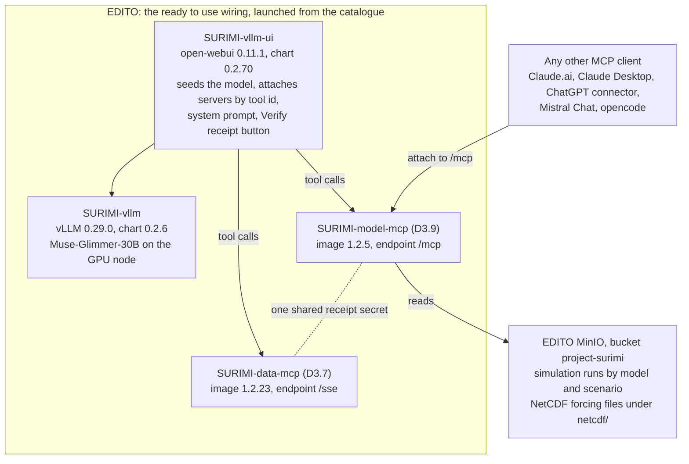
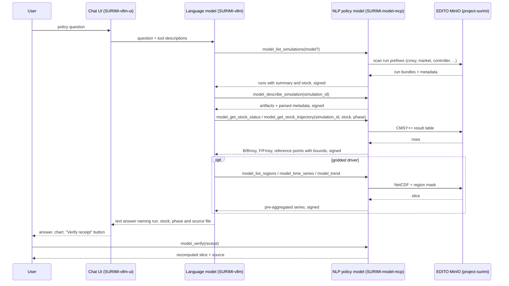

# D3.9 – NLP policy model

## DOCUMENT INFORMATION

| Grant Agreement     | 101157456 |
| ------------------- | --------- |
| Project Acronym     | SURIMI |
| Project Title       | Integration of innovative and reliable socio-ecological models and user-driven solutions into the Digital Twin Ocean, to facilitate what-if scenarios and decision support, under a co-creation approach. |
| Deliverable Number  | D3.9 |
| Work Package Number | WP3 |
| Deliverable Title   | NLP policy model |
| Lead Partner        | NORCE |
| Author(s)           | Hasan Asyari Arief |
| Due Date            | 31 October 2026 |
| Submission Date     | |
| Dissemination Level | Public |
| Type of Deliverable | Other |

| Version   | Summary of Changes |
| --------- | ------------------ |
| Version 0 | Initial version. Figures from the evaluation of 23 September 2026. |

## Summary

|      |  |
| ------------------- | --------- |
| Programming language     | Python |
| Nr of kubernetes pods       | 1 |
| Github repo       | https://github.com/SURIMI-Project/SURIMI-model-mcp |
| Ready-to-use wiring       | https://github.com/SURIMI-Project/SURIMI-vllm-ui (chat interface), https://github.com/SURIMI-Project/SURIMI-vllm (language model serving) |
| Licence       | to be declared |

The NLP policy model surfaced as the **SURIMI model server**, under the tag SURIMI-model-mcp. This policy model exposes the output of the SURIMI simulation models and the gridded forcing data that sit in the project bucket, as well as the stock assessment results, the scenario contract and the species and gear codes, that can be accessed via natural language using the same EDITO-hosted open weight large language model as D3.7, called Muse-Glimmer-30B from Meta.

While the main deliverable of this SURIMI-model-mcp is limited to exposing and serving the tools and the simulation output (the runs of CMSY++, the market model, the controller and the fisheries authority as uploaded to the bucket, together with the NetCDF forcing files), it is also baked in inside the same ready to use wiring as the data server, SURIMI-vllm-ui as the chat interface with SURIMI-vllm serving the language model behind it, thus an EDITO user can run and deploy this setup via their browser and ask about a scenario and about the data lake in one and the same conversation.

Important to understand that SURIMI-model-mcp is a Model Context Protocol server as well, meaning it can be wired within a frontier model like Claude.ai and ChatGPT in the same way as the data server,[^1] and that it does not launch simulations: a SURIMI experiment takes one to two days to run, so the consortium decided on 25 March 2026 that the assistant works over runs that already exist and explains them.

*Figure 1. The model server in the ready to use wiring on EDITO, reading the project bucket, next to the data server under one shared receipt secret, and open to any other MCP client.*

The server provides a set of tools that the language model can call over what the bucket holds. The bucket holds two kinds of content, namely the simulation runs, which are per-model bundles laid out as `<model>/<scenario_name>/` for the CMSY++, market, controller, fisheries authority and output creator models, each with its own artifacts and metadata, and the gridded forcing and observation files under the `netcdf/` prefix. On top of this sit 24 tools in five groups: simulation tools, which list the runs, describe one run, fetch one of its artifacts, and read the stock status and trajectory out of a CMSY++ result table; gridded tools, which report what a file holds and return a regional series, a trend, a period comparison or a ranking as a pre-aggregated slice, so that raw grid cardinality never reaches the language model; reference tools, which name the ecosystem model behind a run, return the SURIMI scenario contract, and look up species and gear codes; a capability tool, which states which classes of question the server does not serve; and one verification tool, which recomputes any signed slice or figure from its receipt. Every analytical call carries an HMAC-signed receipt, and every stock estimate is returned with its bounds and the estimator that produced it, so that a stated figure can be verified and its uncertainty is never dropped.

*Table 1. The 24 tools by group.*

| Group | Tools | What they answer |
| --- | --- | --- |
| Simulation | `model_list_simulations`, `model_describe_simulation`, `model_get_artifact`, `model_get_stock_status`, `model_get_stock_trajectory`, `model_explain_assessment_field` | which runs exist and what each is about, one run's artifacts and metadata, the Kobe status and trajectory of a stock with bounds, what a CMSY++ field means |
| Gridded files and coverage | `model_list_files`, `model_describe_file`, `model_list_variables`, `model_list_regions`, `model_get_time_range`, `model_get_spatial_bounds`, `model_get_coverage_summary`, `model_check_cf_compliance`, `model_validate_alignment` | what a file holds, its regions and period, and whether two files align |
| Gridded series | `model_time_series`, `model_trend`, `model_compare_periods`, `model_top_regions` | a regional series, its trend, a period comparison, a ranking of regions |
| Reference | `model_describe_ecosystem_model`, `model_get_contract`, `model_lookup_code`, `model_search_taxon`, `describe_model_capabilities` | the ecosystem model behind a run, the scenario contract, species and gear codes, what the server serves |
| Verification | `model_verify` | recompute any receipted slice or figure |

Quality is assessed with the same expert evaluation as D3.7, together with the server's own behavioural benchmark of 33 cases, each with a grounding command that recomputes the expected figure directly from the files and scored by the same deterministic grader on every release. Of the ten experts who contributed the 68 questions, three asked from a policy position, namely a fisheries economist who also filed the marine spatial planning form (E1), a marine science policy adviser for fisheries policy and subsidies (E2), and a science policy officer (E10), and their 23 questions are the ones that matter most for this deliverable. In the evaluation of 23 September 2026 the system answered 6 of those 23, declined 5 that it was right to decline, and got 4 wrong, while on the other 8 it declined questions the data could have answered. Across all 68 questions it answered 20 of the 54 the data supports and declined 11 of the 14 it does not support, and no answer was judged fabricated. Two runs of the same evaluation agree on about 75 per cent of the verdicts, so the policy-facing subset is reported as counts and not as a rate.

*Table 2. The three policy-facing reviewers and their questions.*

| Reviewer | Role | Questions | Answered | Declined correctly | Declined although answerable | Wrong |
| --- | --- | ---: | ---: | ---: | ---: | ---: |
| E1 | fisheries economist, marine spatial planning form | 10 | 1 | 3 | 5 | 1 |
| E2 | marine science policy adviser, fisheries policy and subsidies | 8 | 1 | 2 | 2 | 3 |
| E10 | science policy officer | 5 | 4 | 0 | 1 | 0 |
| | | **23** | **6** | **5** | **8** | **4** |

*Figure 2. Verdicts on all 68 expert questions next to the 23 from the policy-facing reviewers, Muse-Glimmer-30B through the EDITO chat, 23 September 2026. The full count per class is in section 6.3.*

This model server is wired together with the other NLP deliverable, SURIMI-data-mcp, which is the NLP assessment model (D3.7) serving the tabular data lake, and which is meant for the data GUI side. The ready to use wiring toolbox attaches both servers at the same time, they share one receipt secret so that one verification flow covers both, and the language model picks the server based on the question, so that a policy question about a scenario and a question about the observed record are answered in the same conversation. Integration into the model GUI itself, which is due in April 2027, is outside this deliverable, the wiring is what an EDITO user has today.

[^1]: The `README.md` of SURIMI-data-mcp lists the supported MCP clients, and `docs/workshop-cheatsheet.md` in the same repository walks through attaching a SURIMI server to Claude Desktop in a few steps; the model server attaches in the same way at its `/mcp` endpoint.

## 1. Model purpose

The Grant Agreement places D3.9 in the policy layer of the SURIMI model ensemble under task T3.2, where the layer "will use either a state-of-the-art R library or extract management procedures from the POSEIDON model (D3.8) and an additional NLP module using text-descriptions to justify policy choices (D3.9)", and the deliverable description calls it an "AI-based management procedure model". The advantage the agreement sees in this is "text justification of future policies" that is "easily comprehensible even for users who lack detailed understanding of the quantitative models powering the simulation". The policy layer therefore has two component models, the MSE policy model (D3.8), which computes regulations from harvest control rules inside the simulation, and this NLP policy model, which explains simulation results and the policy choices behind them in text.

The agreement describes two roles for NLP in SURIMI, one inside the model loop, "simulating the process of assessment and selection of KPIs, and simulating their influence on management procedures and decisions", and one outside the loop, "as a helper for users to summarize and explain model runs, tables, charts and policy results". D3.9 as delivered fills the second role for simulation output, while the first, an NLP management procedure that takes part in the simulation and emits regulations, is not implemented and is stated as a limit in section 6.4. In SURIMI a policy choice is a management strategy, namely a harvest control rule, a quota, a subsidy or an effort limit, tested by simulation across the ensemble (D3.1 to D3.8), and the model server is the text layer over those simulations, which tells a user which runs exist, what each one assumed, what it found for a stock and with what confidence, and how a gridded driver behaved over a region and a period.

The scope was fixed by the consortium on 25 March 2026, when this module was placed on the model GUI side of the platform, where what-if scenarios and policy measures live, with D3.7 on the data GUI side. Under that remit the module tells a user what simulations exist, explains their parameters, namely region, climate scenario, policy measure and simulation length, helps choose or compare scenarios, explains what-if results and trade-offs, and answers "what can this tool do?", while it does not launch simulations, does not write to storage, and does not read data the user supplies. Like D3.7 it is built as a tool server, in which the language model that drives it is replaceable and what the deliverable fixes is the reading of SURIMI's simulation output, the tools, their prompts, and the guarantees around every figure, and every analytical result is signed with the same receipt secret as the data server, so that one `verify` flow covers both.

## 2. Process overview and scheduling diagram

A policy question usually starts with discovery, in which the language model lists the runs, picks one by its summary, and then pulls the result it needs, while a question about a climate or ocean driver goes to the gridded tools of the same server, as the diagram below shows.

## 3. Configuration

All configuration is version-controlled in the repository and applied at deploy time.

### 3.1 The server

| Setting | Value |
| --- | --- |
| Entry point | `server.py`, FastMCP; three registering modules (`nc_tools`, `sim_tools`, `reference_tools`) and CI asserts that every declared tool is defined and namespaced `model_*` |
| Storage | the `project-surimi` bucket on EDITO MinIO; no database |
| Gridded prefix | `netcdf/`, with the legacy `NetCDF/` reachable only through a transitional fallback |
| Run layout | `<model>/<scenario_name>/...`; model directories `cmsy`, `market`, `controller`, `fisheries_authority`, `output_creator`, all `lower_snake_case` under the consortium naming convention |
| Excluded prefixes | housekeeping and lake prefixes (`raw/`, `processed/`) are never scanned for runs, and the listing reports how many run-like objects sit there |
| Cache | a persistent prefetch cache, so the server survives the 24-hour expiry of the EDITO storage token; `stale=true` marks a listing served after storage became unreachable |
| Receipt secret | `SURIMI_RECEIPT_SECRET`, shared with the data server (D3.7) |
| Deployed version | image `ghcr.io/surimi-project/surimimodelmcp:1.2.5` |

### 3.2 Stock assessment reading

| Setting | Value |
| --- | --- |
| Source | the CMSY++ result table of a run (`Out_..._id_file.csv`) |
| Phase | required argument, `historical` (assessed from observed catch and abundance) or `simulation` (assessed from ecosystem-model output); a run without that split is refused by file name |
| Estimator | reported per run, CMSY (catch only) or BSM (catch plus abundance index), decided by the same rule the CMSY++ script uses |
| Bounds | every point estimate carries `lcl` and `ucl`, stated as the 2.5th and 97.5th percentile of the MCMC posterior and not as a confidence interval |

### 3.3 Ready to use wiring

The wiring is the one documented in D3.7, section 3.2, and this server is attached to it as `server:mcp:surimi-model` at `https://project-surimi-surimi-model-mcp.lab.dive.edito.eu/mcp`.

## 4. Inputs

The user provides a single input, a policy question in natural language, either through the chat interface or through any other MCP client, while everything else the model reads sits in the bucket.

### 4.1 Simulation runs

The runs are per-model bundles in the layout of section 3.1, and the six simulation tools of Table 1 read them, from the listing with its one-line summary and assessed stock per run, through one run's artifacts and parsed metadata, to the Kobe status and the year-indexed trajectory of a stock out of its CMSY++ result table and the meaning of any CMSY++ input or result column.

### 4.2 Gridded forcing and observations

The files under `netcdf/` are external forcing and observation datasets on the same grid conventions as the ensemble, and the thirteen gridded tools of Table 1 return pre-aggregated, pivotable slices over them, so that raw grid cardinality never reaches the language model.

### 4.3 Reference and contract

The reference tools of Table 1 name the ecosystem model behind a run, return the SURIMI scenario contract, and resolve species and gear codes, while `describe_model_capabilities` states which classes of question this server serves and which it does not.

## 5. Outputs

### 5.1 Run discovery

A list of the SURIMI runs that bear on the question, each with the model, the scenario, the stock and the year range, together with a statement of what the listing could not see, namely whether it is stale, partial, or whether run-like objects sit outside the scanned area.

### 5.2 Stock status and trajectory

The status of a stock in a named run and phase, as B/Bmsy and F/Fmsy with their bounds and the estimator that produced them, and its trajectory over the years, with the source file named in the answer, while a run that does not carry the phase asked for is refused by name.

### 5.3 Gridded slice and explanation

A pre-aggregated series, trend, period comparison or ranking over named regions, with the file, variable and mask it came from, and a definition of any assessment field, code or contract element the user names, taken from the CMSY++ documentation, the SURIMI protocol or the reference tables.

### 5.4 Receipt and refusal

Every figure carries a signed receipt that `model_verify` recomputes, and where no run or file supports the question the capability registry says so and the answer states what was looked for.

## 6. Objectives

The Grant Agreement asks this documentation for "objectives for each prompt", and on this server the prompts are the tool descriptions the language model reads before each call, together with the system prompt of the ready to use wiring. The overall objective is that the model tells a user which SURIMI runs exist and what they say about a stock or a measure, grounds every figure in a named run or file, and refuses what the runs and files do not support.

### 6.1 Objectives for each prompt

| Prompt | Objective |
| --- | --- |
| `model_list_simulations` description | Call first for any question about a run. Answer "which models have runs" from the scanned list, and "what is run X about" from the run's own summary and stock, without opening every run. Treat a null summary as unknown, never as a guess. Say when the listing is stale or partial. |
| `model_describe_simulation` description | Open one run only after the listing has picked it. Report artifacts and parsed metadata. |
| `model_get_stock_status` and `model_get_stock_trajectory` descriptions | Require the phase, historical or simulation, and refuse a run that has no such split, naming the file to fetch instead. Report every estimate with its bounds and say what the bounds are. Name the estimator, CMSY or BSM, and why. |
| `model_get_artifact` description | Fetch one file and say when the content is a cut prefix, never present it as the whole file. |
| `model_explain_assessment_field` description | Define a CMSY++ input or result column and how the script uses it, from the script's own documentation. |
| Gridded tool descriptions | Find the file, then the variable, then the exact region name from the mask, then call one analytic tool. Never guess a region name. Answer from the pre-aggregated summary. Prefer `model_trend` for "is it increasing" questions. |
| System prompt of the wiring, gridded workflow block | The same four-step order, stated once for every client that uses the shared prompt. |
| System prompt of the wiring, register and rules blocks | Lead with the answer in everyday words for policy-makers and stakeholders. Define terms at first use. Never invent a run, stock, file or number. Cite every figure with its receipt id. End every turn with a plain answer. |

### 6.2 How the model is evaluated

The model is evaluated in two ways. The first is the server's own behavioural benchmark of 33 cases in `benchmark/` of SURIMI-model-mcp, each with a grounding command that recomputes the expected figure from the files and scored by the same deterministic grader as D3.7, which runs against every release.

The second is the expert evaluation described in D3.7, section 6.2, in which ten domain experts asked 68 questions, each adjudicated into one of four classes, the expected answer was established from the raw data and published with its source files, and each question was then put through the ready to use wiring on its own. Three of the ten reviewers asked from a policy position, the fisheries economist E1 on the marine spatial planning form, the marine science policy adviser E2 and the science policy officer E10, and their 23 questions form the policy-facing subset reported below, while the whole-model figure remains the primary result for D3.9 as it is for D3.7, because the set is not split by server.

### 6.3 Result

The evaluation of 23 September 2026 was run against data-mcp 1.2.21 and model-mcp 1.2.5, with Muse-Glimmer-30B (W4A16) through the chat interface, and the verdicts are kept as the judged run `benchmark/runs/muse-r10-judged` in SURIMI-data-mcp.

| | All 68 | Policy-facing 23 |
| --- | ---: | ---: |
| Answered correctly | 11 | 4 |
| Answered in part | 9 | 2 |
| Refused although the data supports an answer | 23 | 8 |
| Refused, and the judge accepted the refusal | 1 | 0 |
| Wrong | 12 | 4 |
| Correctly refused, unanswerable question | 11 | 5 |
| Answers judged fabricated | 0 | 0 |

Five of the spatial planning questions ask about housing, infrastructure and development priorities, which no SURIMI dataset covers, and the model refused three of the five correctly.

### 6.4 Known limits

The model does not set up or launch a simulation and does not take part in the simulation loop, so the Grant Agreement's in-loop role, an NLP management procedure that reads the state of the simulated fishery and emits regulations through the SURIMI protocol, is not implemented, and every answer about a scenario is an answer about a run that a modeller has already completed and uploaded. The modellers' meeting of 17 June 2026 recorded the tension between the policy-analysis ambition and the TRL the project reaches and asked that the deliverable not over-promise, which this document follows.

The runs observed live carry one unlabelled CMSY++ result table and no historical or simulation split, so the stock status and trajectory tools refuse them by name and the language model falls back to fetching the result table as an artifact, which means that until the runs carry the split, a question about a stock's status in a scenario is answered from the raw table and not from the typed tool. In the same way, the scenario catalogue the stakeholders described on 25 March 2026, with a region, a climate scenario, a policy measure and a duration for each pre-run scenario, is not yet what the bucket holds, as the runs there are per-model bundles named by scenario directory, and when the consortium's runs arrive in that shape, discovery works over them without a code change, because the listing reads the run's own metadata.

The policy-facing subset is 23 questions, and since two runs of the same evaluation agree on about 75 per cent of the verdicts, a change of one or two questions in that subset is noise, which is why the subset is reported as counts and not as a rate. Three of the four wrong policy answers are the subsidies adviser's, whose questions join a support table on the data server to a sustainability measure, so they measure the wiring across both servers and not this server alone.
